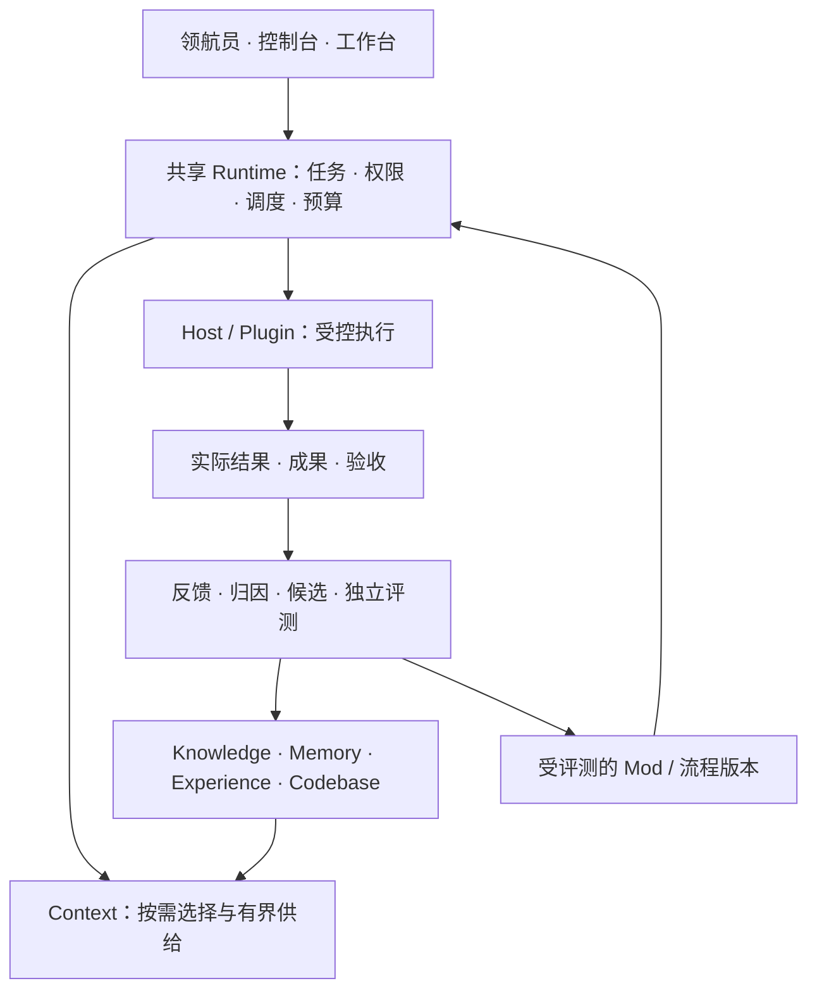

# Craft 产品与技术能力总纲

> **用途：**统一下一代 Craft 的产品目标、关键设计与发布验收，供产品、设计、研发、测试共同执行。本文是目标规格，不是已实现清单；功能存在、真实触发、实际有效、持续复用必须分别举证。
>
> **统一名称：领航员（Navigator）、控制台（Console）、工作台（Workbench）。**本次改写文档不代表应用已完成改名或功能已经发布。

## 1. 产品目标与范围

Craft 是一个本地优先、允许托管与接管、能从真实工作中持续改进的个人 Agent 工作平台。用户提出目标，系统组织资料、模型和工具，在授权范围内执行、验证、交付，并把有独立证据支持的成果沉淀为长期能力。

首批面向个人开发者和知识工作者，覆盖跨项目研发、研究与文档、文件交付、消息转任务。领域扩展提供专业对象与验收器；非代码任务使用资料和产物快照。

产品价值以独立任务成功率、人工修正时间、恢复成功率、复用收益和总成本衡量，调用量与候选量不能替代效果。

**本轮主线**：三模式、共享运行时、五项核心子能力、持久执行、数据迁移、受控进化、模型与插件接入、消息与目录感知、性能稳定性、可复现发布。组织协作、多设备同步、远程执行和市场生态保留扩展契约，通过真实验收后再开放，不作为本地版本的隐含依赖。

完整规划一次确定，可靠性与收益分别验证。未达门槛的能力保持实验状态；不要求重写所有框架、训练基础模型或默认启动多 Agent。

## 2. 三种模式与用户体验

三模式共享同一任务、会话、权限、成果和运行状态，只改变用户的观察与干预方式。

| 模式 | 核心职责 | 必须具备的体验 |
| --- | --- | --- |
| 领航员 | 默认入口，理解目标、确定范围、组织执行 | 自然语言输入；项目与约束卡片；必要时结构化澄清；真实进度；交付摘要；一键接管 |
| 控制台 | 全局治理、审批、恢复与健康观察 | 待处理优先；任务与资源；成本；异常归因；数据健康；候选评测与回滚；逐项可追溯的批处理 |
| 工作台 | 单项目深度协作与成果修改 | 对话与成果预览；文件及版本差异；局部接受；人工修改保护；模型与 Host 状态；可折叠终端和证据 |

**命名迁移**：原“领航／领航台”显示为“领航员”，“观象”为“控制台”，“灵策”为“工作台”。同步导航、通知、设置、帮助、截图和测试。显示名称与稳定键解耦；旧链接、枚举和用户配置通过版本化别名兼容。历史审计原文不批量改写。升级后必须能用旧链接重新打开同一任务。

**一致交互**：切换保留任务、项目、草稿和筛选，不重跑、不增权。后台运行用状态条提示，仅丢草稿或影响执行时确认。视图按需加载，用快照加事件游标刷新，断线补齐。

**低认知负担**：先展示成果、下一步和待决定事项，细节按需展开。空态、加载、部分结果、错误、离线、过期与无权限均有明确文案。支持键盘、读屏、缩放、对比度和减少动画；通知去重、限频，重要失败可见。

**首次使用**：检测 Host／模型，复用或配置 Profile，选目录、确认范围并完成小任务。引导可恢复；凭据失效时针对性修复。已安装、已配置、可连接、可执行分别展示。

## 3. 统一架构与领域对象

| 边界 | 职责与约束 |
| --- | --- |
| Craft 内核 | 身份、任务状态、权限、预算、队列、回执与验收门；所有入口共用，不能另开绕过门禁的执行通路 |
| 子能力 | 各自管理资产与生命周期，通过统一引用、范围和反馈契约协作，不直接修改其他能力的数据库 |
| Host | 承载模型循环与实际工具执行，声明能否恢复、取消、改写请求、沙箱和上报用量；不支持的能力明确降级 |
| Plugin / Mod / Skill | Plugin 提供执行能力；Mod 提供行为约束；Skill 是可发现的操作指导。文本规范不能授予执行权限 |
| craft-eval | 独立评测执行与报告，Craft 消费可核验结果；模型评分不是最终晋升权 |
| Workbench | 三模式的用户界面与桌面承载，共享 Craft 状态，不复制一套业务真值 |

共享对象包括项目、会话、任务、运行与尝试、快照、能力、策略、来源、证据、成果、资产版本、评测和反馈。重试不新增独立证据，进程结束不等于验收通过。

**轻量本体**：定义来源、支持、反驳、适用、依赖、替代、撤销与使用关系，附范围、版本、生效时间、记录时间和证据。观察与推断分开，未知不等于不存在。先用类型化记录及索引，按实际需求引入图数据库。来源语义参考 [W3C PROV](https://www.w3.org/TR/prov-overview/)。

**技术取舍**：共享内核降低状态漂移，但需严格模块接口；分域存储减少争用，但增加恢复成本。优先复用现有工作流，新增框架须有真实收益和迁移依据。

## 4. 意图、计划与成果交付

- 任务约定保存目标、输入、项目、禁止事项、交付物、验收、预算与自主权。简单问答直接处理，外部副作用进入受控链。
- 路由结合显式路径、当前项目、目标和目录描述，否定优先。“不要修改 A，修复 B”不得因子串匹配派发到 A；歧义通过结构化选择澄清。
- 子任务继承共同约束和依赖。澄清答案绑定问题、允许修改；修改使相关旧计划失效。明确且已授权的工作继续，不每步索要批准。
- 并行检查写集合和资源冲突，重叠写入串行或隔离后合并。多 Agent 相对单 Agent 基线验证收益，共享总预算。
- 成果支持预览、差异、编辑、局部接受和导出。版本校验保护人工修改，仅重做受影响部分。
- 交付包含实际产物、验证结果和遗漏；纯模型回答不能冒充命令执行，进度不编造百分比。

## 5. 持久执行、恢复与副作用

执行顺序为“准备 → 派发 → 执行 → 再观察 → 验收 → 交付”。用户可见状态至少区分执行中、等待、暂停、结果未知、待验收、已交付、失败与取消。

| 关键机制 | 底层要求 |
| --- | --- |
| 幂等接收 | 请求先持久化；同一幂等键与相同内容返回原结果，不同内容报冲突；UI 重试不能创建第二个任务 |
| 可靠派发 | 任务状态与待发事件在同一事务提交；跨库或外部调用通过持久事件箱、消费去重和对账恢复，不假设跨库原子性 |
| Worker 协调 | 租约、心跳、版本令牌隔离过期持有者；租约到期不代表外部进程已停止 |
| 检查点 | 绑定计划、输入、快照、权限、能力版本与预算；恢复前复核，漂移则重新规划 |
| 结果未知 | 外部成功但本地未落盘时显式保留；优先查询外部结果或验证实际状态，不盲目重复副作用 |
| 重试与熔断 | 区分临时故障、业务拒绝、权限错误和未知结果；退避加抖动，限制次数与总成本；建议互改最多 3 轮后暂停求证 |
| 暂停与取消 | 停止新派发，尽力终止在途操作；展示已经发生的副作用；补偿作为新的受控动作，不能承诺全部可撤销 |
| 等待与回放 | 等待外部事件时释放计算资源；回放默认只读或隔离，真实重执行重新授权和验收 |

运行状态与长期记忆分离，借鉴 [LangGraph 的检查点与跨线程存储](https://docs.langchain.com/oss/python/langgraph/persistence)。故障注入覆盖“接收、派发、外部完成、落库、验收提交”各边界。

## 6. Context：少而准的上下文供给

Context 确定任务、项目真实路径、Host 会话、代码或资料快照后，统一执行：权限过滤 → 有效性检查 → 检索 → 冲突处理 → 去重 → 预算分配 → 短摘录。Knowledge、Memory、Experience、Codebase 提供候选引用，Host 历史与当前任务状态参加共同预算。

- 默认只提供必要摘要、适用条件和精确引用。命中一篇内容不发送整篇，memory.md 不整体注入；展开时再次校验权限、版本和预算。
- 否定、前置条件和例外必须保真。完整语义单元放不下就给展开提示；必需内容无法取得或容纳时明确失败，不截成可能反义的片段。代码状态、参数和错误现场保留精确引用。
- 预算包含材料、工具定义、历史、约束、响应封装与输出预留。外部 Host 不提供总量时，只声明 Craft 可控制的部分，标明估算和实测。
- 建议小包起点为最多 3 条、1,200 字符的材料，响应另有上限；可选材料超限可收缩并说明，必需内容超限返回可操作错误，避免原样反复重试。
- Hook、MCP 与同轮调用共享按任务、轮次、范围和资产版本计算的去重记录；更正与新版本不能被旧去重挡住。
- 分开记录“检索到、选中、实际发出、被使用、结果验证”。裁掉的材料不能算发出，检索命中不能算有效使用；Host 无法证明使用时标为未知。
- 稳定摘要保留来源，过期与撤销传播到缓存及展开接口。长期记录不意味着长期占据模型上下文。

该方向参考 [Anthropic 上下文工程](https://www.anthropic.com/research/effective-context-engineering-for-ai-agents)与 [MemGPT](https://arxiv.org/abs/2310.08560)。检验重点是选材正确率、遗漏、否定保真、实际 token、延迟，以及各成员的消融贡献。

## 7. 五项子能力的演进规则

学习资产及检索／分析策略遵循“观测 → 候选 → 独立评测 → 正式或拒绝 → 使用 → 修订或退出”。候选与正式版本分开，事件只追加，有效指针原子切换。Codebase 日常索引按快照和分析有效性更新，不要求每次先做收益评测。

| 能力 | 形成与组织 | 生效条件 | 修订与退出 |
| --- | --- | --- | --- |
| Knowledge | 项目文档和有验证结果的任务形成 Claim；按项目、主题、粗细场景归类；保留精确来源、约束、例外与冲突 | 分别判断事实可信、范围适用、对独立任务有帮助；模型可分类和建议，不能自授可信身份 | 来源改变、撤销、冲突、过期或负反馈触发暂停注入、重验、修订或退出 |
| Memory | 保存稳定偏好、约定与事实；会话、项目、全局三级，默认自动捕获和治理 | 单次进入会话；同项目至少两个独立会话才具备项目资格；至少三个独立项目才具备全局资格；还须核验独立性、正确性、通用性、冲突和使用证据 | 保留更正与双方来源；纠错、过期、撤销同步数据库、缓存、索引与 Markdown；归档后删除临时记忆 |
| Experience | 从目标、输入输出、修改区域、验证方式和结果识别粗细场景；独立成功任务形成候选流程 | 流程包含入口、输入、步骤、可观察结果、验证、异常处理、退出条件和适用版本；留出任务检验迁移 | 新任务失败、成本恶化或回归隔离问题版本；降级、回退到已验证版本并重验 |
| Codebase | 绑定项目、分支、HEAD、工作树及源码摘要、分析器版本；文件增量索引 | TypeScript、JavaScript、Python、Java、Go 分别实测定位、关系遗漏／误报及增量更新；索引作导航，不替代执行 | 文件、分支或分析器变化使相关关系失效；分析不完整标 partial；旧快照成绩不能沿用 |
| Context | 组合有效资产与当前状态；调整检索、排序、预算和摘要策略形成候选 | 用固定基线和独立任务检验误召回、遗漏、约束保真、成本与延迟 | 质量或成本回归回退策略；撤销资产立即从新发出的上下文排除 |

**范围与真实性**：项目事实不能靠重复出现全局化，场景同名不能证明共同前提。复制会话、镜像文档及任务变体沿同一来源链计数。记忆要完整保留“不要、仅当、除非”；偏好不能覆盖当前明确指令。用户明确要求记住、更正或忘记走直接授权路径，自动推断不能伪装成用户指令。

**文件与目录**：Knowledge 正文、来源、分类和版本分别管理；模型可建议目录，不能自行改变物理归属。memory.md 是可读投影，不是第二套真值；人工编辑须解析、比较、版本校验后回写。会话归档先迁移合格脱敏长期证据，再清理临时内容，不满足条件的记录不能为保留而强行晋升。

## 8. Plugin、Mod、Skill 与流程扩展

- Plugin 声明输入输出、权限、副作用、资源上限、版本、健康与兼容性；安装、启用、授权分开，Runtime 检查实际执行边界。
- Mod 提供范围化行为约束，相关任务按需加载；定义冲突优先级，不能覆盖用户授权或内核边界。Skill 提供操作指导，本轮不自动修改或发布用户 Skill。
- 缺能力可自动发现并形成安装提案，外部材料不能授予安装权限。Experience 可形成流程或 Mod 候选，须隔离评测后灰度。
- 已授权范围内低风险、可逆变化可自动晋升；新增权限、外发目的地或不可逆副作用需明确决定，证据不足不晋升。
- 在安全边界挂载与升级，在途任务固定版本。回退需验证旧版本仍然有效；卸载撤销入口并允许用户选择数据去留。

## 9. 独立评测与进化控制

增量采集授权的当前与历史会话，报告发现、处理、排除及原因。按独立任务绑定真实会话、项目、快照、输入、验证结果与时间；模型摘要仅作线索。每轮进化记录问题、收益假设、范围、基线、候选、来源、适用条件、改动、评测、成本、决定与反馈。

1. **归因**：区分环境、路由／检索、执行、流程和评测故障；归因是待验证假设，环境故障不直接改写资产。
2. **隔离**：生成集、开发集、留出集按来源血缘拆分，不能靠不同 case ID 或 `independent: true` 证明独立。留出集版本化、记录访问，调参使用后须更换或降为开发集。
3. **冻结**：实施者写候选，验收者只读冻结版本；修改后重验。固定输入、环境、模型与预算，对照正式版本或无能力基线；重复试跑不增加独立任务数。
4. **判定**：事前固定门槛，报告成功、回归、误召回、遗漏、人工修正、token、费用、延迟、样本分母及不确定性，包含失败与取消。程序与真实结果优先，LLM 判官仅辅助且需校准；不足为 uncertain。
5. **持续验证**：后续任务验证复用，负反馈与漂移触发重验或退出；不要求每轮机械单调提升。模型、Host、检索器与分析器升级需检查影响。

晋升只接受受控评测执行签发、绑定候选摘要与来源的回执；actor、trust、评分或人工确认字段不能自授资格。分别举证代码、真实触发、独立贡献和持续复用。[Anthropic Agent 评测](https://www.anthropic.com/research/demystifying-evals-for-ai-agents)

## 10. 身份、统一存储与迁移

Craft 管理的持久产物只写入 `~/.craft_data/`；业务源码和用户选择的交付文件仍留在授权工作目录。数据根不因某个 Plugin、测试工具或 Host 切换而改变。

| 范围 | 目标布局 |
| --- | --- |
| 全局能力 | `knowledge/`、`memory/`、`experience/`、`codebase/`；全局记忆为 `memory/memory.md` |
| 项目 | `projects/<可读名称--路径哈希>/project.json`，其下按能力分目录；项目记忆为 `memory/memory.md` |
| 会话 | `sessions/<Host及会话唯一标识>/`，其下保存临时 memory 与必要会话状态 |
| 公共基础 | `runtime/`、`context/`、`evaluation/`、`telemetry/`、`backups/`、`migrations/`、受控暂存与制品缓存 |

项目身份使用真实规范绝对路径及 SHA-256 哈希。`project.json` 保存完整路径、哈希、名称、格式版本与别名迁移记录，数据库建立身份及资产归属唯一约束。软链接归一，同名不串数据，搬迁显式重绑定；跨机器另绑定执行端身份。

在父目录工作可按需明确检索已授权子项目，归属不变；不自动加载全部子级或上级知识。路径包含不授予权限；项目根缺失或歧义时隔离，绝不回落全局。

**存储设计**：插件声明自己拥有的表、索引、迁移版本和保留策略，Runtime 控制数据根与生命周期。关系状态使用类型化表，正文／大成果使用带摘要的文件，索引可重建。Trace 与高频遥测独立分库分区，关键执行回执不随遥测清理。按能力及确有必要的项目分区，不为每条记录创建数据库，不继续堆成无限增长的通用 records 表。

**迁移闭环**：只读盘点 → 备份 → 逐页复制 → 内容与依赖校验 → 切换写入 → 对账 → 验证旧目录不增长。迁移有批次、游标、唯一键与恢复检查点；明确分类已迁移、隔离、失败、排除及原因。运行中迁移可短暂不可见，但必须捕获增量或短暂冻结相关范围写入，防止切换窗口丢数据。登记身份成功不等于正文与分库迁移成功。

**导入导出**：按项目、能力、时间、状态批量导出版本化清单、来源、依赖与摘要；导入先 dry-run，校验越界路径、格式、冲突、来源和目标归属，再幂等写入。导出包不能夹带凭据，导入的信任等级不能靠包内字段自行提升。备份覆盖一致的跨库切点、正文和依赖；恢复先在隔离数据根演练。

## 11. 并发、性能与容量

读路径避免应用级全局锁和隐含迁移；写路径按能力、项目、资产细化互斥，使用短事务、唯一约束、预期版本校验与冲突重试。事务中禁止等待模型、网络和全目录扫描。

SQLite 的 WAL 可改善读写并发，但单库仍只有一个写者，也可能返回忙碌；多个库不能因此假定统一原子提交，网络文件系统不能直接套用本机 WAL 方案。[SQLite WAL](https://www.sqlite.org/wal.html)

- 启动只加载配置、目录和必要状态；历史迁移、全文索引、语义分析和学习后台增量运行，前台请求优先。
- 队列有长度与并发上限、背压、项目公平性、超时、退避和幂等；空队列零模型调用，空闲调度不高频全库扫描。
- Hook 热路径只做有界本地读取，不做学习、重索引和长模型调用。可选 Context 超时返回明确部分结果；必需权限、脱敏检查不能静默放行。
- 忙碌等待有截止时间。可选成员失败不拖垮全部检索；必需成员失败明确返回。不能把 `database is locked` 隐藏成空结果或不停重试。
- 索引按变更增量处理，事件丢失后做有界对账；缓存键包括身份、范围、版本、权限和策略摘要。撤销与纠错必须失效缓存。
- 连接池、文件句柄、WAL、日志、索引、备份与正文分别计量并设上限。清理不阻塞前台，不删唯一证据，磁盘不足时停止新写入并保留恢复信息。

下列是**建议初始服务目标，不是当前成绩**。发布前在注明硬件、数据规模、并发数和冷热条件的基线上固定；不能为了过门禁在测试后随意放宽。

| 指标 | 建议目标与测量边界 |
| --- | --- |
| 首屏可交互 | 冷启动 P95 ≤ 3 秒，热启动 P95 ≤ 1 秒；模型及后台索引不在就绪关键路径 |
| 模式切换 | 已加载应用内 P95 ≤ 300 毫秒；耗时重数据异步呈现 |
| Context 本地检索 | 已就绪索引、无外部模型时 P95 ≤ 500 毫秒，P99 ≤ 1 秒 |
| Context Hook | 稳态 P95 ≤ 200 毫秒；预留 Host 截止时间余量，建议 1 秒内结束可选工作 |
| 本地小状态写入 | 标准并发负载下 P95 ≤ 200 毫秒；大正文、备份和迁移另列 |
| 稳定性 | 发布故障矩阵中不丢已确认任务、不重复提交副作用；未知结果可读回；持续负载后内存与队列无无界增长 |

同时报告 P50/P95/P99、吞吐、超时、锁等待、RSS、CPU、磁盘扫描、WAL 增长和每个验收任务的总成本。模型排队、首 token、生成时间分开测，不能用一次快速重试代替性能证明。

## 12. 模型、Host 与隐私权限

Model Profile 保存提供方、准确模型 ID、能力、上下文限制、价格来源与凭据引用，优先复用已有 Host Profile 并真实探测。模型降级不得暗中改变质量、权限和数据目的地；费用未知则标未知。

- UI、CLI、MCP、Hook 共用策略，远程入口绑定真实身份，本地服务限制监听与认证。外部材料不能自授权限；审批绑定动作、对象版本、范围和有效期，变更后重验。
- 文件、网络、进程和凭据按任务授权；沙箱能力按 Host 与操作系统实测，不支持则限制或拒绝相关动作。
- Datasec 默认仅检测手机号、邮箱；身份证、银行卡、IPv4、API 密钥、密码、JWT、私钥等规则可显式开启。凭据仍使用安全存储和引用，不因扫描关闭而写入源码或日志。
- 不在用户提交消息时先拦截；在可控的模型和外部工具出站边界脱敏，工具返回再外发也检查，记录规则与改写结果。内部真实参数与外发内容分离，避免破坏业务调用。
- Host 不支持请求改写时显示覆盖缺口，通过受控网关或适配器补齐；装了 Hook 不等于全部出站已脱敏。
- 轨迹默认存元数据、摘要和引用，不永久复制全文或保存模型内部思考链。原文回放需明确范围、加密和期限；撤销、删除覆盖索引及备份恢复。
- 预算预留后结算，包含生成、评测、重试、摘要和后台学习，取消后仍对账实际用量。

配置位于 `~/.craft_data/config.json`，有版本、校验与继承来源。界面与生成语言分开，知识、记忆、经验默认中文；原文、稳定键、源码与命令不翻译，配置迁移不重置权限。

## 13. 消息、目录感知与主动行为

消息监听、去重、筛选和展示不用模型 token；明确的智能规则或用户指令才触发摘要、草稿或任务。收到消息不等于授权回复，外部内容按不可信输入处理。

连接器分别验收读取、订阅、续传、附件、发送、认证和限流，不把本地适配器或占位接口宣传成所有消息平台已接通。

`craft-file-dir-desc` 按需记录使用过的目录、用途、别名、执行端与来源，支持双向检索，不扫描全盘。频率提高排序，不证明语义、归属或权限；搬迁、离线、重名与远端身份改变需重验。

主动任务固定触发范围、去重、防抖、时区、错过调度后的补跑及预算规则。多设备需明确身份、关联与冲突策略，不能靠复制正在写入的 SQLite 文件同步。

## 14. 数据保留、可观测性与运维

任务、资产、调用、评测、发布与反馈用关联 ID 串联。Hook 记录名称、版本、阶段、耗时、超时与关联 ID；诊断包按范围脱敏，遥测默认本地，指标标签不含正文或凭据。

建议调试日志保留 7 天、一般 Trace 30 天，均可配置；关键执行回执、晋升依据与备份按依赖生命周期保留。清理先检查引用与容量，不删唯一证据；恢复时重放删除标记，防止已忘记内容复活。

提供配额告警、备份恢复演练、自检与迁移看板。维护可暂停单能力，不能锁住其他项目正常读取。

## 15. 仓库、依赖与发布方式

保持 `craft`、`craft-workbench`、`craft-eval` 独立仓库：Eval 提供评测包，Craft 提供运行时与能力，Workbench 固定依赖 Craft，禁止反向依赖；不要求所有源码搬入 craft/packages。

内部包通过本地私有 npm 仓库发布不可覆盖版本，锁定摘要，运行包不长期存 Git。npm 包仍可使用压缩格式，改变的是分发方式。多机／CI 使用可达且认证的仓库；桌面包带入已核验运行时，用户启动不依赖开发机私服。见 [依赖与私服规范](docs/technical/modules/local-npm-registry.md)。

发布链为“main 提交 → 固定构建及测试 → 包与依赖校验 → 远端 URL 安装 → 新 Host 读回版本、哈希、路径与数据根 → 真实验收”。预发布与稳定渠道分离，记录包、协议、数据格式、Host、平台与分析器兼容矩阵。

不支持热加载的 Host 显示“已安装新版本／进程仍旧版”，不能把更新插件等同于刷新 MCP。在途任务固定版本，发布指针原子切换并保留回滚包；数据库设兼容窗口和恢复方案，程序回滚不替代数据恢复。

## 16. 实施收敛与发布验收

按依赖推进，每项登记负责人、代码、测试、真实回证与剩余边界；“已实现”不自动成为“已生效”。

| 工作包 | 主要责任 | 完成证据 |
| --- | --- | --- |
| 统一语义与三模式 | 产品、设计、前端、Runtime | 旧名称兼容；三模式同一任务与权限；否定路由及共同约束不丢；人工接管不覆盖修改 |
| 数据与身份 | 存储及各能力负责人 | 固定盘点分母；迁移、隔离、失败逐项对账；正文及依赖读回；旧路径停止增长；导出导入与恢复通过 |
| 可靠执行与性能 | Runtime、Host、测试 | 幂等与结果未知恢复；并发和故障注入；Hook 与数据库争用回归；真实规模的性能分位数 |
| 有界上下文与子能力 | 五项子能力、评测 | 短摘录、预算、撤销与反馈一致；三级记忆；流程回退；五语言真实仓库；来源独立性不可伪造 |
| 产品接入与分发 | Host、桌面、发布 | 干净安装、升级、断网、权限失效和旧进程提示；固定包；远端安装；新 Host 读回；平台声明与实测一致 |
| 持续进化 | 评测、产品、能力负责人 | 真实生成集与留出集；基线比较；晋升或拒绝；实际使用；后续反馈及退出；成本和不确定性 |

发布设五道门：

1. **数据门**：不串范围、不丢已确认数据；所有存量记录有归宿或明确隔离，未恢复项不得清理唯一副本。
2. **工程门**：构建、协议、相关回归、并发及故障注入通过；新增和修改的可执行代码增量覆盖率 100%，分别报告行与分支；纯文档改动检查结构、术语、链接和事实边界。
3. **运行门**：同一固定版本在真实 Host 留下任务、四能力调用、Context 回执、候选与评测 Trace；不能用本地源码代替安装包。
4. **效果门**：真实独立任务相对预先固定基线达标，报告全部样本分母与成本；拒绝证明流程可运行，只有可重复收益才能称自进化有效。
5. **退出门**：来源撤销、记忆纠错、流程失败、代码快照变化后，旧资产停止错误注入，缓存与投影一致，可追溯回退。

必须保留的回归场景：相似项目名与否定路由、拆任务丢共同约束、切模式增权、裁掉材料仍获使用反馈、超过预算重复报错、Hook 超时无日志、数据库锁争用、旧身份冲突、执行成功但落库失败、重复审批、导入伪造信任、撤销后缓存复活。

效果验收先选择一个真实项目的多个独立任务，再扩大到多项目。任务数、硬件与并发基线由评测和发布负责人在测试前固定；样本不足就保持实验状态，不按工作区改动量估算完成率。各操作系统与外部连接器分别验收，未测的平台不写进正式支持承诺。

## 17. 研究依据与设计边界

研究核对日期：2026-11-06。以下只说明设计参考；没有把论文成绩、项目星数或工具宣传换算成 Craft 收益。

| 来源 | 采用的思想 | 不作出的推论 |
| --- | --- | --- |
| [Anthropic 长任务 Harness](https://www.anthropic.com/engineering/effective-harnesses-for-long-running-agents) | 小增量、明确状态、可验证交接 | 增加角色或循环就必然更可靠 |
| [LangGraph](https://github.com/langchain-ai/langgraph) | 持久状态、恢复与人工介入的工程结构 | 引入框架即可保证外部副作用恰好执行一次 |
| [Voyager](https://arxiv.org/abs/2305.16291) | 环境反馈与可复用程序积累 | Minecraft 实验收益可直接外推真实办公与研发 |
| [Apple 生成式 AI 设计入口](https://developer.apple.com/design/human-interface-guidelines/generative-ai) | 作为体验研究入口；本文的渐进披露、可接管和非 AI 基础路径是 Craft 的产品要求 | 用视觉风格代替可用性测试；本轮未完整读取其动态页面正文 |

与现有 [产品概览](docs/product/overview.zh-CN.md)、[产品架构](docs/product/architecture.zh-CN.md)和 [实现记录](docs/NEEDREAD-implement.md)出现冲突时，技术负责人需分别更新目标和现状说明，历史记录保持原始证据。本文中的建议阈值要经基线验证，不能作为已通过指标。
