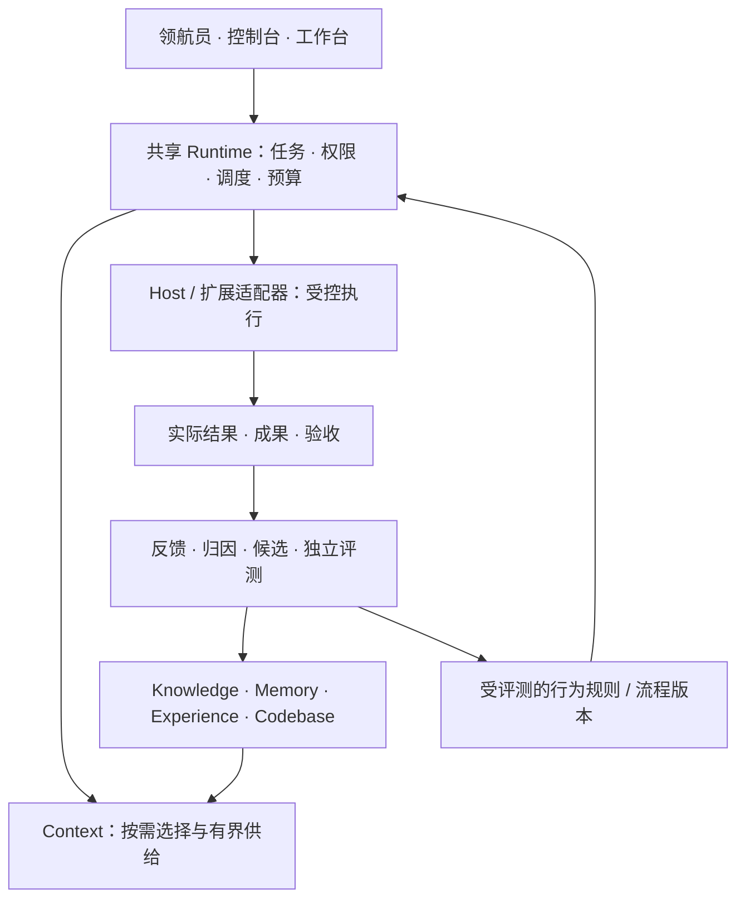

# Craft 产品与技术能力总纲

> **用途：**统一下一代 Craft 的产品目标、关键设计与发布验收，供产品、设计、研发、测试共同执行。本文是目标规格，不是已实现清单；功能存在、真实触发、实际有效、持续复用必须分别举证。
>
> **统一名称：领航员（Navigator）、控制台（Console）、工作台（Workbench）。**本次改写文档不代表应用已完成改名或功能已经发布。

## 1. 产品目标与范围

Craft 是一个本地优先、允许托管与接管、能从真实工作中持续改进的个人 Agent 工作平台。用户提出目标，系统组织资料、模型和工具，在授权范围内执行、验证、交付，并把有独立证据支持的成果沉淀为长期能力。

首批面向个人开发者和知识工作者，覆盖跨项目研发、研究与文档、文件交付、消息转任务。领域扩展提供专业对象与验收器；非代码任务使用资料和产物快照。

产品价值以独立任务成功率、委托成本、恢复成功率、复用收益和总成本衡量。委托成本包括交代背景、检查结果、催办、接管与修正所需的用户时间；调用量、候选量和对话时长不能替代效果。用户可以选择暂不行动，产品不以增加任务或持续互动作为收益。

每项可发布的产品能力都须有可观察结果、评测方法和验收证据，按第 16 章登记。确定性行为用程序检查，任务收益用独立对照，体验用代表性用户任务与可用性观察；不能统一替换为模型评分。未建立验收方法的能力只能作为探索项，不承诺已可用。

**完整目标范围**：三模式、共享运行时、上下文与学习子能力、能力发现与质量评测、脱敏及目录语义、持久执行、数据迁移、受控进化、模型接入、统一扩展与业界格式适配、已有云电脑接入、统一设置、消息与目录感知、性能稳定性、可复现发布。直接使用已有 Skill、MCP、Codex Plugin、Claude Plugin、DSH Plugin 和 Claude Mods 是扩展目标；具体兼容程度逐项实测。完整目标不等于每项都阻断同一版本发布。

| 发布范围 | 本版要求与边界 | 开放及阻断条件 |
| --- | --- | --- |
| 当前发布必需 | 三模式共享同一任务的最小交付与接管路径；身份、存储迁移与异常隔离；持久执行、权限与脱敏、受控模型接入；有界 Context 与学习资产闭环；性能诊断及固定版本安装恢复 | 先在一个真实项目的多个独立任务、明确的 Host／平台组合上验收。按第 16 章五道门逐项举证；数据、安全、恢复及已承诺范围的门禁失败即阻断。样本不足不能宣称学习有效，自动晋升保持实验状态 |
| 实验开放 | 尚未取得完整证据的生态格式／Mods／Hook 适配、模型化多角色、已有云电脑、邮箱／IM 与主动服务，以及核心能力中的未验证策略 | 按能力和版本显式启用，展示边界、预算和回退方式；安全与数据门仍须通过。未启用项不阻断核心发布；一旦成为已承诺路径的依赖，就纳入该路径门禁，不能用“实验”豁免 |
| 后续预留 | 组织协作、多设备自动同步、云资源购买／创建、自建市场交易／发布生态 | 保留合同，进入发布范围前补齐依赖、负责人及验收卡；已有机器接入不包含云资源管理，从已有来源获取扩展不依赖自建市场 |

产品、技术与评测负责人在实现和验收前固定发布清单，写明能力、依赖、Host／平台、开放级别和阻断项，复用第 16 章验收卡。改变范围须保留原因与影响，不能在失败后静默移出必需项。分级交付减少跨生态依赖对核心交付的拖延，代价是维护实验开关、兼容矩阵和边界说明；未列入本版的能力仍保留在完整目标中。

完整规划一次确定，可靠性与收益分别验证。未达门槛的能力保持实验状态；不要求重写所有框架、训练基础模型或默认启动多 Agent。

**设计取舍**：以现有任务、资产、权限和运行记录承载个人 Agent 的连续性，不另建“数字分身”真值或全量个人画像库。相较只增强聊天，这能支持长任务和成果接力，代价是状态、失效与迁移管理；相较直接建设全能生活助理，先在可验证的工作场景降低委托成本。未通过持续运行验收时，保留按需执行与人工接管。组织协作沿用同一合同扩展，不改变个人数据归属，也不因接入工作账号而默认开放所有资料。

## 2. 三种模式与用户体验

三模式共享同一任务、会话、权限、成果和运行状态，只改变用户的观察与干预方式。

| 模式 | 核心职责 | 必须具备的体验 |
| --- | --- | --- |
| 领航员 | 默认入口，理解目标、确定范围、组织执行 | 自然语言输入；项目与约束卡片；必要时结构化澄清；真实进度；交付摘要；一键接管 |
| 控制台 | 全局治理、审批、恢复与健康观察 | 待处理优先；任务与资源；成本；异常归因；数据健康；候选评测与回滚；逐项可追溯的批处理 |
| 工作台 | 单项目深度协作与成果修改 | 对话与成果预览；文件及版本差异；局部接受；人工修改保护；模型与 Host 状态；可折叠终端和证据 |

**命名迁移**：原“领航／领航台”显示为“领航员”，“观象”为“控制台”，“灵策”为“工作台”。同步导航、通知、设置、帮助、截图和测试。显示名称与稳定键解耦；旧链接、枚举和用户配置通过版本化别名兼容。历史审计原文不批量改写。升级后必须能用旧链接重新打开同一任务。

**一致交互**：切换保留任务、项目、草稿和筛选，不重跑、不增权。后台运行用状态条提示，仅丢草稿或影响执行时确认。视图按需加载，用快照加事件游标刷新，断线补齐。

**低认知负担**：先展示成果、下一步和待决定事项，细节按需展开。空态、加载、部分结果、错误、离线、过期与无权限均有明确文案。支持键盘、读屏、缩放、对比度和减少动画；通知去重、限频，重要失败可见。

待决定事项展示触发原因、最新证据、选项与影响、建议及不确定性，支持处理、补充条件、稍后和停止跟进；不把整段 Trace 当审批材料。领航员收敛意图，控制台管理异常和注意力，工作台承载持续使用的成果；多项目任务可在工作台按需切换目标项目，范围仍按第 10 章独立校验。

**首次使用**：检测 Host／模型，复用或配置 Profile，按首任务需要选目录、确认范围，不强制创建无关项目。引导可跳过、恢复和从设置重开，显式深链不被引导遮挡；完成后不反复弹出，凭据失效时只修复相关配置。桌面直接启动应用，后台进程可诊断但不要求用户先打开终端；同数据空间重复启动避免重复 Worker。已安装、已配置、可连接、可执行分别展示。

**导航收敛**：以任务为主线，将审批、澄清、冲突和故障收为“待处理”，知识、记忆、经验和成果收为“资产”，Plugin、Skill、MCP、Mod 的安装与管理收为“扩展”。模型、执行环境、账号和偏好的管理统一在“设置”，相关详情提供深链；任务中保留模型与执行位置的快捷选择。运行与评测从任务或控制台进入，不为每个底层类型增加一级菜单。三模式复用对象与深链，保留项目筛选；用户应能从异常直达可执行的处理动作，不必理解内部类型树。

**任务内操作**：真实阶段进度可下钻到问题、证据和对应工作台任务；目录选择显示来源、候选与歧义，评分不能冒充校准概率。会话工具栏显示实际生效的扩展／规则版本及停用影响，终端显示有界且脱敏的真实执行事件。批量审批、消息处理和重试逐项校验、逐项回执，部分失败不回滚无关成功项；刷新保留勾选，但对象版本变化后重新确认受影响动作。消息拖入输入框只加入引用草稿，不自动发送或触发模型。

## 3. 统一架构与领域对象

| 边界 | 职责与约束 |
| --- | --- |
| Craft 内核 | 身份、任务状态、权限、预算、队列、回执与验收门；所有入口共用，不能另开绕过门禁的执行通路 |
| 子能力 | 各自管理资产与生命周期，通过统一引用、范围和反馈契约协作，不直接修改其他能力的数据库 |
| Host | 承载模型循环与实际工具执行，声明能否恢复、取消、改写请求、沙箱和上报用量；不支持的能力明确降级 |
| 执行环境 | 本机或远端机器的身份、连接和资源边界；其中可运行多个 Host。模型提供方、Host 与执行机器分别记录，不因使用云端模型就称为云电脑执行 |
| 扩展 Extension | 统一登记来源、版本、能力、范围、配置与可用性；Plugin 是外部分发格式，Skill、行为规则、服务及运行时模块是组合能力，详见第 8 章 |
| craft-eval | 独立评测执行与报告，Craft 消费可核验结果；模型评分不是最终晋升权 |
| Workbench | 三模式的用户界面与桌面承载，共享 Craft 状态，不复制一套业务真值 |

共享对象包括项目、会话、任务、运行与尝试、快照、能力、策略、来源、证据、成果、资产版本、评测和反馈。重试不新增独立证据，进程结束不等于验收通过。

| 统一抽象 | 共享机制 | 保留的领域差异 |
| --- | --- | --- |
| 资产 Asset | 身份、范围、版本、来源、引用、比较与退出证据 | Knowledge、Memory、Experience、成果各自保留正文结构及生命周期，不把 Skill 发布等同于经验晋升 |
| 连接 Connection | 端点、账号、凭据引用、健康与授权范围 | MCP、消息和资料连接分别保留协议能力；模型配置与执行 Host 不合并成同一种对象 |
| 运行 Run / Attempt | 关联、预算、取消、恢复、观测与结果 | 用户任务、学习、评测和定时任务保留各自状态机与验收器 |
| 触发器 Trigger | 事件身份、调度、去重、防抖与来源 | 手动、消息、时间、Hook 各自校验语义，触发不等于授权 |
| 待处理事项 Attention | 优先级、责任人、关联对象、处理动作与回证 | 审批、澄清、冲突、故障和未知结果不能使用同一种“确认”动作 |

抽象只统一公共合同与交互组件，不统一所有状态机或数据库。以薄登记层、类型化能力合同和领域拥有的存储实现；复用第 10 章身份与范围，不增加第二套项目真值。新增类型须给出既有合同无法表达的真实用例，避免万能 JSON 和递归继承树。

**轻量本体**：定义来源、支持、反驳、适用、依赖、替代、撤销与使用关系，附范围、版本、生效时间、记录时间和证据。观察与推断分开，未知不等于不存在。先用类型化记录及索引，按实际需求引入图数据库。来源语义参考 [W3C PROV](https://www.w3.org/TR/prov-overview/)。

**技术取舍**：共享内核降低状态漂移，但需严格模块接口；分域存储减少争用，但增加恢复成本。优先复用现有工作流，新增框架须有真实收益和迁移依据。

## 4. 意图、计划与成果交付

- 任务约定保存目标、输入、项目、禁止事项、交付物、验收、预算与自主权。简单问答直接处理，外部副作用进入受控链。
- 路由结合显式路径、当前项目、目标和目录描述，否定优先。“不要修改 A，修复 B”不得因子串匹配派发到 A；歧义通过结构化选择澄清。
- 子任务继承共同约束和依赖。澄清答案绑定问题、允许修改；修改使相关旧计划失效。明确且已授权的工作继续，不每步索要批准。
- 并行检查写集合和资源冲突，重叠写入串行或隔离后合并。多 Agent 相对单 Agent 基线验证收益，共享总预算。
- 成果支持预览、差异、编辑、局部接受和导出。版本校验保护人工修改，仅重做受影响部分。
- 交付包含实际产物、验证结果和遗漏；纯模型回答不能冒充命令执行，进度不编造百分比。

**长期目标与动态意图**：复用任务约定，保存目标版本、硬约束、阶段结果、期限、等待条件、下一次检查条件与停止条件。模糊愿望先作为待澄清意图；缺失信息会改变行为时问关键问题，其余在已有授权内推进。修改目标、追加条件和临时插入任务分别留事件，只使受影响计划与候选失效，保留仍有效的约束；在途动作核对新版本后停止或对账。路径失败可重规划，但不能通过更换交付目标宣称成功；长期目标不能覆盖用户当前明确选择。

**交付与接力**：任务以可独立验收的成果、责任转移或必要判断划分，内部工具步骤默认折叠，不要求每步人工确认。交接包绑定当前目标、成果版本、已验证结果、未决问题、责任人与下一步，只携带必要引用。有人回复“已接手”不算完成，已有负责人处理时不重复派发。任务状态持久化在 Runtime，近期状态摘要是可重建投影，不写成长期 Memory；换会话按游标和版本续接，不依赖复制聊天或某个 Host 常驻。

### 4.1 协调、主控、执行与审查角色

保留原设计的 Coordinator → Mainer → Worker ↔ Reviewer 协作链。角色定义职责与权限，不等于四个常驻 Agent、四次模型调用或四套任务状态机；简单任务可由一个执行者配合确定性协调与验收完成，复杂任务再按依赖和收益启用并行。Mainer 指主控，不是 Maintainer；后台队列 Worker 是运行设施，不自动等于任务执行角色。

| 角色 | 职责与交付 | 边界 |
| --- | --- | --- |
| 意图协调者 Coordinator | 识别目标、项目与约束，发现歧义、历史重复与冲突，形成任务约定 | 不因猜测扩展范围；在顶层目录工作时按需选择已授权子项目，遵守第 10 章 |
| 主控 Mainer | 维护计划与依赖、选择执行器、分配预算、派发与回收结果，处理返工和重规划，汇总交付 | 使用共享任务／运行真值；不自行授予权限、降低验收标准或把 Worker 完成直接判为成功 |
| 执行者 Worker | 在明确范围和快照上执行，交付修改／成果、验证结果、证据引用与未解决问题 | 保护用户改动；不能修改自己的验收标签或签发最终通过；多个执行者按写集合协调 |
| 审查者 Reviewer | 对冻结候选与任务约定做独立检查，报告通过、返工、阻塞或证据不足，给出定位及复验要求 | 对候选只读；验证可在隔离副本执行并产生证据。模型审查仅辅助，确定性门禁及第 9 章独立评测不能被口头“通过”替代 |

**执行决策表**：Runtime 按版本化策略检查可观察条件，记录命中的规则、输入快照与选择原因。模型可提出计划，不能自行跳过下表检查；“任务复杂”或提示词长度不能单独决定增加 Agent。

| 决策 | 可检查的触发条件 | 执行动作与条件不足时的处理 |
| --- | --- | --- |
| 单执行者或拆分 | 默认单执行者；存在可分别验收的子成果和显式依赖时才拆分 | Coordinator／Mainer 的确定性职责仍保留；无可靠拆分依据时串行执行，不为角色齐全增加模型调用 |
| 并行派发 | 子任务依赖已满足；写集合不冲突或已具备隔离与合并方案；执行资源、剩余总预算和审查容量均有余量 | 按每项任务的资源与成本预留量折算可用执行槽位，再取配置及各约束允许的最小并行数；写集合未知或检查失败时串行／排队。并行策略需相对单执行者验证收益 |
| 独立审查 | 任务命中事前登记的风险规则，如权限／数据迁移、跨项目写入、扩展执行边界或资产晋升 | 冻结候选后独立验收；缺少可靠验证器的语义问题可增加模型辅助审查。必须的证据无法取得时阻塞，低风险任务保留确定性检查 |
| 扩展激活 | 格式版本及必要能力受支持；来源、依赖、授权和所需隔离能力通过第 8 章检查 | 仅激活已验证能力；未知执行语义或隔离能力不足时拒绝相关激活。原生 Host 委托也要满足同一权限要求 |
| 候选保留与晋升 | 来源独立性、适用范围、冲突检查、硬约束及受控评测回执均有效，达到事前固定的效果门槛 | 由治理门决定晋升；证据不足继续观察，硬失败拒绝，已生效版本回归按第 9 章停流与回退 |
| 运行降级与接管 | 超过队列、资源、截止时间或返工预算；必要能力失效、权限撤销或外部结果未知 | 降并行、暂停可选后台工作、返回明确部分结果或进入待处理；必需检查不能跳过，未知副作用先对账，不重置预算继续循环 |

容量、风险规则与时间／费用阈值由负责人依据第 11 章基线配置，派发前固定；缺失时采用单执行者及受限执行，缺少必要授权或验收条件则阻塞。收益策略可以更换，权限与质量门不得随降级放宽。

**交接与返工**：交接绑定任务、候选版本、输入快照、权限、预算和证据引用，只传必要摘要与可展开引用。Reviewer 不直接修补候选；修改由 Worker 形成新版本再复验，旧结果不得给新版本背书。每个修订周期区分阻塞缺陷与建议，轮询、重复回执和重连不增加返工次数；目标默认最多 3 轮，或更早达到时间／费用上限即暂停新派发，进入控制台待处理。恢复须说明新增证据、环境修复或计划变更，不能重置计数后无限互改；在途取消和未知结果仍遵守第 5 章。

**用户体验与配置**：领航员以“理解任务 → 计划 → 执行 → 审查 → 交付”展示真实阶段；工作台可展开子任务、执行端、差异、审查问题和重验结果；控制台集中呈现阻塞、预算耗尽与待接管事项，不要求用户学习角色术语才能操作。设置中的任务执行策略管理角色启用条件、已授权模型／Host 引用、并行数、审查级别和预算；任务可在策略范围内覆盖。必须保留确定性验收，不能用关闭模型 Reviewer 关闭全部检查。角色不与三模式一一绑定，切换模式不重新派发。

**现状与验收**：复用 [Pilot 编排](core/pilot-orchestrator.ts)、[结果验收](core/pilot-results.ts)及[审查轮次回归](tests/pilot-review-round.test.ts)。现有 Mainer 拆分和计划 Reviewer 含无模型的确定性逻辑，相关入口不等于完整智能规划或独立任务收益已经实现；角色模型化与多 Agent 扩展需相对单执行者基线证明收益。原实现记录保留历史口径，不能据其测试清单宣称上述目标全部通过。

### 4.2 可编辑成果与使用反馈

文档、表格、代码、素材等以带版本的工作对象及成果引用组织，由领域扩展提供合适的预览／编辑器。人的编辑与 Agent 提案基于同一版本，采用局部变更预览、冲突检查和选择接受；不为修改一个字段重做整份成果，也不覆盖已接受或人工修改的部分。来源绑定到对象版本和必要的段落／单元格／符号定位；上游变化只使相关下游进入待复核，未受影响成果保留。无法证明修改者身份时标来源未知，不猜是用户或模型。复用[局部变更](core/changeset.ts)与[成果血缘](core/lineage.ts)，有数据模型不等于所有领域编辑器已经可用。

交付分别记录“直接采纳、修改后采纳、拒绝、尚未反馈”，绑定精确版本；修改差异、原因和延迟结果按授权采集，更正以新事件保留历史。采纳是使用与偏好信号，不自动等于事实正确或业务成功；未点击也不等于拒绝。反馈传入第 9 章归因，影响相关候选与后续验证，不能把全部编辑历史直接注入上下文。

**可复用成果界面**：稳定、反复使用的需求可保存为表格、卡片、时间线或小工具，重开后恢复数据和视图，不要求用户重新描述。优先使用领域编辑器与已登记界面组件；生成的界面绑定资产、数据合同及动作权限，沿用第 8 章隔离和第 10 章存储。可执行小工具走候选、验证、启用与回滚，不把任意生成脚本载入主进程。保存、共享、部署分别授权；卸载视图不删除业务数据。动态布局需经用户接受后固定，更新提供差异与回退，避免破坏熟悉的操作位置。验收实际编辑、保存、重开和错误恢复，不以截图好看或代码编译通过代替可用。

## 5. 持久执行、恢复与副作用

执行顺序为“准备 → 派发 → 执行 → 再观察 → 验收 → 交付”。用户可见状态至少区分执行中、等待、暂停、结果未知、待验收、已交付、失败与取消。

| 关键机制 | 底层要求 |
| --- | --- |
| 幂等接收 | 请求先持久化；同一幂等键与相同内容返回原结果，不同内容报冲突；UI 重试不能创建第二个任务 |
| 可靠派发 | 任务状态与待发事件在同一事务提交；跨库或外部调用通过持久事件箱、消费去重和对账恢复，不假设跨库原子性 |
| Worker 协调 | 租约、心跳、版本令牌隔离过期持有者；租约到期不代表外部进程已停止 |
| 检查点 | 绑定计划、输入、快照、权限、能力版本与预算；恢复前复核，漂移则重新规划 |
| 结果未知 | 外部成功但本地未落盘时显式保留；优先查询外部结果或验证实际状态，不盲目重复副作用 |
| 重试与熔断 | 区分临时故障、业务拒绝、权限错误和未知结果；退避加抖动，限制次数与总成本；模型修订周期按第 4.1 节计数，不能混入网络重试或状态查询 |
| 暂停与取消 | 停止新派发，尽力终止在途操作；展示已经发生的副作用；补偿作为新的受控动作，不能承诺全部可撤销 |
| 等待与回放 | 等待外部事件时释放计算资源；回放默认只读或隔离，真实重执行重新授权和验收 |

运行状态与长期记忆分离，借鉴 [LangGraph 的检查点与跨线程存储](https://docs.langchain.com/oss/python/langgraph/persistence)。故障注入覆盖“接收、派发、外部完成、落库、验收提交”各边界。

**流程复用与编译**：Experience 沉淀方法，Runtime 执行已验证的具体流程版本；固定节点输入输出、条件分支、依赖、失败路径、人工等待和有界循环。图或脚本编译成功只证明静态检查，不产生执行权；首次执行仍经授权与验收。每个流程明确适用版本、参数、验证器及回退到重新规划的条件，环境不适用时不得硬套旧流程。等待时可释放进程，恢复前核对检查点、外部结果、权限和预算；不承诺恢复任意进程内存。[现有图编译入口](core/graph-compiler.ts)

## 6. Context：少而准的上下文供给

Context 确定任务、项目真实路径、Host 会话、代码或资料快照后，统一执行：权限过滤 → 有效性检查 → 检索 → 冲突处理 → 去重 → 预算分配 → 短摘录。Knowledge、Memory、Experience、Codebase 提供候选引用，Host 历史与当前任务状态参加共同预算。

- 默认只提供必要摘要、适用条件和精确引用。命中一篇内容不发送整篇，memory.md 不整体注入；展开时再次校验权限、版本和预算。
- 否定、前置条件和例外必须保真。完整语义单元放不下就给展开提示；必需内容无法取得或容纳时明确失败，不截成可能反义的片段。代码状态、参数和错误现场保留精确引用。
- 预算包含材料、工具定义、历史、约束、响应封装与输出预留。外部 Host 不提供总量时，只声明 Craft 可控制的部分，标明估算和实测。
- 建议小包起点为最多 3 条、1,200 字符的材料，响应另有上限；可选材料超限可收缩并说明，必需内容超限返回可操作错误，避免原样反复重试。
- Hook、MCP 与同轮调用共享按任务、轮次、范围和资产版本计算的去重记录；更正与新版本不能被旧去重挡住。
- 分开记录“检索到、选中、实际发出、被使用、结果验证”。裁掉的材料不能算发出，检索命中不能算有效使用；Host 无法证明使用时标为未知。
- 稳定摘要保留来源，过期与撤销传播到缓存及展开接口。长期记录不意味着长期占据模型上下文。

**正文与引用**：决策前必须遵守的限制直接提供完整短句；事实给必要结论与适用条件，流程给入口、验证与退出要求，长文档和代码给相关性说明、片段／符号定位及展开入口。引用绑定资产版本或内容摘要，不能只有文件名。首轮未给全文不算遗漏；需要决策时仍取不到必要证据、或错误操作后才读到约束，才算供给不足。无答案可以返回空结果，但 `ready` 只表示流程完成，不证明任务证据充分。

授权采集的会议、群聊、口述和外部文章作为来源保存，按需定位到时间段或原文片段；转录存在歧义时保留不确定性。决策摘要保留理由、条件、反对意见与替代方案，不把发言或摘要直接变成已确认事实。保留原文不等于全文注入，也不默认开启录音或屏幕采集。跨仓库任务先读取已授权项目的职责、依赖与验证入口，再展开相关项目快照，不因统一导航合并知识归属或读取整个目录树。

该方向参考 [Anthropic 上下文工程](https://www.anthropic.com/research/effective-context-engineering-for-ai-agents)与 [MemGPT](https://arxiv.org/abs/2310.08560)。检验重点是选材正确率、遗漏、否定保真、实际 token、延迟，以及各成员的消融贡献。

## 7. 子能力与公共能力域

### 7.1 能力版图与归属

Context、Knowledge、Memory、Experience、Codebase 是上下文与学习链中的一组能力，不是 Craft 全部能力。产品能力、源码模块、插件安装包和 MCP 暴露面分别登记，不能用某个目录或注册表的条目数代表产品总数；一个包可以组合多个能力，一个能力也可以通过多个入口使用。

| 能力域 | 成员及职责 | 详细设计 |
| --- | --- | --- |
| 上下文与学习 | Context 选择材料；Knowledge 管事实；Memory 管分层记忆；Experience 管可复用流程；Codebase 管快照绑定的代码证据 | 第 6、7.2、9 章 |
| 能力发现与独立评测 | Craft Capability 发现、去重、检查健康并推荐最小能力集合；独立 craft-eval 负责通用评测，Craft 保留任务验收、证据校验与治理门 | 第 7.3、8、9 章 |
| 数据保护与目录语义 | Datasec 管脱敏及受控映射；craft-file-dir-desc 管目录与用途的双向定位，服务本机及远端项目选择 | 第 7.3、10、12、13 章 |
| 任务执行与治理 | Coordinator／Mainer／Worker／Reviewer、计划路由、持久工作流、队列、授权、预算、验收与恢复；学习控制从证据形成候选并经评测治理 | 第 3—5、9、11 章 |
| 扩展与外部连接 | Skill／规则／运行时模块／Hook／MCP 的接入与生命周期；Host、模型、云电脑、邮箱／IM 和主动触发 | 第 8、12、13 章 |
| 运维与交付 | 身份、分域存储、迁移、备份恢复、可观测性、发布及回滚 | 第 10、14—16 章 |

**不再保留独立 Craft Quality 子产品。**通用评测统一归 craft-eval；旧 `craft-quality`／`craft-skill-quality` 名称仅按第 9.1 节兼容迁移，不再发展第二套评测引擎或产品页面。完整 `craft` 是组合入口。`craft-file-dir-desc` 作为目录能力登记，不因当前经 Context 提供入口而消失，也不因此要求单独分发插件。Skill 的来源管理、候选制作、评测与发布分属能力发现、扩展生命周期和评测治理，不能混成 Experience 自动发布 Skill；本轮仍不自动改写或发布用户 Skill。

核对依据为[能力注册表](core/capability-catalog.ts)、[Capability 插件声明](plugins/craft-capability/.codex-plugin/plugin.json)、[Datasec 模块](capability/craft-datasec/README.md)与[目录语义实现](core/file-dir-desc.ts)。它们证明已有模块或入口，不证明全部目标已实现；旧组件架构中 Context 仅含 Knowledge／Memory、长期 Memory 一律人工批准等表述，不作为本总纲的目标合同，按本章及第 9 章核对现状与迁移。

### 7.2 上下文与学习能力的演进

学习资产及检索／分析策略遵循“观测 → 候选 → 独立评测 → 正式或拒绝 → 使用 → 修订或退出”。候选与正式版本分开，事件只追加，有效指针原子切换。Codebase 日常索引按快照和分析有效性更新，不要求每次先做收益评测。

| 能力 | 形成与组织 | 生效条件 | 修订与退出 |
| --- | --- | --- | --- |
| Knowledge | 项目文档和有验证结果的任务形成 Claim；按项目、主题、粗细场景归类；保留精确来源、约束、例外与冲突 | 分别判断事实可信、范围适用、对独立任务有帮助；模型可分类和建议，不能自授可信身份 | 来源改变、撤销、冲突、过期或负反馈触发暂停注入、重验、修订或退出 |
| Memory | 保存稳定偏好、约定与事实；会话、项目、全局三级，默认自动捕获和治理 | 单次进入会话；同项目至少两个独立会话才具备项目资格；至少三个独立项目才具备全局资格；还须核验独立性、正确性、通用性、冲突和使用证据 | 保留更正与双方来源；纠错、过期、撤销同步数据库、缓存、索引与 Markdown；归档后删除临时记忆 |
| Experience | 从目标、输入输出、修改区域、验证方式和结果识别粗细场景；独立成功任务形成候选流程 | 流程包含入口、输入、步骤、可观察结果、验证、异常处理、退出条件和适用版本；留出任务检验迁移 | 新任务失败、成本恶化或回归隔离问题版本；降级、回退到已验证版本并重验 |
| Codebase | 绑定项目、分支、HEAD、工作树及源码摘要、分析器版本；文件增量索引 | TypeScript、JavaScript、Python、Java、Go 分别实测定位、关系遗漏／误报及增量更新；索引作导航，不替代执行 | 文件、分支或分析器变化使相关关系失效；分析不完整标 partial；旧快照成绩不能沿用 |
| Context | 组合有效资产与当前状态；调整检索、排序、预算和摘要策略形成候选 | 用固定基线和独立任务检验误召回、遗漏、约束保真、成本与延迟 | 质量或成本回归回退策略；撤销资产立即从新发出的上下文排除 |

**范围与真实性**：项目事实不能靠重复出现全局化，场景同名不能证明共同前提。复制会话、镜像文档及任务变体沿同一来源链计数。记忆要完整保留“不要、仅当、除非”；偏好不能覆盖当前明确指令。用户明确要求记住、更正或忘记走直接授权路径，自动推断不能伪装成用户指令。

**个人记忆的选择**：区分稳定偏好、阶段性条件、观察事实和待验证推断，记录来源、适用任务、生效／失效条件及更正关系；当前进度与未完成承诺归任务状态。一次拒绝不自动变成永久偏好，项目选择不推导个人性格，模型赞同不增加事实支持。用户可查看“记住了什么、为什么使用”，选择更正、忘记或限制使用场景；隐私主题不因语义相关就反复提及。记忆用于减少重复解释，不作为操作授权或事实判定的替代。既定自动晋升阈值不变。

**维护与纠错**：正式 Knowledge／Experience 及共享能力登记维护者、复核条件和错误反馈入口；个人场景由用户持有管理权。专家的修正形成带依据的新候选，知识正确性、范围适用性及使用收益仍分别验证。维护者缺失、来源不可用或版本过期时标明状态并按风险暂停推荐；向上下游复用方法仍遵守扩展发布边界，不自动把 Experience 改写成 Skill。

**文件与目录**：Knowledge 正文、来源、分类和版本分别管理；模型可建议目录，不能自行改变物理归属。memory.md 是可读投影，不是第二套真值；人工编辑须解析、比较、版本校验后回写。会话归档先迁移合格脱敏长期证据，再清理临时内容，不满足条件的记录不能为保留而强行晋升。

### 7.3 能力发现、保护与定位

| 能力 | 形成与使用 | 演进、退出与验收 |
| --- | --- | --- |
| Craft Capability | 从已授权来源登记 Skill、MCP、Workflow、Adapter 等，保留来源、版本、依赖、范围及健康；按任务返回少量候选与激活计划，实际安装和执行交给受控 Runtime | 来源撤销、版本变化、健康失败使推荐失效；排序策略用独立任务比较推荐命中、遗漏、无效激活、成本和时延。发现、推荐、安装、授权、执行分别留回执，不自动加载全部工具 |
| Datasec | 本地检测、生成安全副本、维护隔离映射及最终出站检查；默认手机号和邮箱，其他规则显式开启 | 规则／处理链候选经漏检、误报、业务字段保真、流式边界、Host 覆盖及性能回归后启用；反馈不能自动关闭必要保护或全局放行敏感值，回滚仍保持当前授权要求 |
| craft-file-dir-desc | 按实际使用记录目录、用途、别名、执行端和来源，支持“描述找目录／目录找描述”；观察态与正式条目分开，只读检索不增加使用证据 | 使用频次是候选信号，还须核实路径、描述、归属与冲突；搬迁、纠错、离线和身份变化触发失效或重绑。验收重名、否定、歧义、远端同路径及选择子项目的定位正确率，不全盘扫描、不靠目录关系增权 |

以上能力的规则与排序可以形成版本化候选，但不要求每次脱敏、目录查询或健康探测调用模型。正常路径按需、增量、有界执行；权限规则不能由收益分数覆盖。所有能力登记拥有的状态、来源、配置与版本、检索／调用入口、失效传播、成本和验收卡；新增能力同步更新本表及第 16 章，不能只加代码或插件名称。

## 8. 统一扩展与业界生态适配

### 8.1 对象与组合

用户直接添加原始目录、文件、包坐标、市场／Git 地址或服务配置，Craft 识别格式并生成接入预览，不要求先重写成 Craft 专用包。歧义时要求选择格式，不靠猜测执行。独立 Skill、规则或远程 MCP 也可登记为扩展，无须外包一层 Plugin。

| 对象 | 职责 |
| --- | --- |
| Extension（扩展） | 用户管理的稳定入口，关联来源、可用能力、安装版本与使用范围 |
| Package（分发包） | 固定获取位置、原始格式、版本／revision、完整性摘要与依赖；保留原始清单及资源 |
| Contribution（能力项） | 带类型的 Skill、行为规则、MCP 服务声明、工具／命令、Hook、界面及渠道连接器等；具有自己的输入输出与权限要求；一个运行时模块可注册多种能力项 |
| Instance（实例） | 在特定执行端、Host、账号和配置下的服务连接或运行实例；同一声明可有多个实例 |
| Binding（绑定） | 将扩展、能力或实例绑定到既有项目／会话范围；安装不意味着自动全局启用 |

关系为“扩展关联分发包，分发包提供多个能力项，能力按需实例化并绑定范围”。组件间通过显式依赖关联，不套 `PluginExtension` 嵌套 `SkillExtension` 的递归树。统一目录中的能力 ID 带来源命名空间；同名不自动合并，同包重复导入幂等，已有实例可显式复用。

**Mod 语义**：Craft 原有文本认知约束在产品中称“行为规则”（Rule），保留旧 `mod` 稳定键与路由兼容。Claude Mods 是可执行的 Host 事件与界面扩展，不是 Rules、CLAUDE.md 或输出风格的别名；通过运行时模块适配，不能降成提示词冒充兼容。[Claude Mods 官方定义](https://code.claude.com/docs/en/plugins/mods/overview)

### 8.2 原格式接入与执行路径

| 输入生态 | 接入目标与重点验收 |
| --- | --- |
| Agent Skills | 读取 `SKILL.md` 元数据、指令及相对引用，保留脚本／资源；按需加载，脚本执行另走授权与依赖检查，不能只复制正文就算兼容 |
| MCP | 接入本地进程与远程服务，协商协议能力；分别验证 tools、resources、prompts、认证与连接恢复，不把成功列出工具当执行成功 |
| Codex Plugin | 按受支持版本识别清单、Skills、MCP、Hook 等声明；保留路径替换和命名空间，验证实际 Host 加载与调用，不把安装缓存当生效证据 |
| Claude Plugin | 解析清单及其引用的能力与资源；命令、子 Agent、Hook、MCP、LSP、界面等按实际声明分类，不能静默丢弃不认识的成员 |
| DSH Plugin | 复用隔离 Profile 与原生运行时桥接，验证包依赖、服务／工具注册及调用；需要 DSH 会话或界面的能力明确执行位置，不伪装成普通 MCP 工具 |
| Claude Mods | 保留事件处理与界面语义；按实际 Host 版本验证加载、事件顺序、改写／拦截、状态与渲染能力；无界面环境明确不支持显示，不把事件加载成功等同于界面可用 |

每个能力选择并记录“Craft 直接承载、兼容适配、原生 Host 委托、不支持”之一。原生 Host 委托仍属于可用路径，但用户须知道执行位置、所需安装／账号及权限边界；不能承诺跨 Host 无损运行。必要成员不兼容时阻止相关能力启用，可选成员缺失可部分可用并列出影响，外部清单不能自行降低必要性。

适配流程为“只读识别 → 清单和依赖检查 → 映射能力与差异 → 配置及范围确认 → 安全获取 → 激活 → 探测 → 真实调用验证”。探测安装内容不得提前执行未授权代码；包发布者声明的权限／副作用不直接成为有效授权。未知字段保留并报告，影响执行语义的未知项拒绝激活；不得默默忽略安全相关 Hook。可执行模块使用已验证的隔离／原生 Host 边界，不能直接载入 Craft 核心或界面主进程后宣称已隔离。

每条执行路径登记文件、网络、凭据、子进程及界面访问边界、强制执行位置和终止方式。独立进程本身不构成权限沙箱；原生 Host 委托仍须验证其实际限制。界面模块经受控渲染桥提交声明与动作，主进程校验动作权限，不暴露任意执行入口。激活验收覆盖越界读写、未授权外联、凭据读取、子进程逃逸及权限界面篡改；任一所需限制无法强制执行时保持不支持，不让用户用一次安装确认替代隔离。

兼容矩阵按“生态格式版本 × 能力类型 × Host／运行时 × 平台”记录支持、部分支持、不支持、未验证，区分清单可解析、可激活、可执行与结果正确。复用现有[格式适配器](core/plugin-adapters.ts)和 [DSH 桥接](adapters/dsh-plugin-host/README.md)，这些接线不构成全部生态兼容证明。外部规范以 [Agent Skills](https://agentskills.io/specification)、[Claude Plugin](https://code.claude.com/docs/en/plugins-reference)及对应版本的 Host 合同为依据。

### 8.3 统一扩展体验

“扩展”入口提供“已添加、发现、待处理”；扩展内待处理是全局待处理事项的筛选，不另造审批状态。默认按扩展展示，也可按能力查看“技能、行为规则、工具与连接、自动化（Hook／触发器）、运行时模块、界面”。Plugin 格式属于来源筛选，不能与其内含的 Skill／MCP 做互斥分类。独立项与组合包用相同卡片，不重复计算安装数。

详情统一展示概览、提供能力、配置与范围、权限、运行与评测，隐藏不适用栏目。首先回答“能做什么、当前能否使用、需要处理什么”；协议、摘要与进程参数收在高级信息。使用一致的布局、状态文字和图标，状态不只靠颜色表达；搜索支持用途与名称，筛选可恢复，空态给出添加或修复动作。复杂配置采用渐进展开，不能为少一个页面而隐藏权限或失败原因。

安装／登记、范围启用、授权、运行健康分别记录，再派生可用性，不能只有一个 `enabled`。包内 MCP 失败不遮蔽独立 Skill，但依赖它的能力明确受阻；已更新但 Host 仍加载旧版须显示差异。控制台管理全局，工作台展示当前项目绑定，领航员从任务直达需要的扩展，共享同一状态与深链。

### 8.4 生命周期、成本与迁移

- 包内能力固定随包版本，用户覆盖与连接配置独立存储；升级前比较权限、依赖、配置及能力差异，在途任务固定旧版本。获取依赖和安装脚本同样受授权与预算约束，失败不能留下半启用状态。
- 停用／卸载先检查依赖与在途任务；释放本扩展绑定，不删除其他扩展仍使用的实例、用户原始目录或长期资产。回滚复核旧包兼容性与数据格式，不能覆盖用户修改。
- Skill、行为规则和工具按需发现、展开或启动，纳入 Context 共同预算；初始化只执行匹配且必要的生命周期 Hook，不启动无关 MCP 或注入全部指令。列出活动实例、资源与调用成本，支持故障隔离和限流。
- 扩展登记、受控包缓存、版本锁、实例配置与迁移记录归入 `~/.craft_data/extensions/`，项目绑定在既有项目目录下；凭据只存引用。用户原始来源只读保留。Craft 托管 Host 使用该数据根内的隔离配置；连接现有外部 Host 时不擅改其目录，对不可控持久化明确边界，不宣称符合托管存储验收。
- 先建立统一读取视图及旧身份映射，再切换写入、对账和迁移；不长期双写两套真值，不为页面合并强行合库。旧插件／技能／Mod 页面深链与配置继续定位同一对象，Craft 行为规则与 Claude Mods 的历史类型不能相互误迁。
- Experience 可形成流程或行为规则候选，按第 9 章独立评测后灰度；本轮不自动修改或发布用户 Skill。缺能力可形成安装提案；新增权限、外发目的地或不可逆副作用需明确决定，外部内容不能自授权。

抽象的收益必须由“更容易找到并使用能力、新增适配少改公共代码”验证；成本是版本与兼容矩阵维护。交付顺序为“统一对象与导航 → 原格式适配及可用性 → 生命周期迁移 → 各生态真实任务与升级回滚验收”，每步保留可读证据，不以页面变少宣布接入完成。

### 8.5 社区 Mods 兼容与界面插入点

[ClaudeMod](https://www.claudemod.com/) 是社区目录，作为发现来源，不作为协议或信任背书；[hamzafer/claude-code-mods](https://github.com/hamzafer/claude-code-mods) 是重点兼容样本。其 `context-bar` 通过 `hooks.json` 加载 TSX 模块，使用 `register(on)`、事件中间件、状态、存储、命令与界面 API；只读清单无法执行这些行为。[样本源码](https://github.com/hamzafer/claude-code-mods/blob/main/mods/context-bar/hooks/register.tsx)

兼容层须按锁定版本建立“源事件／方法／组件 → Craft 对应合同”映射，并保留事件顺序、`next` 调用、状态作用域、异步错误与卸载语义。可表达的能力在受控运行时与渲染桥中执行；无法表达的能力交给原生 Host 或明确不支持。不能把终端组件直接塞进网页、执行任意源码后假称隔离，或在后台悄悄替换模型与权限。

Craft 的插入点覆盖输入框辅助区、对话消息／工具结果、侧栏与分栏、成果预览、状态条、命令面板、任务／评测详情及渠道消息卡片。每个插入点有版本化数据合同、允许的动作、布局与更新预算；按界面能力协商，终端、桌面和无界面运行分别验收。扩展复用主题、字体、间距、焦点与可访问性组件，用户可排序、折叠和关闭；不改写内核权限确认界面，不任意覆盖整个 DOM。后台刷新合并与限频，隐藏视图暂停渲染，异常只隔离相应贡献项。

以 `context-bar`、`md-preview`、`mission-control`、`secret-guard`、`glance` 组成代表样本，分别验证状态呈现、预览、事件监控、敏感信息处理与外部连接；固定样本 revision、依赖、Host 和平台后运行原始用例及 Craft 对照，缺依赖报告受阻。社区样本的额外检测规则不自动覆盖 Craft 默认规则。目标是支持更多工作环节且保持已有样本语义，不以插入点数量或社区热度证明扩展性更好。

### 8.6 Hook 作为扩展能力

**定义分层**：Hook 是事件及其处理合同，Mod 是可注册多个 Hook、命令和界面的运行时模块；两者不等同。Claude 官方也区分模块内处理器与配置文件中的 settings hooks。Craft 将 Hook 登记为 Contribution，一个包可同时提供 Hook、Skill、MCP 和页面，独立 Hook 无须包装成 Mod；界面在“扩展 → 自动化”统一管理，保留所属模块与来源。[Claude Mods 与 Hooks 的区别](https://code.claude.com/docs/en/plugins/mods/overview)

支持范围收敛为 **Claude Code Hook、Codex Hook、Craft 原生 Hook** 三类入口，共用登记、权限、预算与观测机制，通过适配器保留各自语义。按固定 Host 版本映射事件、匹配规则、输入输出、退出码、同步／异步、改写／阻断、信任与超时；不能仅因都叫 `PreToolUse` 就视为兼容。Claude Mods 内的处理器通过第 8.5 节模块桥接接入。新增处理器格式复用同一合同，不另建 Hook 产品。

**调度归属**：Craft 自己调度的 Hook 支持用户调整顺序，导入后由 Craft 承载的 Hook 也遵循这一规则。委托 Codex 原生执行的 Hook 保留其并发行为，不要求改变 Codex 调度；Craft 内部顺序不等于其他原生 Hook 的全局顺序。两种执行位置及实际顺序分别展示和记录。核对时 Codex 的 `UserPromptSubmit` 可追加上下文或阻断，`PreModelRequest` 仅诊断，不能由此宣称替换原始输入或阻断模型请求；请求保护仍按第 12 章核验覆盖。[Codex Hook 合同](https://developers.openai.com/codex/hooks)

声明事件与版本、匹配条件、作用域、处理器、顺序依赖、超时、允许读写字段及失败策略。处理器可由受控模块、命令或服务适配，外部处理器同样走出站策略；禁止先把原文发给远程 Hook 再宣称已本地脱敏。以下是拟定的 Craft 事件族，不代表已有公开 API 或每个外部 Host 均支持。

| 插入阶段 | 可提供的能力与边界 |
| --- | --- |
| 输入接收与提交副本 | UI、CLI、邮箱、IM 统一标明来源；受信隐私处理器先生成安全副本，普通扩展默认只读安全视图，不阻止用户本地保存草稿 |
| Context 检索与组装 | 提供候选、排序或变换建议；范围、有效性和总预算仍由 Context 最终检查 |
| 模型请求前／响应后 | 改写允许的内容字段、脱敏、记录用量；模型、目的地和权限变化另行验证，最终出站门不可跳过 |
| 工具调用前／结果后 | 校验、有限参数变换、拒绝或受控处理；变更后的动作重新检查权限和幂等，结果再进入模型前脱敏 |
| 任务／会话／资产事件 | 观测进度、归档、成果与评测变化，提交后续动作提案；不能直接改成通过、晋升或已使用 |
| 渠道接收／发送前后 | 消息过滤、转任务、草稿和发件检查；发送权限、收件人及最终内容绑定见第 13 章 |
| 界面渲染与交互 | 在已登记插入点呈现与响应，动作委托 Runtime；页面事件不自动取得文件或网络权限 |

**顺序配置**：用户可在扩展的 Hook 列表拖动排序，也可通过配置调整同阶段的执行顺序；展示前后依赖及最终生效顺序。修改时校验依赖循环、阶段边界和必要保护位置，冲突给出原因，不静默忽略用户排序。顺序配置版本化，当前事件使用固定快照，变更从下一事件生效；回执记录实际执行顺序和配置版本。

改写器按生效顺序串行处理，后一个读取前一个的输出，每一步校验结构与版本，禁止最后写入者静默覆盖冲突。无顺序依赖且明确允许并行的只读观察器可消费不可变事件，其并行状态在列表中标明；用户配置先后关系后按依赖执行。返回明确的继续、补丁、拒绝或受控处理结果；替代执行需独立授权和执行回执，不能绕过验收。扩展不能用自报优先级越过内核最终授权与出站检查。事件关联任务／轮次／调用及因果链，异步消费允许重复但必须幂等，设置重入深度和触发预算，防止 Hook 触发自身无限循环。

一次操作共享总截止时间，各 Hook 分配子预算，不能每个独占完整超时。可选观察器故障可降级，必要脱敏／授权失败只暂停相应外发或执行，保留本地输入和可修复原因。取消或超时后的迟到结果不得生效；变换链版本和输出摘要绑定实际执行请求，日志只留脱敏元数据及受控引用，不复制原始敏感正文。回放默认只读，禁止自动重发消息或重做副作用。

## 9. 独立评测与进化控制

增量采集授权的当前与历史会话，报告发现、处理、排除及原因。按独立任务绑定真实会话、项目、快照、输入、验证结果与时间；模型摘要仅作线索。每轮进化记录问题、收益假设、范围、基线、候选、来源、适用条件、改动、评测、成本、决定与反馈。

1. **归因**：区分环境、路由／检索、执行、流程和评测故障；归因是待验证假设，环境故障不直接改写资产。
2. **隔离**：生成集、开发集、留出集按来源血缘拆分，不能靠不同 case ID 或 `independent: true` 证明独立。留出集版本化、记录访问，调参使用后须更换或降为开发集。
3. **冻结**：实施者写候选，验收者只读冻结版本；修改后重验。固定输入、环境、模型与预算，对照正式版本或无能力基线；重复试跑不增加独立任务数。
4. **判定**：事前固定门槛，报告成功、回归、误召回、遗漏、人工修正、token、费用、延迟、样本分母及不确定性，包含失败与取消。程序与真实结果优先，LLM 判官仅辅助且需校准；不足为 uncertain。
5. **持续验证**：后续任务验证复用，负反馈与漂移触发重验或退出；不要求每轮机械单调提升。模型、Host、检索器与分析器升级需检查影响。

晋升只接受受控评测执行签发、绑定候选摘要与来源的回执；actor、trust、评分或人工确认字段不能自授资格。分别举证代码、真实触发、独立贡献和持续复用。[Anthropic Agent 评测](https://www.anthropic.com/research/demystifying-evals-for-ai-agents)

**学习不可改写的底线**：身份与数据范围、授权与外发目的地、必要保护链、总预算、验收标准及晋升签发权均由受控策略管理，不进入自动学习的可写集合。学习执行器仅写授权范围内的候选与证据；Runtime 在写入、派发和版本切换处校验，评测执行端保护留出标签与验证器，治理门独立校验回执后更新正式指针。用户授权的配置变更走配置流程，不能伪装成学习收益。验收包含恶意来源指令、复制证据、候选改门槛、撤权后重试与撤销后缓存复活；这些底线可确定性检查，内容语义正确性仍须独立任务验证。

**受控试用与回退**：独立评测通过后，按能力风险在已授权任务中有限试用，固定基线／候选、分流、样本分母和成本／错误／人工修正门槛。发现严重回归立即停止派发候选，不等凑满样本；一般差异按预先声明的方法判断。复用 Runtime 的精确版本切换与回退机制，统计判定归 craft-eval；停止新流量不代表已撤销在途副作用。扩量、推广与跨范围使用分别受治理门约束，不能仅因“未发现失败”自动全量生效。

### 9.1 评测归属与复用边界

| 位置 | 负责的工作 | 边界 |
| --- | --- | --- |
| Craft Runtime 与 Context | 资产供给、短摘录、引用展开、范围与预算检查；产生有界观测 | 自报记录不等于选材正确或模型有效使用 |
| Craft 评测适配与治理门 | 提供领域用例、冻结资产与授权数据，提交评测／接收报告；校验来源、版本、摘要及范围，决定本次任务验收与资产晋升、拒绝或退出 | 只保留领域验证器、薄适配及策略执行，不另建通用评测引擎；不能把报告分数直接当晋升许可 |
| craft-eval | 统一管理通用 Subject／Suite／Runtime 合同、执行隔离、用例审计、判分器校准、配对实验、统计及报告；适配 Skill、流程、检索、Host 和交付等被测对象 | 不反向导入 Craft 内核，不读写正式资产库，不拥有业务授权或晋升权；目标覆盖不等于当前执行器已支持全部对象类型 |
| craft-workbench | 发起评测，展示遗漏、冗余、引用问题、效果与成本，跳转证据 | 不在前端复制判分或资产真值 |

依赖保持 Craft → craft-eval，按第 15 章固定包版本。复用现有 [Host 观测](core/context-host-evaluation.ts)、[检索评测接线](core/retrieval-evaluation.ts)和[受控执行入口](core/workbench-evaluations.ts)，拆出其中可复用的执行、判分与统计；Craft 专属场景、确定性任务验收和治理策略留在 Craft。评测无需用户另装一个 Quality 插件，Workbench 从任务／控制台展示同一报告。合同不兼容或证据缺失时保持未判定，不静默补造。

**迁移与兼容**：先盘点旧 Quality 插件／MCP／CLI、内核、配置和报告的调用方，将可复用逻辑及其测试迁到 craft-eval；旧入口暂以薄适配保持必要兼容，提示替代入口，不继续双轨实现。报告保留原 schema、引擎版本、输入摘要与结论，旧结果不能补写成新引擎认证；不兼容数据只读保留或显式转换。完成同输入回归、历史报告读回、取消／超时和权限边界验收后再退役旧实现。现有独立仓库已提供执行、审计、比较、实验及校准入口，但 Craft 仍留有旧 Quality 声明和本地评测模块；不能仅凭已有依赖就宣称迁移完成。

**评测引擎自身的可信度**：用例、判分器和门槛版本化，变更用独立校准集检验误判、重复性与成本，并用已知缺陷检验用例盲区；候选不能调整标准使自己通过。离线重打分另存结论与判分器版本，不冒充重新执行。子进程取消、超时、输出上限、后代进程清理及运行配置快照进入验收；被测命令受信任也不等于已具备操作系统沙箱。Craft 发起的输入副本、评测工作区、报告和暂存均遵守第 10 章，独立工具示例的任意输出目录不能直接成为集成默认值。

### 9.2 用例、观测与报告合同

三种合同均版本化并绑定摘要；测试配置可以入库，真实私有任务与运行产物遵守第 10 章数据根。

| 合同 | 必需内容 |
| --- | --- |
| 用例 | 来源血缘、任务与快照、必需事实、禁止材料、等价证据集合、约束最迟取得时点、执行验证器、数据分区与预算；检索标签不能要求唯一措辞 |
| 观测 | 任务／轮次／调用关联、资产版本、选中／发出／展开事件、内容摘要、范围、遗漏原因、耗时和用量；注明 Runtime、Host 或受控网关的观测来源 |
| 报告 | 基线与候选、用例集与评测器版本、预先声明的指标和门槛、全部样本状态、逐例证据、配对结果、成本及不确定性 |

参考答案、留出标签和判分脚本仅评测器可读；仅复制一个工作目录不等于权限隔离。各实验组从同一冻结快照起跑，不把前一轮记忆、学习产物或结果缓存带入下一组；冷热缓存条件单独声明。重复运行增加稳定性观测，不增加独立任务分母。

区分“Runtime 返回、Host 收到、模型请求包含、可观察使用、结果验证”。输入摘要只证明绑定的字节，不能证明理解或因果贡献；读取、最终答案引用也不能单独证明收益。Host 不开放请求边界或用量时标未知，整场 token 不可强行分摊到某条材料。

### 9.3 Context 的三层评测与交付

| 层次 | 方法与可核验输出 |
| --- | --- |
| 合同回归 | 无模型执行范围、撤销、否定保真、预算、去重、引用失效、快照漂移及无答案用例；逐项断言并保留失败原因 |
| 选材与展开 | 固定任务标签，实际运行检索和分轮展开；报告必需事实覆盖、关键约束遗漏、无关／重复材料、引用可读率、内容保真及取得时点 |
| 真实任务对照 | 在相同权限、快照、Host／模型配置及总预算下，配对比较普通搜索、当前 Context 与候选策略；报告成功、错误修改、返工、累计 token、费用与延迟 |

将 Craft Context 保存回执交给 `craft-eval context-audit`，用独立冻结的期望引用、禁止引用和预算断言报告覆盖、误召回、重复、内联正文、字符数及估算／Host 实测 Token；报告绑定回执与期望清单摘要，不输出正文。此门只证明回执满足已标注的选材合同，partial 或缺少必需实测数据时保持 inconclusive；是否有用仍由同一任务的正式基线／候选配对和独立留出任务判定。

对照先跑通一个真实项目的独立任务，再分别移除 Knowledge、Memory、Experience、Codebase 观察贡献；按需删除材料验证冗余，不能因一次凭模型已有知识答对就移除关键约束。人工或校准判官可辅助标注语义，硬约束与任务结果优先由可执行检查确认。每次报告应能回答：少了哪条、多了哪条、哪个引用失效、是否影响结果。

按“观测接通 → 选材回归集 → 独立任务配对 → 发布门禁与回滚”交付。每步固定版本并留可读证据；样本不足不能把机制通过写成效果通过。故障测试覆盖误绑定、记录丢失、重复事件、报告篡改和版本变化；前一步报告不能给漂移后的候选背书。

正常 `context_open` 只生成有界观测，不等待评测、不启动判官或扫描评测集；完整脱敏回放按需受控保留。重任务在后台限流、断点恢复，使用隔离数据副本与短事务，不能争用正式库长写锁。报告同时列材料、响应封装、工具定义、后续展开与任务累计成本，避免只优化首轮字数；实际测不到的部分保留估算或未知。

### 9.4 个人 Agent 的连续任务评测

Craft 提供授权的任务轨迹与行为验证器，craft-eval 执行第 9.2 节隔离和配对比较。除单步正确性，还测跨会话完整轨迹：目标修订、追加约束、临时中断、恢复、偏好更正、来源失效和权限撤销；被测系统承接自己的历史输出，不能每轮用标准答案修复状态后宣称连续可靠。单点成绩与整段成绩分开，跨会话续接样本不自动成为晋升所需的独立来源。

主动行为用带时间窗口的正例与“不应行动”反例共同验收。分别报告帮助内容与时机、误触发、遗漏、重复提醒、约束遵守、委托成本、后台浪费和任务总成本；不能靠一直沉默降低误报，也不能靠多提醒提高召回。未点击不算负例，用户采纳不算事实正确。权限越界和目标硬约束违例为硬失败，其他阈值由产品与评测负责人在试验前固定。

先比较同一任务和预算下的按需执行、现有记忆、候选主动策略，再用后续独立任务检验复用。候选规则、用户偏好摘要、模型或 Host 升级均检查回归；缺少真实样本时只报告合同通过或离线结果。参考第 17 章的 π-Bench、MemoProAgent 与 StreamVibe 评测思想，不外推其数据集成绩。

## 10. 身份、统一存储与迁移

Craft 管理的持久产物只写入 `~/.craft_data/`；业务源码和用户选择的交付文件仍留在授权工作目录。数据根不因某个 Plugin、测试工具或 Host 切换而改变。

| 范围 | 目标布局 |
| --- | --- |
| 全局能力 | `knowledge/`、`memory/`、`experience/`、`codebase/`；全局记忆为 `memory/memory.md` |
| 项目 | `projects/<可读名称--路径哈希>/project.json`，其下按能力分目录；项目记忆为 `memory/memory.md` |
| 会话 | `sessions/<Host及会话唯一标识>/`，其下保存临时 memory 与必要会话状态 |
| 公共基础 | `runtime/`、`context/`、`evaluation/`、`extensions/`、`telemetry/`、`backups/`、`migrations/`、受控暂存与制品缓存 |

同一执行端内，项目身份使用真实规范绝对路径及 SHA-256 哈希。`project.json` 保存完整路径、哈希、名称、执行端身份、格式版本与别名迁移记录，数据库建立身份及资产归属唯一约束。软链接归一，同名不串数据，搬迁显式重绑定。跨端引用与唯一约束包含“执行端 ID＋项目身份”，同路径或同 Git remote 不自动合并；现有本地 ID 不因接入远端而重算，补登记稳定的本地执行端。机器重装、克隆或更换凭据后验证身份，不能只用地址、主机名或可复制配置识别机器。

云电脑上的 `~` 指实际执行用户的主目录，其 Craft 托管数据同样只落在该端 `~/.craft_data/`。本机保存带执行端命名空间的必要回执与索引，远端正文按授权引用或传输；双方各有明确数据所有者与保留策略，不直接跨网打开或复制正在写入的 SQLite 文件。全局记忆默认属于对应用户的数据实例，跨机器共享必须显式导入或建立经验证的同步机制。

在父目录工作可按需明确检索已授权子项目，归属不变；不自动加载全部子级或上级知识。路径包含不授予权限；项目根缺失或歧义时隔离，绝不回落全局。

例如在 `eval-all` 工作时选择 `d-simu`，Context 用目标项目真实身份检索，回执同时记录当前工作位置与目标知识归属；仅因 Host 位于父目录不能报身份迁移错误。选择普通子文件夹时先解析所属已登记项目，可按来源路径进一步过滤，不为每个子文件夹创建新身份；嵌套项目或旧身份有歧义时展示候选／迁移状态，不扩大到整个目录树读取。查询不隐式执行破坏性身份合并。

**存储设计**：插件声明自己拥有的表、索引、迁移版本和保留策略，Runtime 控制数据根与生命周期。关系状态使用类型化表，正文／大成果使用带摘要的文件，索引可重建。Trace 与高频遥测独立分库分区，关键执行回执不随遥测清理。按能力及确有必要的项目分区，不为每条记录创建数据库，不继续堆成无限增长的通用 records 表。

**迁移闭环**：只读盘点 → 备份 → 逐页复制 → 内容与依赖校验 → 切换写入 → 对账 → 验证旧目录不增长。迁移有批次、游标、唯一键与恢复检查点；明确分类已迁移、隔离、失败、排除及原因。运行中迁移可短暂不可见，但必须捕获增量或短暂冻结相关范围写入，防止切换窗口丢数据。登记身份成功不等于正文与分库迁移成功。

**导入导出**：按项目、能力、时间、状态批量导出版本化清单、来源、依赖与摘要；导入先 dry-run，校验越界路径、格式、冲突、来源和目标归属，再幂等写入。导出包不能夹带凭据，导入的信任等级不能靠包内字段自行提升。备份覆盖一致的跨库切点、正文和依赖；恢复先在隔离数据根演练。

**个人资料可迁移**：更换模型／Host 或迁到新机器时，可选择导出授权的记忆、决策依据、来源引用、未完成任务与成果关系，同时携带版本、冲突和删除标记。不可携带的组织资料列入排除清单，不因个人曾访问就进入个人全局记忆。目标端重新绑定身份、路径和连接；凭据、活跃租约及执行权不随包恢复，未完成任务经兼容性和授权核验后续接。检索索引可重建，缺失来源显式报告；导出成功不等于跨 Host 执行兼容，也不等于已实现自动同步。

## 11. 并发、性能与容量

读路径避免应用级全局锁和隐含迁移；写路径按能力、项目、资产细化互斥，使用短事务、唯一约束、预期版本校验与冲突重试。事务中禁止等待模型、网络和全目录扫描。

SQLite 的 WAL 可改善读写并发，但单库仍只有一个写者，也可能返回忙碌；多个库不能因此假定统一原子提交，网络文件系统不能直接套用本机 WAL 方案。[SQLite WAL](https://www.sqlite.org/wal.html)

- 启动只加载配置、目录和必要状态；历史迁移、全文索引、语义分析和学习后台增量运行，前台请求优先。
- 队列有长度与并发上限、背压、项目公平性、超时、退避和幂等；空队列零模型调用，空闲调度不高频全库扫描。
- 前台 Context／隐私 Hook 热路径只做有界本地处理，不等待学习、重索引或外部模型。可选后台观察器可在独立预算内调用服务，但不能事后改写已发出的请求；原生重 Hook 的延迟单独显示，不冒充本地快路径。可选 Context 超时返回明确部分结果；必需权限、脱敏检查不能静默放行。
- 忙碌等待有截止时间。可选成员失败不拖垮全部检索；必需成员失败明确返回。不能把 `database is locked` 隐藏成空结果或不停重试。
- 索引按变更增量处理，事件丢失后做有界对账；缓存键包括身份、范围、版本、权限和策略摘要。撤销与纠错必须失效缓存。
- 连接池、文件句柄、WAL、日志、索引、备份与正文分别计量并设上限。清理不阻塞前台，不删唯一证据，磁盘不足时停止新写入并保留恢复信息。

下列是**建议初始服务目标，不是当前成绩**。发布前在注明硬件、数据规模、并发数和冷热条件的基线上固定；不能为了过门禁在测试后随意放宽。

测试负责人须把“标准并发负载”固定为可重放配置：硬件／磁盘、数据库与索引规模、SQLite 版本及持久化配置、进程／连接数、读写比例与频率、事务大小、持续时间和后台任务组合。分别测前台独立运行、前后台混合及过载恢复，包含热点库、多进程竞争、长读事务、checkpoint、迁移与索引更新，报告请求总数及失败分母。不能仅统计成功请求或通过降低持久性达标；缺少负载定义时性能门保持未验证。

容量不足先定位热点与事务时长，再按库采用有界写入调度、短批次和背压，读路径不因此增加全局应用锁；分库不能消除同库争用。只有约定负载持续不达标且已有调优证据，才评估服务化存储及其迁移、运维成本，不因多进程需求直接更换数据库。

| 指标 | 建议目标与测量边界 |
| --- | --- |
| 首屏可交互 | 冷启动 P95 ≤ 3 秒，热启动 P95 ≤ 1 秒；模型及后台索引不在就绪关键路径 |
| 模式切换 | 已加载应用内 P95 ≤ 300 毫秒；耗时重数据异步呈现 |
| Context 本地检索 | 已就绪索引、无外部模型时 P95 ≤ 500 毫秒，P99 ≤ 1 秒 |
| Context Hook | 稳态 P95 ≤ 200 毫秒；预留 Host 截止时间余量，建议 1 秒内结束可选工作 |
| 本地小状态写入 | 标准并发负载下 P95 ≤ 200 毫秒；大正文、备份和迁移另列 |
| 稳定性 | 发布故障矩阵中不丢已确认任务、不重复提交副作用；未知结果可读回；持续负载后内存与队列无无界增长 |

同时报告 P50/P95/P99、吞吐、超时、锁等待、RSS、CPU、磁盘扫描、WAL 增长和每个验收任务的总成本。模型排队、首 token、生成时间分开测，不能用一次快速重试代替性能证明。

端到端任务另记录提出到验收的耗时，按执行、排队、等待输入、审查和返工定位瓶颈。并行阶段按关键路径计算总耗时，资源成本单独累计，不直接相加重复时间；人工投入无法观测时标未知。监控审查积压、首次验收通过率、重开率及每个合格交付物的成本，按下游容量限制新派发；优先删减重复步骤、使用确定性程序，再按证据选择模型与并行数。

## 12. 模型、执行环境、设置与隐私

### 12.1 模型与隐私权限

Model Profile 保存提供方、准确模型 ID、能力、上下文限制、价格来源与凭据引用，优先复用已有 Host Profile 并真实探测。模型降级不得暗中改变质量、权限和数据目的地；费用未知则标未知。

- UI、CLI、MCP、Hook 共用策略，远程入口绑定真实身份，本地服务限制监听与认证。外部材料不能自授权限；审批绑定动作、对象版本、范围和有效期，变更后重验。
- 文件、网络、进程和凭据按任务授权；沙箱能力按 Host 与操作系统实测，不支持则限制或拒绝相关动作。
- 自主权按动作配置自动、通知或人工批准；已有明确授权按范围继续执行。一次批准绑定请求摘要、对象版本和有效期，不能复用于另一动作。组织联签保留扩展合同，不强迫个人用户配置多人审批；人工批准的本地写入也不冒充强隔离或任意外部副作用可回滚。
- Agent 转交任务或通过消息调用其他 Agent 时，传递真实委托身份、任务范围、动作边界、期限与预算；接收方按委托范围与自身权限共同校验，不能借另一账号扩大原授权。共享任务中的查看、发言、修改和批准分别授权，冲突指令按身份与版本处理，不以最后到达覆盖；未完成组织身份与委托验收前不开放跨用户执行。
- Datasec 默认仅检测手机号、邮箱；身份证、银行卡、IPv4、API 密钥、密码、JWT、私钥等规则可显式开启。凭据仍使用安全存储和引用，不因扫描关闭而写入源码或日志。
- 用户输入可在本地正常提交；先生成脱敏的模型输入副本，在每个可控出站边界做最终检查，工具返回再外发也检查。默认自动改写而非让用户手工删除；失败时暂停外发而非丢失输入。Hook 的处理顺序与失败合同见第 8.6 节。
- Host 不支持请求改写时显示覆盖缺口，通过受控网关或适配器补齐；装了 Hook 不等于全部出站已脱敏。
- 轨迹默认存元数据、摘要和引用，不永久复制全文或保存模型内部思考链。原文回放需明确范围、加密和期限；撤销、删除覆盖索引及备份恢复。
- 预算预留后结算，包含生成、评测、重试、摘要和后台学习，取消后仍对账实际用量。

配置位于 `~/.craft_data/config.json`，有版本、校验与继承来源。界面与生成语言分开，知识、记忆、经验默认中文；原文、稳定键、源码与命令不翻译，配置迁移不重置权限。

设置可提供显式选择的开发／企业脱敏策略，展示新增检测项、作用范围和生效来源，不静默改变个人默认。凭据安全存储与受控使用是独立要求，不能随内容扫描关闭；粘贴在正文中的未知密钥仍可能外泄，规则关闭时须准确显示覆盖缺口。组织策略仅在具备对应治理能力且已绑定的范围内强制执行，不能借此扩展组织对个人数据的访问。

**脱敏路径**：本地输入 → 受信隐私处理 → 安全副本 → Context／普通 Hook → 绑定目的地的最终脱敏与授权检查 → 发送。后续改写不得把敏感信息重新引入已检查的请求；最终检查后只允许发送绑定的字节与目的地。流式内容、引用正文和附件提取结果都按完整可判定单元检查后放行，不能先流出原文再改写；无法处理的格式明确阻断对应外发。多账号、项目与会话的占位符映射隔离、限期保存且不随日志输出；原文不因改写而永久保留。允许用户预览安全副本与字段级改写说明。

收件地址、业务标识等真实字段与模型可见文本分离：在已授权的本地连接器内绑定必要路由参数，不把模型输出的任意占位符自动还原后外发。用户明确授权发送真实字段时，校验具体接收方、用途及最终内容，不能用“业务需要”全面绕过策略。外部 Host 若不能在原文进入模型前改写，须走可控入口／网关或声明不支持；事后 Hook 无法追回已经外发的数据。

跨应用执行优先使用已授权且可验证的服务接口或连接器；GUI 操作单独验证页面状态、目标账号与实际结果。服务方拒绝自动操作、登录过期或能力不可用时明确受阻或交还用户，不以绕过验证补齐能力。推荐按用户目标、质量和成本排序，商业关系或赞助须披露；不会通过隐蔽推荐改变用户目标。

### 12.2 云电脑与执行环境

首阶段接入用户已有的远程开发机或云桌面，不默认购买、创建或销毁云资源。执行环境是一等对象，连接器可作为扩展提供；SSH 连接成功不代表可操控桌面，远程 MCP 接通也不代表能在该机器执行完整任务。

| 能力档位 | 接入与使用边界 |
| --- | --- |
| 命令与代码 | SSH 或经认证的远端 Runtime，验证文件访问、命令、Host、工具链、资源与恢复能力；按授权目录执行 |
| 浏览器与桌面 | 另验证浏览器会话、桌面代理、屏幕读取、输入与操作系统授权；区分只查看和可控制，无图形会话明确不支持 |

**配置流程**：“设置 → 执行环境 → 添加云电脑”填写名称、连接方式、地址／端口、用户和凭据引用，必要时设置跳板机。验证主机指纹或服务证书，再只读探测系统／架构、运行时版本、能力与数据根；缺少组件时展示安装位置、固定包版本和动作，授权后安装并读回摘要。选择远端项目目录、Host、模型 Profile 与网络配置，明确模型请求从哪端发出、使用哪端凭据，不能自动复制本机登录状态。通过连接检查及用户授权的小任务验证；已保存、可连接、可执行、桌面可控分别显示。密码、私钥及云凭据不进入模型或普通配置导出。

**执行与接管**：任务固定执行端、远端规范路径、快照和工具路由，输入区、终端、成果及审批始终显示执行位置；不能把远端路径解释成本机路径，远端离线也不能自动转到本机执行。代码与文件默认留在远端，上传／下载／同步先展示方向、范围、冲突与大小，按摘要增量传输，成果按需取回。端口转发绑定授权服务和期限，默认本机回环访问，不悄悄公开公网。桌面同一会话只有一个写控制者，人工接管暂停 Agent 输入；剪贴板、文件传输、截图外发分别授权，不连续全屏录制后全部喂给模型。

**运行与恢复**：本机只关闭界面或断线时，已持久接收且支持后台运行的任务可继续，界面明确其状态；重连从游标补齐，未知状态先查询远端，禁止重发未知副作用。断开连接、停止任务、停止远端服务、删除配置分别提供动作；删除配置不等于停机或删除数据。失联后不能宣称已取消，撤权立即停止本端新派发，但远端未确认前显示撤销待确认；远端以有期限的授权租约限制离线继续执行，过期后不启动新动作，追踪在途结果。执行端声明可强制限制的 CPU／内存／磁盘、并发与运行预算，不能强制的资源只报观测，不能冒充配额保护。列网络耗时、任务成本及已知的云资源费用，未知费用不能显示为零。休眠、重启、主机身份变化和版本不兼容都有可恢复提示。

### 12.3 设置与偏好

设置是配置的统一入口，控制台负责运行观察；扩展详情、任务快捷选择与设置引用同一对象，不维护多份配置。支持搜索、深链和“当前生效值／来源／作用范围”，高级项渐进展开。

| 设置分组 | 内容与关键行为 |
| --- | --- |
| 模型与提供方 | 账号及凭据引用、Profile、能力和上下文、默认模型、用途路由、费用与预算；连接测试与真实推理测试分开，后者说明费用。任务可选已授权 Profile，不默默跨目的地降级 |
| 执行环境 | 本机／云电脑、Host 版本、工具链、项目绑定、资源、连接和恢复状态；远端权限独立管理 |
| 网络 | 跟随系统、直连、手动代理及绕过列表；按执行端展示实际生效配置，提供分层检测与脱敏诊断 |
| 账号与连接 | 邮箱、IM、资料账号及授权范围；扩展提供连接器，设置管理可复用实例，断开／撤权与删除本地数据分开 |
| 通用与交互 | 界面／生成语言、主题、字体与缩放、无障碍、快捷键、通知与勿扰、启动与后台运行；关闭窗口和退出进程的影响明确 |
| 权限、隐私与自动化 | 项目范围、审批、脱敏规则、数据外发、持续授权与撤销；学习／定时任务开关及费用上限，默认值不提升已有授权 |
| 数据与维护 | 数据占用、保留、导入导出、迁移／备份／恢复、诊断、更新渠道与回滚；清理预览影响，诊断包可检查后导出 |

**网络细则**：跟随系统是读取该端系统代理，不是修改操作系统全局设置；只有用户明确选择“修改系统代理”时才走系统权限、原配置备份与恢复。手动代理按实际实现声明 HTTP／SOCKS／PAC 支持范围，未支持的配置不可保存成可用状态；代理认证使用凭据引用。本机、远端、Host 子进程和下载器分别报告网络配置来源，不能把本机 `localhost` 代理直接套到远端。代理失败不暗中改为直连，TLS 校验不因诊断失败而关闭。

诊断按 DNS、TCP、代理认证、TLS、目标服务认证和协议调用分层，报告失败阶段、耗时与建议；使用明确的检测目标、超时和取消，默认不外发项目正文或触发收费推理。模型、MCP、软件源与云电脑分别检测，系统能联网不等于各连接可用。实际路径与耗时归入第 11 章性能观测，不能把网络等待算成本地执行耗时。

**快捷键**：区分应用内、编辑器／终端和系统全局快捷键，支持搜索、冲突提示、按作用域修改、恢复默认与导入导出；输入法组合、文本输入、终端透传和辅助技术快捷键优先，不吞掉用户输入。全局监听单独启用并检查系统权限。

**配置变更**：按“强制策略边界内：任务显式选择 → 项目覆盖 → 用户设置 → 默认值”解析，执行端配置决定该端能力；不是所有字段都允许覆盖。修改做格式／能力校验、版本比较与原子提交，提示即时生效、新任务生效或需重启；在途任务固定配置快照，撤权不等待下一任务，远端失联按第 12.2 节处理。导出移除秘密，导入先预览差异，不能自动启用扩展、提升权限或覆盖另一机器的端点绑定。

## 13. 消息、目录感知与主动行为

### 13.1 邮箱与 IM 的渠道接入

渠道连接器作为 Extension 的能力项，账号作为 Connection／Instance，项目或会话使用绑定引用，不另建“邮箱插件系统”和“IM 插件系统”。支持通过服务商正式 API、标准邮件协议、可信本地桥或现有 MCP 接入，按平台实际能力选择推送或增量轮询；MCP 能查询消息不代表能持续订阅或发送。邮箱验收线程、正文、附件、收件／抄送及回复关系；IM 验收会话／群、线程、提及、编辑／撤回与发送回执，不强行抹平语义差异。

统一消息记录包含提供方、账号、外部消息／会话／线程 ID、事件版本、发送与接收时间、身份引用、正文／附件引用、来源权限及关联任务；用提供方＋账号＋外部身份及版本去重，保留编辑和删除墓碑。不得仅按显示名合并联系人或项目，第三方消息不是用户的新授权指令，引用与转发不授予权限。回复关系保留原平台标识，正文摘要不能代替原始邮件头或消息路由。

账号详情显示授权范围、可用动作、同步游标、最后成功时间、积压与失败原因。接收采用分页增量、游标检查点、断线补齐、限流退避和背压；Webhook 验签、防重放，轮询与推送事件统一去重。附件先检查类型、大小与访问范围，再按需下载／提取；远程图片和嵌入内容不自动执行。读取、归档、删除、发信各自授权，断开账号后停止订阅并撤销凭据引用。

消息监听、去重、筛选和展示不用模型 token；明确的智能规则或用户指令才触发摘要、草稿或任务。提供统一收件箱与“待处理”筛选，显示来源、线程、同步状态和任务关联；支持查看原消息、转任务、起草、回复与忽略。群消息、附件及邮件往来按任务相关性进入 Context，不整箱或整段群聊注入。

发送默认先形成草稿；明确单次授权或限定账号、对象、动作、期限与预算的持续规则可自动发送，不每次重复询问。通过持久发件箱记录最终收件人／群、线程、正文、附件摘要和幂等键，变更后重新校验；适配器确认后才标为已发送。外部成功但确认丢失时标结果未知，先查平台回执再决定重试；不支持幂等或查询的渠道不能承诺恰好一次发送。标为已读、生成草稿和处理完成分别记录，收到消息不等于授权回复。

连接器分别验收读取、订阅、续传、附件、发送、认证和限流；复用现有[消息收件箱](core/message-inbox.ts)逐步扩充合同，不能把消息登记骨架或一个聚合 Mod 当成所有平台已接通。渠道私有产物和游标按连接实例隔离，遵守第 10 章项目范围与数据根，消息编辑、删除及权限撤销传播到缓存、索引和任务引用。

### 13.2 目录与主动触发

`craft-file-dir-desc` 按需记录使用过的目录、用途、别名、执行端与来源，支持双向检索，不扫描全盘。频率提高排序，不证明语义、归属或权限；搬迁、离线、重名与远端身份改变需重验。

主动任务固定触发范围、去重、防抖、时区、错过调度后的补跑及预算规则。多设备需明确身份、关联与冲突策略，不能靠复制正在写入的 SQLite 文件同步。

**主动准备**：在明确授权与空闲预算内提前索引、预取必要元数据、总结或起草；候选绑定输入摘要、有效期和数量上限，未使用也计入成本，过期或来源变化后不继续推荐。接受前复核范围与快照，准备草稿不等于允许发送、安装或执行外部写入。候选命中率、过期浪费和实际节省成本与按需执行基线比较，不能把后台产出数量当收益。[现有准备机制](core/speculative.ts)

### 13.3 有界主动服务与注意力

主动性分为提醒、准备和执行三个独立开关，不因用户开放资料读取而全部启用。规则绑定任务、来源范围、触发条件、允许动作、有效期、成本及通知上限。显式定时与事件条件优先用程序判断；隐式需求只形成带依据的建议，模型可在已授权的有界筛选任务内参与，不对每条消息持续推理。无待处理事件和到期规则时不调用模型。

每次介入检查目标是否仍有效、事项是否完成或已有负责人、证据是否更新、用户是否正在处理、是否处于冷却或勿扰期。建议说明“为什么现在出现”，支持接受、调整、稍后、停止跟进及撤销规则；拒绝后不换措辞重复推送。紧急通知须来自用户配置的事件类型，不能由模型自行绕过勿扰。外部动作沿用第 12 章授权，不能把愿望、偏好或群聊讨论升级成承诺。

可在限定资料、时间和预算内进行探索性整理，关联近期未决问题、外部证据与反例，返回少量待验证观察及引用。关联、矛盾判断和新需求都保持候选，不能因多个 Agent 重复同一摘要就当成独立支持，也不自动改写长期记忆或启动开发。用户可以选择不继续；收益与打扰按第 9.4 节验证。

## 14. 数据保留、可观测性与运维

任务、资产、调用、评测、发布与反馈用关联 ID 串联。Hook 记录名称、版本、阶段、耗时、超时与关联 ID；诊断包按范围脱敏，遥测默认本地，指标标签不含正文或凭据。

建议调试日志保留 7 天、一般 Trace 30 天，均可配置；关键执行回执、晋升依据与备份按依赖生命周期保留。清理先检查引用与容量，不删唯一证据；恢复时重放删除标记，防止已忘记内容复活。

提供配额告警、备份恢复演练、自检与迁移看板。维护可暂停单能力，不能锁住其他项目正常读取。

## 15. 仓库、依赖与发布方式

保持 `craft`、`craft-workbench`、`craft-eval` 独立仓库：Eval 提供评测包，Craft 提供运行时与能力，Workbench 固定依赖 Craft，禁止反向依赖；不要求所有源码搬入 craft/packages。

内部包通过 `~/.craft_data/package-registry/` 下的本地私有 npm 仓库发布不可覆盖版本，锁定摘要；只允许精确内部包名发布，公共依赖只读代理，禁止普通发布身份撤销版本。服务需可诊断地启动／停止，认证配置不进仓库；备份必须能在隔离目录恢复并读回相同摘要。npm 包仍可使用压缩格式，改变的是分发方式。多机／CI 使用可达且认证的仓库；桌面包带入已核验运行时，用户启动不依赖开发机私服。见 [依赖与私服规范](docs/technical/modules/local-npm-registry.md)。

发布链为“main 提交 → 固定构建及测试 → 包与依赖校验 → 远端 URL 安装 → 新 Host 读回版本、哈希、路径与数据根 → 真实验收”。预发布与稳定渠道分离，记录包、协议、数据格式、Host、平台与分析器兼容矩阵。

不支持热加载的 Host 显示“已安装新版本／进程仍旧版”，不能把更新插件等同于刷新 MCP。在途任务固定版本，发布指针原子切换并保留回滚包；数据库设兼容窗口和恢复方案，程序回滚不替代数据恢复。

## 16. 实施收敛与发布验收

按依赖推进，每项登记负责人、代码、测试、真实回证与剩余边界；“已实现”不自动成为“已生效”。

**统一验收卡**：每个可发布声明有稳定能力 ID，绑定本文章节、责任人、触发与范围、可观察输出、正例／反例／边界／恢复用例、验证器、基线、指标分母与门槛、版本及证据位置。下表是最小覆盖，新增能力及承诺必须补卡；组内的键盘、读屏等不同声明不能由一条冒烟测试代替。门槛在执行前固定，结果区分通过、失败、未测、证据不足；不适用必须给范围依据，不能计入通过数。

**证据状态表**：每张验收卡按下表分别填写结果及证据链接，不用一个“已完成”字段覆盖所有层次。下表定义记录要求，不宣称当前能力已通过；未经核验的格子保持未测。

| 证据层次 | 可读回的依据 | 不能据此推断 |
| --- | --- | --- |
| 目标已定义 | 版本化约定、发布范围、依赖、适用场景和事前固定的验收条件 | 已有代码或可直接发布 |
| 代码已有 | 对应实现、调用入口、配置与代码快照 | 入口实际触发或行为正确 |
| 测试通过 | 绑定该快照的命令、用例、报告与覆盖边界；可执行代码覆盖率要求见工程门 | 真实 Host 已加载或独立任务有效 |
| 真实运行验证 | 固定安装包及新 Host 读回、真实调用 Trace、产物、恢复／退出记录 | 检索命中、候选生成或模型调用带来收益 |
| 独立收益验证 | 隔离留出任务、基线对照、样本分母、成本与不确定性 | 首次收益可外推其他项目、平台或版本 |
| 持续复用验证 | 后续独立任务的复用结果、回归观测、修订及退出证据 | 一次通过后无需持续监测或重验 |

验收卡同时记录发布级别、阻断原因、下一验证动作与负责人。证据绑定代码、资产、数据集、配置和 Host／平台版本；变更使受影响结论待重验，旧证据只保留历史用途。发布汇总从这些卡片生成，列出必需项缺口与实验项边界，不维护另一套手填完成率。

| 能力范围 | 责任角色 | 方法与验收证据 |
| --- | --- | --- |
| 产品价值与任务类型（第 1 章） | 产品、评测 | 研发、研究、文档与文件交付分别跑独立任务；对照成功率、人工修正时间、恢复及复用收益和总成本，不以调用量验收 |
| 三模式与命名（第 2 章） | 前端、Runtime | 同一任务跨模式与旧链接回放；任务、权限、草稿和成果不漂移、不重复执行；读回状态及交互轨迹 |
| 首次使用与可访问性（第 2 章） | 产品、设计、测试 | 代表性用户完成配置、首任务及接管，测完成率、耗时、误操作与求助；覆盖键盘、读屏、缩放、断线和凭据失效，记录设备与用户样本边界 |
| 共享架构与契约（第 3 章） | 内核、各入口 | UI／CLI／MCP／Hook 对同一输入和身份做契约测试；状态与权限判定一致，未知和部分结果显式；关系及证据可追溯 |
| 意图、计划、并行与交付（第 4 章） | Runtime、产品 | 否定／歧义路由、约束继承、并行重叠写入、局部接受及人工接管场景；校验实际产物、验证结果和未提交修改，多 Agent 与单 Agent 对照 |
| 长期目标与接力（第 4、5、12 章） | Runtime、Host、评测 | 多轮修改／追加／中断目标、重启与换会话；旧计划失效、有效约束保留、已接手不冒充完成、未知副作用不重发；接手者只凭交接包恢复。扩展到多人／多端前，另验身份、委托权限、并发冲突和撤权，不以单机通过背书 |
| 角色协作与返工（第 4.1 节） | Runtime、评测、前端 | 验证角色交接、冻结候选只读、新版本复验、重复回执不增轮次、预算／轮次熔断和有依据恢复；三模式读回同一进度与问题，关闭模型审查不绕过确定性验收；报告审查漏检／误报、返工耗时与总成本，复杂协作相对单执行者基线评测 |
| 持续使用的成果界面（第 4.2、8 章） | 前端、扩展、测试 | 对照重复聊天完成同一任务的耗时和误操作；验证编辑、保存、关闭重开、来源更新、界面升级回退和卸载保留数据，生成动作不能绕过 Runtime；失败和未支持领域列明 |
| 持久执行与恢复（第 5 章） | Runtime、Host | 在派发、外部完成、落库等边界断进程／断网，重放请求与过期租约；已确认任务不丢、不盲重副作用，取消与未知结果均可读回 |
| Context（第 6、9 章） | Context、评测 | 三层评测报告覆盖、冗余、约束保真、引用展开与总成本；越权、撤销注入、反义截断和必需材料静默遗漏为硬失败 |
| Knowledge（第 7 章） | Knowledge、评测 | 来源支持、适用范围与独立任务帮助分开判定；加入冲突、来源变化、撤销及伪造审定用例，读回候选到退出证据 |
| Memory（第 7 章） | Memory、评测 | 两会话／三项目的独立支持及不足样本、复制来源、纠错、归档、遗忘用例；数据库、检索、缓存与 Markdown 一致，长期使用收益另测 |
| 个人上下文与维护（第 6、7、10 章） | 学习能力、存储、评测 | 区分事实／推断、稳定偏好／临时条件、任务状态／长期记忆；测无关召回、过期与纠错、原文引用、维护者反馈、跨 Host 导入排除与删除标记，私有组织资料和执行权不随迁移扩散 |
| Experience（第 7 章） | Experience、评测 | 留出任务执行入口、步骤、验证、失败恢复和退出；同名不同前提不得误复用，回归版本可隔离回退，报告迁移收益与成本 |
| Codebase（第 7 章） | Codebase、评测 | 五语言真实仓库分别标注定位与关系真值，测遗漏／误报和增量开销；切分支、脏文件及分析器升级后不复用不匹配关系，缺口标 partial |
| 能力发现与评测集成（第 7.3、9 章） | Capability、craft-eval、Runtime | 验证最小推荐、去重、健康／撤销和激活边界；旧 Quality 调用映射、历史报告读回、引擎合同与判分器独立校准通过，报告篡改／漂移不授予晋升；没有两套执行／判分真值 |
| 目录语义（第 7.3、10、13 章） | 目录能力、Context | 验证描述与路径双向定位、观察到正式、纠错／搬迁／撤销、远端身份与歧义；父目录选择指定子项目成功读取但不改变归属、不读其他子级，不通过重复查询伪造使用频次 |
| 统一扩展与生态适配（第 8 章） | 扩展、Host、评测 | 六类输入逐项固定真实样例、版本与平台，验证导入、配置、执行、升级、回滚、卸载；覆盖组合包、同名、多账号、依赖失效、未知字段和危险 Hook，受控原生 Host 与适配路径分别留证，Skill 发布不由流程候选自授 |
| 收敛后的发现与管理（第 2、3、8 章） | 产品、设计、前端 | 与现有分散入口比较寻找／添加／使用／修复的任务完成率、耗时、误操作和求助；验证深链、键盘、读屏、项目筛选、部分可用与旧进程提示；新增类型用合同测试证明无需复制治理模块 |
| Mods 与 Hook 插入点（第 8.5、8.6 节） | 扩展、Host、前端 | 三类 Hook 入口按固定 Host 版本核对事件与输出语义；固定社区样本执行界面／事件／状态兼容测试；覆盖用户排序及配置读回、依赖冲突、在途顺序快照、原生并发与受控串行差异、信任失效、改写冲突、重入、超时、迟到及无界面降级，不能以观察事件冒充请求保护，并测总链路延迟 |
| 独立评测与进化（第 9 章） | 评测、治理 | 血缘去重、留出隔离、标签泄漏、报告篡改和候选漂移测试；晋升／拒绝／回滚可追溯，后续独立任务证明确有复用收益 |
| 身份、迁移与导入导出（第 10 章） | 存储、各能力 | 同名、软链接、上下级授权、缺根及搬迁用例；迁移中断续跑、并发增量对账、导出导入与恢复校验摘要和分母；不串范围，旧路径停止增长 |
| 并发、性能与容量（第 11 章） | Runtime、测试 | 真实规模下冷热、混合读写、锁忙、磁盘满和持续负载；按本章固定门槛报告分位数、吞吐、资源及失败率，空队列零模型调用 |
| Host、模型、隐私与配置（第 12 章） | Host、Datasec | 在受控接收端用合成敏感值验证输入、工具回传、引用、附件及流式边界，后置 Hook 重新引入敏感值仍被拦住；检查漏检／误报、映射隔离及业务参数保真，未知覆盖不能算通过；配置迁移保留权限与语言边界 |
| 云电脑（第 12.2 节） | Runtime、Host、桌面端 | 真实远端完成连接、目录选择、执行、成果取回与人工接管；覆盖同路径不同机器、身份变化、断网／重启、未知结果、失联取消、控制权竞争及撤权；报告连接与恢复 P95、传输量、资源和费用，命令与桌面分别验收 |
| 设置、网络与快捷键（第 12.3 节） | 产品、前端、平台 | 用户完成模型／代理／快捷键配置及故障修复，测成功率、耗时与误操作；验证继承、并发修改、在途快照、导入不增权、代理失败无直连、TLS 错误与系统代理恢复；覆盖不同执行端、输入法、终端和全局快捷键冲突 |
| 消息、目录与主动任务（第 13 章） | 连接器、调度 | 邮箱与 IM 各选真实平台验收，覆盖重复／乱序／编辑／撤回、断线游标、限流和发送确认丢失；多账号不串消息、不误发，草稿不算已发送；目录按需检索、时区补跑与预算有回证，监听零模型调用 |
| 主动服务与委托成本（第 9.4、11、13.3 节） | 产品、调度、craft-eval | 正例与不应行动反例按完整轨迹配对；覆盖已完成、已有人处理、拒绝、勿扰、来源过期和目标变更，报告时机／内容、误触发／遗漏、重复提醒、人工投入、交付周期与全部成本；独立验收收益，不以局部判断或采纳率替代 |
| 保留、诊断与运维（第 14 章） | 运维、存储 | 从故障定位到关联 Trace，校验 Hook 名称与超时；执行配额清理、备份恢复及单能力暂停，唯一证据不误删、撤销不复活、其他项目仍可读 |
| 依赖、发布与兼容（第 15 章） | 发布、Host | 干净环境安装、升级、离线启动及回滚；远端包哈希与新 Host 读回一致，旧进程明确提示；兼容矩阵逐平台留证，数据恢复独立验证 |

**既有实现不可漏验的细节**：以下索引帮助复用已有模块，不作为已通过证明；每项纳入上表对应验收卡。

| 实现入口 | 必须保留或完善的产品行为 | 验收补充 |
| --- | --- | --- |
| [历史交互实施记录](docs/NEEDREAD-implement.md) | 首次引导恢复、目录澄清、阶段下钻、生效扩展工具栏、真实终端与批量处理 | 旧“切模式就重载／确认”不能替代状态保留；深链不受引导阻断，批量部分失败逐项回证 |
| [局部变更](core/changeset.ts)、[血缘](core/lineage.ts) | 成果局部接受、人工改动保护、上游变化使下游待复核 | 并发编辑、失效传播、定位引用和不重做无关成果；完整领域编辑器另验 |
| [Pilot 结果](core/pilot-results.ts)及历史采纳交互 | 成功／失败／未知、用户采纳／修改／拒绝分别记录 | 未反馈不算拒绝，采纳不算事实标签，重复提交与反馈更正可追溯 |
| [流程编译](core/graph-compiler.ts)、[自主权](core/autonomy.ts) | 流程适用条件、失败回退、等待恢复和动作级授权 | 静态通过不触发执行；权限漂移、过期及重复授权消费不能绕过门禁 |
| [主动准备](core/speculative.ts)、[能力灰度](core/capability-canary.ts) | 候选有效期、资源预留、有限试用、退化停流与精确回退 | 未使用成本仍计入；严重回归立即停流，样本不足不自动扩量，外部副作用不伪称已回滚 |
| [评测集成](core/workbench-evaluations.ts) | 固定输入、进程生命周期、报告完整性、重启后未知状态 | 用独立 craft-eval 统一执行与统计；模拟 Host、旧报告和当前真实运行分别标明，不能靠包装器存在宣称完成迁移 |

**全局完成度**按验收卡及独立任务分母报告，并列出未覆盖声明，不按代码量或测试条数计算。体验观察不能替代正确性测试，单元测试不能替代真实 Host 或业务收益；统计样本不足时报告范围与不确定性，不编造达标率。按第 1 章分别汇总当前发布、实验开放及后续预留，开放前同样补齐验收卡；已有云电脑接入与已有生态格式适配分别按第 12、8 章验收。

发布设五道门，按验收卡的具体声明逐项判定。基础运行版本可以不承诺学习收益，但必须公开效果未验证并保持相应策略为实验状态；宣称“自进化有效”的版本必须通过效果门。实验标记不能豁免数据、安全、恢复与退出要求，也不能在验收失败后静默降级原有发布承诺。

1. **数据门**：不串范围、不丢已确认数据；所有存量记录有归宿或明确隔离，未恢复项不得清理唯一副本。
2. **工程门**：构建、协议、相关回归、并发及故障注入通过；新增和修改的可执行代码增量覆盖率 100%，分别报告行与分支；纯文档改动检查结构、术语、链接和事实边界。
3. **运行门**：同一固定版本在真实 Host 留下任务、四能力调用、Context 回执、候选与评测 Trace；不能用本地源码代替安装包。
4. **效果门**：真实独立任务相对预先固定基线达标，报告全部样本分母与成本；拒绝证明流程可运行，只有可重复收益才能称自进化有效。
5. **退出门**：来源撤销、记忆纠错、流程失败、代码快照变化后，旧资产停止错误注入，缓存与投影一致，可追溯回退。

必须保留的回归场景：相似项目名与否定路由、拆任务丢共同约束、切模式增权、裁掉材料仍获使用反馈、超过预算重复报错、Hook 超时无日志、数据库锁争用、旧身份冲突、执行成功但落库失败、重复审批、导入伪造信任、撤销后缓存复活。

效果验收先选择一个真实项目的多个独立任务，再扩大到多项目。任务数、硬件与并发基线由评测和发布负责人在测试前固定；样本不足就保持实验状态，不按工作区改动量估算完成率。各操作系统与外部连接器分别验收，未测的平台不写进正式支持承诺。

首条端到端验证可采用 Craft 自身的真实问题处理：问题报告 → 任务约定 → 定位／修改 → 独立验证 → 固定版本发布 → 新 Host 读回 → 后续使用反馈。任务选择含成功、失败和恢复，不挑选演示性样本；先记录当前方式基线，再比较候选方式的等待、返工与委托成本。自身使用能发现问题，但不代替外部用户、独立留出任务与 B 端业务验收；企业试点需由业务负责人定义流程范围、交付指标和既有系统权限。

## 17. 研究依据与设计边界

研究核对日期：2026-11-06。以下只说明设计参考；没有把论文成绩、项目星数或工具宣传换算成 Craft 收益。

| 来源 | 采用的思想 | 不作出的推论 |
| --- | --- | --- |
| [Anthropic 长任务 Harness](https://www.anthropic.com/engineering/effective-harnesses-for-long-running-agents) | 小增量、明确状态、可验证交接 | 增加角色或循环就必然更可靠 |
| [LangGraph](https://github.com/langchain-ai/langgraph) | 持久状态、恢复与人工介入的工程结构 | 引入框架即可保证外部副作用恰好执行一次 |
| [Voyager](https://arxiv.org/abs/2305.16291) | 环境反馈与可复用程序积累 | Minecraft 实验收益可直接外推真实办公与研发 |
| [Apple 生成式 AI 设计入口](https://developer.apple.com/design/human-interface-guidelines/generative-ai) | 作为体验研究入口；本文的渐进披露、可接管和非 AI 基础路径是 Craft 的产品要求 | 用视觉风格代替可用性测试；本轮未完整读取其动态页面正文 |
| [GitLab AI 原生手册](https://about.gitlab.com/ai-native-playbook/) | 端到端瓶颈、按任务选择执行方法、证据驱动自治，落实于第 4、11、16 章 | 编码量、并发数或自治比例等于业务收益 |
| [OpenAI GTM Assistant](https://openai.com/index/openai-gtm-assistant/)、[Anthropic 法务实践](https://claude.com/resources/articles/how-anthropic-uses-claude-legal) | 在已有工作入口提供帮助，专家定义质量和纠错，第 7、13 章 | 自查替代具名责任或扩大访问权限 |
| [Anthropic AI 原生 SDLC 安全](https://claude.com/resources/articles/how-anthropic-secures-its-ai-native-software-development-lifecycle) | 委托与 Agent 间通信纳入权限边界，第 12 章 | 仅限制某个 Agent 的工具即可防止越权 |
| [π-Bench](https://arxiv.org/abs/2605.14678v3)、[MemoProAgent](https://arxiv.org/abs/2610.22671v2)、[StreamVibe](https://arxiv.org/abs/2610.34662v2) | 核对摘要及 StreamVibe [项目页](https://stream-vibe.github.io/)；借鉴跨会话、内容与时机、动态意图及完整轨迹评测，第 4、9.4、13.3 节 | 视频／研究基准成绩可外推办公任务；必须采用其训练或模型结构 |
| [BCG 个人上下文与信任](https://www.bcg.com/x/the-multiplier/personal-ai-agents-compete-on-trust) | 授权上下文、可撤销访问与可迁移性，第 7、10、12 章 | 记住用户越多越好，或者市场预测已经成立 |

以下为用户提供的实践访谈、体验文章与评论，已读取文字正文，未逐张核验配图或内嵌视频。只提取设计问题与待验假设；产品宣传、作者自报成绩、融资、价格及未来预测不作为 Craft 的支持承诺或效果证据。同源摘要不算独立案例。

| 阅读材料 | 纳入的设计与边界 |
| --- | --- |
| [工作包实践](https://mp.weixin.qq.com/s/8J1cc6ZHbSUidV3EkIl5yA)、[用 Manus 改造 Manus](https://mp.weixin.qq.com/s/I_hNNAf7LFBf5nJ0rEJHig)、[AI-native 四种工作方式](https://mp.weixin.qq.com/s/5Yr57--H4aUmyHRDok8Xlw) | 第 4、6、11 章：成果交接、选择性跨仓库上下文、减少等待；不全量注入会议记录，不复制无限共享会话 |
| [个人数字操作系统讨论](https://mp.weixin.qq.com/s/IqmsassRx73keVcXJzHvhg)、[Personal Agent 前世今生](https://mp.weixin.qq.com/s/Gvw9g-iXQINHvZpsVjLjqg)、[AI 分身讨论](https://mp.weixin.qq.com/s/THDg1T2JcQLbPNEBH_9pdg) | 第 1、7、10、12 章：委托成本、用户控制、记忆变化与迁移；不把拟人化或全能助理作为首批目标 |
| [千问技术访谈](https://mp.weixin.qq.com/s/BvLIGHNO7rVGInmBoC7Qvw)、[意图形成与 Karpo](https://mp.weixin.qq.com/s/Z7uPudstsAwmATJAOTm2gw) | 第 4、7、13 章：需求驱动记忆、澄清模糊意图、尊重当前条件；推断不替代授权，长期偏好不锁定当下选择 |
| [Today AI 使用体验](https://mp.weixin.qq.com/s/XyorU2Yx7tEsfbY1jqnRDg)、[个人 Agent 实战指南](https://mp.weixin.qq.com/s/Nh-uiZ4N5C1qO9Uf9Im4bg) | 第 4、9.4、13.3 节：减少管理 Agent 的成本、近期状态续接、探索性观察与反例；主动建议与自我改写分离，多 Agent 赞同不证明正确 |
| [Eazo 与个人软件](https://mp.weixin.qq.com/s/0jpselvsXclK24rhiCX5uQ) | 第 4.2、8 章：持续可用的界面与完整交付；不引用厂商自建榜单证明优于其他 Agent，不为此另建应用平台 |
| [StreamVibe 解读](https://mp.weixin.qq.com/s/aWFQ5IAgweM01dV976GEng) | 第 4、9.4 节：修改、叠加、中断及持续状态跟踪；以原论文／项目页为核对来源，不以单点评分代替连续效果 |

与现有 [产品概览](docs/product/overview.zh-CN.md)、[产品架构](docs/product/architecture.zh-CN.md)和 [实现记录](docs/NEEDREAD-implement.md)出现冲突时，技术负责人需分别更新目标和现状说明，历史记录保持原始证据。本文中的建议阈值要经基线验证，不能作为已通过指标。
