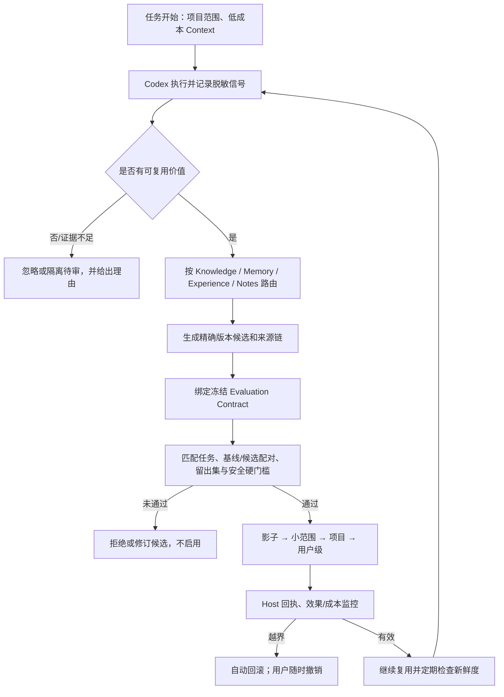

# Craft Context 帮助 Codex 自我改进：理想态规划

| 项目 | 内容 |
| --- | --- |
| 文档类型 | 产品与技术联合规划 |
| 状态 | 规划基线，分阶段实现和验收 |
| 目标读者 | Craft 产品、架构、实现与评测维护者 |
| 范围 | Codex 中的 Craft Context 学习闭环及其受治理资产 |
| 不包含 | 训练或改写 Codex 模型；未经评测直接发布；自动改写 Codex 配置、用户规则或仓库规则；把检索到的 Knowledge 当成强制执行策略 |
| 决策依据 | ADR-0032、ADR-0033、ADR-0034、ADR-0035 |

## 1. 结论

Craft Context 的目标是让 Codex 在真实任务中逐渐获得更合适的上下文、可复用经验与受治理能力，并能证明它们确实帮助了后续任务。改进发生在 Craft 管理的数据、检索和资产层，不代表 Codex 基础模型被训练或修改。

理想闭环为：任务开始时给出低成本、项目隔离的最小充分上下文；任务过程中记录可验证的脱敏信号；任务结束后识别值得保留的内容并路由到正确资产；候选绑定不可变评测合同；独立配对评测通过后按作用域逐步启用；后续真实任务持续衡量收益、退化、成本和撤销效果。

核心验收不是“写入成功”或“检索命中”，而是相对于不使用该资产的基线，Codex 在匹配任务上完成得更好，且没有突破安全、隐私、权限或项目边界。

## 2. 现状基线与证据边界

本规划以 Craft 仓库 HEAD `763132b904cbf49764e3f4f0320d566ed48f114c` 为源码基线，并纳入 2026-11-19 对现有工作区、运行时诊断和 Codex Host 验收材料的核查。该工作区有未提交改动，因此此基线不是一个已发布制品。研究依据见[业界一手资料调研](../research/2026-11-19-craft-context-self-evolution-industry-research.md)。代码和文档只能证明仓库里的机制或设计；不能证明用户安装的插件已经接通完整链路，也不能证明 Codex 的任务成功率已因此提升。

| 能力 | 当前可确认状态 | 仓库依据 | 不能据此声称 |
| --- | --- | --- | --- |
| Context 入口 | 有 Hook/MCP 接入、受预算约束的 Context、资产引用与回执设计 | [Context 技术说明](../technical/modules/craft-context.md)、`core/interfaces/codex-hook-bridge.ts` | 每个真实 Codex 任务都自动调用且生效 |
| Value Gate | 共享本体包已有规则/结构化首阶段分类，输出可审查路径；源码注释明确它本身不把内容变为事实 | `craft-common/packages/craft-common-ontology/src/value-gate.ts` | Gate 能判断事实真伪，或单次分类就证明长期价值 |
| 场景与适配 | 已有开放场景设计、general 回退和适配器线索；当前适配覆盖仍有限 | `craft-capability/capability/craft-context/self-evolution.ts`、[ADR-0034](../adr/0034-codex-context-plugin-self-evolution-plan.md) | 未识别场景的真实业务内容都能正确理解 |
| Experience | 有项目场景目录、Procedure/Runbook 候选和治理设计；候选、可路由资产及正式 Work Loop 验收仍需按具体运行链路核验 | [ADR-0033](../adr/0033-experience-runbooks-are-governed-procedures.md)、`core/application/use-cases/learning-cycle.ts` | 捕获过一次就已形成可执行且有效经验 |
| Evolution 与评测 | 有追加式演进生命周期、合同和阶段治理组件；合同与独立效果证据仍需落实到每类资产及 Host 回执 | `core/evolution-cycle.ts`、`core/evaluation-contract.ts`、[ADR-0032](../adr/0032-versioned-evolution-ontology-and-immutable-core-policy.md) | 有状态机或测试就等于真实用户效果得到证明 |
| Ontology | 有版本化分类修订、候选合同与评测门禁；尚无 Ontology 分阶段激活指针、撤销/回滚接口。分类读取取最新修订；当前 Knowledge 搜索主要附加分类说明，不按分类过滤，不能把它说成已经改变召回效果 | `core/ontology-classification.ts`、`core/application/coordinators/cognitive-search.ts`、[本体论技术说明](../technical/modules/self-evolution-ontology.md) | Procedure 的 Shadow/Canary 门禁就是 Ontology 的发布机制；分类历史可撤销；最新分类已证明改善检索 |
| 编码 Knowledge | 数据模型支持带 Evidence、Source、scope 和有效期的 `fact/rule/decision/term/failure_mode`。README、AGENTS 和项目文档等来源可形成待审摄取候选；这不是自动审核或强制规则 | [Knowledge Claim 治理](https://github.com/wdx9413/craft-capability/blob/main/capability/craft-knowledge/claim-governance.ts)、[Knowledge Source Registry](https://github.com/wdx9413/craft-capability/blob/main/capability/craft-knowledge/knowledge-source-registry.ts) | 对话或源码被扫描就等于已保存、可信、适用于所有项目或会被 Codex 遵守 |
| Codex Host 与效果 | 当前没有最新插件包在真实 Codex Host 上的配对效果报告。配置测试只证明清单/超时约束，MCP smoke 和 conformance 使用隔离 fixture；历史 CLI 报告不能替代当前制品验收 | `tests/codex-host-plugin-config.test.ts`、`scripts/smoke/component-conformance.ts`、[历史 Host 验收](../research/host-acceptance-2026-09-28.md) | 真实 MCP 调用、Hook 安装或一组成功任务就证明当前版本有因果收益 |

2026-11-19 的运行时快照自报 Craft `0.20.5`，全局汇总包含 431 条 Knowledge Claim、713 条 Evidence、3 条 Memory；Experience 诊断有 23 条观察、0 个模式、0 个草稿提案、1 个状态为 `unknown` 的 Procedure，并标记 `host_session_verified=false`、`model_effect_proven=false`。当前项目 Context 返回 0 条 Knowledge/Experience，Knowledge/Memory 组件诊断报 `Project Knowledge storage root is not registered`。这些数量只证明某些记录存在；不能证明当前项目可访问、已晋升、被 Codex 使用或产生效果。运行时快照不是发布验收，实施前必须重新核对。

Value Gate 的定位是“发现候选并说明理由”，不是事实核验器。领域和场景是抽取、检索、评测的组织维度，不是是否允许捕获有价值内容的前置门槛。

## 3. 目标与用户价值

### 3.1 用户目标

用户不必重复解释已经验证的项目约束、偏好和真实踩坑；Codex 能在恰当任务中取用，并展示来源、适用范围和版本。错误、过时或有害经验可以被纠正、撤销或回滚。用户能区分一次性记忆、可核验知识、复用经验和可执行能力。

### 3.2 价值判定

一项资产只有同时具备可理解的内容、证据来源、适用边界和可验证的后续用途，才进入候选流程。高复用、高代价失败或用户明确要求保留可以提高优先级；场景未知不等于没有价值。是否启用由评测决定，不能由模型自评、分类置信度或“被检索次数”替代。

“有价值”必须能落到某类未来任务及可观察结果。例如：避免重复踩同一个仓库构建坑；在正确项目中召回适用流程；减少任务耗时且未增加返工；避免过时约束误导修改。单纯摘要完整、标签丰富或图谱变大不是价值指标。

## 4. 语义模型与资产边界

业务领域、任务场景、资产类型、实体/制品、环境、时间、作用域、来源和信任状态是不同维度。它们可以互相引用，不能挤成一个“场景标签”。Ontology 定义含义和关系；标签帮助检索与解释，不代表真实性、权限或晋级资格。

| 资产 | 回答的问题 | 适用边界 |
| --- | --- | --- |
| Knowledge | 哪条外部状态/声明有何来源，何时有效？ | 事实与来源可核验；推断和人工确认分开 |
| Memory | 当前任务、会话、主体或项目处于什么状态？ | 可变、可过期；新证据追加修订，不静默覆盖 |
| Experience | 做某类任务时，哪些做法、失败模式和恢复办法经真实执行验证？ | 受项目、场景、环境和证据约束；候选不等于已验证 |
| Notes | 某设备、目录或文件有什么简短环境说明？ | 位置/环境事实，为经验提供范围，不承载操作流程 |
| Procedure / Skill / Mod | 哪种可复用行为可以被路由或执行？ | 精确版本、权限与独立合同；代码型 Mod 另受信任审查 |
| Ontology / 分类版本 | 如何解释记录类型及其关系？ | 可版本演进；历史重分类追加保存，不覆盖原记录 |

### 4.1 编码约束知识

代码规范、技术栈、架构边界、依赖/运行时要求、测试方式和安全开发约束都可以是 Knowledge，但须有明确来源、适用项目、版本/时间和复核条件。不是每条聊天内容或代码片段都值得沉淀。

| 内容 | 主要资产 | 首选来源 | 处理方式 |
| --- | --- | --- | --- |
| 项目技术栈、目录架构、API/依赖约束 | 项目 Knowledge | `package.json`/锁文件、架构文档、受信任的项目说明 | 记录精确版本与路径；源变化后标记待复核 |
| 代码风格、测试命令、lint/typecheck、CI 要求 | 项目 Knowledge + 项目工具配置 | `AGENTS.md`、lint/tsconfig、CI 配置、开发文档 | Knowledge 负责解释和检索；项目配置及 CI 负责强制执行 |
| 组织级安全/研发规范 | 全局 Knowledge 候选 | 可追溯的权威组织规范及所有者 | 允许直接创建全局候选；固定合同评测通过后启用 |
| 已复现的 Bug、触发条件、诊断与修复步骤 | Evidence + Experience 候选；稳定事实可另形成 Knowledge Claim | 可复现测试、修复提交、独立 Host 任务结果 | 保留受影响版本和反例；重复有效后才形成可路由 Procedure |
| 用户稳定偏好或当前会话状态 | Memory | 用户明确陈述或经治理的 Host 观察 | 走 Memory 的冲突、有效期和晋级规则，不冒充项目规范 |
| 机器、目录、文件用途说明 | Notes | 用户/设备/目录来源 | 只记录有助于后续判断的简短说明，不存操作经验 |

项目 Knowledge 默认只在该项目使用。跨项目的通用化有两条入口：权威组织规范可形成全局候选；由项目经验归纳的规则须先脱敏，再取得多个独立项目证据并通过目标合同评测。单项目规范、栈版本、路径和架构决策不得因为重复出现就自动全局化。`global` 作用域也不代表公开访问或授权扩大。

Knowledge 是可追溯的参考和候选约束，不是 Runtime 强制策略。模型总结、检索频率和分类置信度不能把知识升级成 Core Policy。若某项要求必须阻止不合规代码合并，应由受信任的 linter、类型检查、测试、CI 或独立授权策略落实；知识失效、来源冲突或仓库配置变更时，旧版本需隔离或重新评测，不能静默覆盖。

### 4.2 Ontology 激活与分类投影

版本化分类修订与“当前对用户生效的语义投影”是两个状态。候选版本通过分类合同后，也不能因为它是最新修订就自动影响检索。激活由作用域指针决定；指针变化追加版本，历史分类和 Context Receipt 保留其当时所见的版本。

| 阶段 | 有效行为 | 晋级/退回 |
| --- | --- | --- |
| Shadow | 候选与当前版本并行分类、对照；不改变用户看到的检索、冲突或晋级结果 | 独立评测达到冻结门槛后才可分配小范围 cohort |
| Small-scope | 只对明确指定的任务/测试 cohort 使用候选指针；其余请求仍读取基线 | 阶段合同通过后可进入项目指针；任一硬门槛失败立即回到上一个指针 |
| Project | 由项目级指针选择 Ontology 与分类修订；未绑定该项目的候选不可见 | 项目合同独立通过后，具备跨项目适用资格的版本才可申请全局阶段 |
| Global | 仅未被项目指针覆盖且明确允许全局读取的范围采用全局指针 | 合同越界自动切回之前的全局指针；用户可随时撤销 |

作用域解析采用项目指针优先、否则回退到全局基线；没有合格指针时保留兼容基线，不猜测新版本。指针绑定 Ontology 精确版本、候选/分类版本、合同与评测回执、前一指针修订和作用域。撤销/自动回滚追加指向已验证版本的新指针，不删除历史。检索若做物化缓存，缓存键必须包含指针修订；切换时做代际失效。当前代码没有此指针、阶段选择或撤销路径，必须先实现再开放分类候选对用户生效。

分类存在多义或证据不足时，保留原分类并标记待判；不因此改变检索、信任或晋级行为。自动重分类只能追加 Ontology 版本、类别、置信度、理由与回执，原始正文、稳定 ID 和来源保持不变。

## 5. 端到端学习闭环

每个阶段需要留下可连接的标识：来源事件/主体、项目和任务作用域、发生及有效时间、候选内容摘要与版本、Ontology 版本、合同/样例/运行版本、使用回执、结果证据、撤销/过期状态。工具实测、Host 自报、人工确认、模型推断必须是不同证据类型。

原始会话和工具输入只允许在当前获授权任务中临时用于理解与提取。持久层只保留最小脱敏候选、摘要、证据引用或内容摘要和必要回执，不归档原始提示词、整段 transcript、凭据或客户数据。无法安全脱敏或判断作用域时，隔离或丢弃并报告原因。

## 6. Codex 中的使用策略

### 6.1 默认轻量，按需深取

任务开始时只读取当前项目相关的高置信、未过期、低成本资产，并提供稳定引用、版本和适用范围。当前 Context 文档记录了 Hook 与 MCP 预算约束；具体预算应以 Host 的真实使用回执持续校准，不把估算 token 数当作实测。

编码 Knowledge 投影必须注明它是规范、事实、经验引用还是待复核候选，并显示来源版本、适用 scope 和有效期。项目级栈、架构或命令不得混入其他项目；全局规范只有在来源权威且全局候选已经通过合同后才注入。即使以“必须”表述，Knowledge 仍是上下文材料；强制执行由项目代码检查或 Core Policy 完成。

遇到高风险改动、陌生场景、初始结果不理想、证据冲突或用户要求调查时，才请求更深层的 Experience/Knowledge/Memory 检索。深取也受项目授权、来源访问策略和调用预算限制；不得因“可能相关”读取其他项目。

### 6.2 经验必须从反馈中证明

任务结束时结合代码差异、运行/测试结果、明确用户纠正等信号，提出候选或明确跳过。被召回不等于被采用；被采用不等于有帮助；任务成功也不能单独归因于某条经验。需要记录候选版本是否进入 Context、是否被实际使用以及独立验证结果。

Host 无法提供采用信息时标为未知，不推断“使用成功”。Host 无法写入时报告未沉淀；不能对用户声称已保存。真实 Codex Hook/MCP 的调用、错误和结果应有无敏感正文的 Receipt。

## 7. 作用域、自动化与安全

| 作用域 | 默认行为 | 晋级条件 |
| --- | --- | --- |
| 当前任务/会话 | 临时上下文；任务结束后做脱敏与候选判断 | 不自动变成长期事实 |
| 项目 | Knowledge、Memory、Experience 默认归属项目 | 同项目证据与合同通过后，可按预授权自动分阶段启用 |
| 全局 Knowledge | 仅存项目无关或权威组织规范；显式作用域才进入 Context | 权威来源可直接建候选；由项目归纳的通用规则必须脱敏、多项目独立支持并通过固定合同 |
| 用户级 Memory | 只存明确属于用户的偏好/稳定事实，不等于跨项目 Knowledge | Memory 自身的独立会话/项目阈值和隐私治理通过；不能改写组织或项目策略 |
| Craft 代码/策略/宿主配置 | 可提出候选或差异 | 代码和策略须独立审查；Codex 配置与 `AGENTS.md` 不自动改写 |

自动化可覆盖预先授权的 Craft 管理资产，并按风险分级；用户始终可查看和撤销。Core Policy 的审批、信任、权限、隐私、安全与数据治理硬门槛由 Runtime 独立实施，任何 Ontology、适配器、提示、合同或 Mod 不得放宽。

自进化 Mod 只在精确代码和权限版本经用户信任后运行；变更需重新审查。即使用户选择信任全部普通 Mod，自进化 Mod 也不能获得审批策略能力。本文中的“自动启用”只指 ADR-0032 预授权范围内、完成固定合同并通过阶段门禁的资产，不表示绕过用户信任或权限边界。

## 8. 评测合同与效果证明

每类候选在生成前绑定版本化 Evaluation Contract。合同至少冻结：基线与候选精确版本、任务样例和环境、主收益指标及阈值、可容忍退化、预算/延迟约束、安全硬断言、样例来源/去重与留出规则、评测器版本和回滚条件。候选生成者不能改动合同、阈值或样例。

采用匹配任务/环境的配对对照、重复运行和独立留出集；提供不使用候选资产的基线。线上反馈可触发复评与回滚，但单独不能证明因果收益。评测执行者须与候选生成路径有足够独立性，不能把同一模型的自评充当独立验证。

| 指标组 | 示例观测 | 解释限制 |
| --- | --- | --- |
| 任务效果 | 验收通过率、任务完成质量、验证器结果、返工/用户修正 | 按任务类型分层；不能只看 Host 完成标记 |
| 使用质量 | 相关资产精确率、漏召回、采用率、误导/冲突、无用注入 | “被召回/采用”都不是正向效果本身 |
| 效率成本 | 完成时间、模型/工具调用、token 与货币成本、等待延迟 | 需同环境、同预算，并记录失败重试 |
| 可靠性 | 过期知识误用、纠错/遗忘生效、撤销、作用域泄漏 | 安全/隐私/越权必须是硬门槛，不与收益折算 |

安全、权限、隐私、来源治理和跨项目隔离为不可权衡的硬门槛，失败即拒绝。其他指标权重和阈值按任务场景预先确定，并使用基线波动与业务要求校准；本规划不虚构通用百分比。最终报告同时展示样本数、置信区间/波动、失败案例和未覆盖环境。

### 8.1 真实 Codex Host 配对验收

必须分别通过 **Host 执行证明** 和 **任务效果证明**。前者说明指定版本的插件确实由真实 Codex Host 加载并调用；后者说明开启 Craft Context 改善了任务结果。Hook/MCP 配置、合成 Host、单测、一次真实调用或 Host 自报字段只能支撑部分链路，不能替代另一层证据。

| 验收步骤 | 必须固定或采集的证据 |
| --- | --- |
| 固定制品 | 插件包版本与 SHA、Codex Host 版本、模型、工具权限、MCP/Hook 配置、Runtime 版本和数据作用域；源代码 checkout 不能代替实际安装制品 |
| 配对环境 | 同一仓库提交/干净工作区、同一任务输入、环境、工具和预算；随机化启用/关闭 Craft Context 的顺序，分别用隔离工作区和独立 Host 会话运行 |
| Host 执行 | Codex 原生会话标识、插件/MCP 初始化与工具列表、实际 Hook/MCP 调用及其任务/项目回执；记录具体注入的资产版本和是否被取用。不能由调用者自填 `host_session_verified=true` |
| 独立判分 | 对处理组别盲化的评测器检查验收条件、代码差异、测试/lint/typecheck、安全硬断言及反例；在线模型自评不能充当独立判分 |
| 配对报告 | 每对任务的效果差异、完成耗时、token/成本、重试、误导/冲突；报告样本量、波动或置信区间和缺失配对。缺失任一组的任务不计作收益配对，但须报告缺失率 |

测试集包含真实且经授权/脱敏的研发任务，按修 Bug、实现需求、架构/重构、安全与测试等类别分层；留出任务不可参与知识提取或候选调参。每类资产的主要收益指标与容忍退化在生成候选前冻结。门槛按证据用途分层：同一低风险资产在两个独立会话中被验证使用，只支持项目内累积并进入配对评测；三个匹配任务对只用于筛查；五个匹配任务对是最早可判断效果的数量，并不保证通过，仍须满足预先声明的统计显著性、最小有意义收益、退化和安全门槛。若基线波动或目标收益要求更多配对，则按合同增加样本。安全/越权/项目泄漏属于硬失败，不可用效率提升抵销。

本地工作区的项目存储根可解析、真实 Codex Host 原生回执完整、候选资产确实进入预期 scope，是开展配对试验的前置条件。配对结果通过后才可授权项目范围启用；项目归纳的通用候选须由至少三个独立项目分别提供配对证据，才可进入全局 Shadow，且仍要通过单独的全局合同评测。项目数、使用次数和 Shadow 资格都不等于全局启用。

## 9. 分阶段路线

各阶段交付的是可验证闭环，不按“新增了多少资产”判断完成。合同冻结具体数值；跨能力共用的最低证据用途边界是：同一项目内两个独立会话支持低风险资产进入评测，三个匹配任务对用于筛查，五个匹配任务对是最早可判断效果的样本底线，项目总结的全局候选须先取得三个独立项目各自的配对证据才可进入全局 Shadow。任务波动、风险或最小有意义收益可能要求更多样本；这些底线不等于通过门槛。

### P0：存储作用域与真实 Host 测量底座

- 修复并单独验收 Knowledge/Memory 当前项目存储根诊断；证明 Context、检索、写入和读取使用同一 canonical project scope，空结果和存储故障可区分。
- 固定实际安装的 Codex 插件包与 Runtime，采集原生 Host session、初始化、Hook/MCP 调用和精确资产注入回执；`host_session_verified` 必须由 Runtime 可验证回执生成。
- 冻结候选无关的任务集、环境、工具、预算、独立判分标准和配对分析方法；任务覆盖修 Bug、实现、架构/重构、安全和研发文档。
- 验收：真实 Codex 会话能证明包加载、工具调用、项目隔离和终态回执；任一环缺证只标为未验收，不宣称效果。

### P1：Ontology 指针、影子投影与可撤销发布

- 为 global/project 作用域实现 Ontology activation pointer 和单调递增 pointer revision；project 指针优先于 global 指针，未注册时维持兼容基线。
- 影子分类只生成候选对照，不改变用户检索/排序/冲突/晋级；小范围 cohort、project、global 指针逐阶段独立合同评测。
- 分类查询按有效指针投影，不再直接把最新 append-only 分类修订当作 active；Context Receipt 记下当时生效的 Ontology 与 pointer revision。
- 自动回滚和人工撤销都通过追加指回已验证版本的 pointer revision 完成；缓存键绑定 pointer revision；未决分类保持原检索行为。
- 验收：从 shadow 到每个阶段均能证明只影响授权 scope；指标或安全门槛失败能即时回到上个有效指针；撤销后的真实 Knowledge 查询不再使用撤销版本。

### P2：编码 Knowledge 来源治理与项目级候选

- 从 AGENTS、README、架构/开发文档、依赖清单、lint/typecheck/CI 配置和用户明确纠正产生有限的编码 Knowledge 候选；记录来源 revision、scope、有效期和优先级。
- 冲突时显示来源与差异，不让模型猜；源文件/依赖版本变化时使对应候选 stale 并要求复核或重评。
- 复现 Bug 的事实可作为 Knowledge Claim；复现路径、修复步骤和反例走 Experience。Session Memory、环境 Notes 与编码规范不得合并成一个提示集合。
- 相关 Knowledge 以有来源的最小上下文提供；真正的硬规则保留在受信任项目配置、检查器和 CI。
- 验收：项目级候选不越过项目 scope；旧版本在源漂移后不再作为新鲜指令注入；有效项目 Knowledge 的检索由真实任务和反例检查证明。

### P3：真实 Codex 配对任务效果与项目激活

- 对 P2 项目候选使用真实 Codex 插件包执行启用/关闭配对；用原生 Host 证据和独立代码/安全判分完成 Evaluation Contract。
- 将主要任务成功指标与可容忍退化范围、成本/时延及安全门槛逐项判定；不以“检索到了”或“Codex 说有帮助”代替效果。
- 合同通过后才允许该项目指针进入 canary/project 阶段；任意安全硬门槛失败或超阈值自动回滚。
- 验收：可从报告追到插件 SHA、Codex/模型版本、仓库快照、样本配对、Context Receipt、独立评分与回滚状态；Mock 与历史版本材料单列。

### P4：跨项目泛化与全局启用

- 权威组织规范有明确 owner/source，可建立全局候选；仍需独立评测其检索适用性和误导风险。
- 从项目总结出的编码原则需脱敏、至少跨三个独立项目获得各自的配对证据后才能进入全局 Shadow，并在目标任务集上通过预先固定合同；项目细节不能随全局分类投影扩散。
- 全局 pointer 独立于项目 pointer 逐步启用；项目 scope 可保留更具体的覆盖版本。全局撤销不删除任何原始项目证据。
- 验收：只有满足全局资格的内容进入 global scope；未通过或来源不独立时保留在项目层；全局回滚不会破坏其他项目自己的已验证指针。

## 10. 主要风险、成本与非目标

| 风险/成本 | 影响 | 控制方式 |
| --- | --- | --- |
| 捕获过多 | 噪音挤占上下文，增加成本 | Gate 分流、预算、过期治理和负向样例 |
| 过度压缩 | 丢失关键适用条件或恢复步骤 | 保留证据引用与适用边界，按需展开 |
| 错误归因 | 把本来会成功的任务算作经验收益 | 配对/留出评测、实际采用回执、独立验证 |
| 跨项目泄漏 | 客户/仓库信息混用 | 默认项目隔离、脱敏、权限复核、硬门禁 |
| 经验陈旧 | 旧命令、路径或业务状态误导 | 有效期、版本绑定、漂移检测、撤销与重验 |
| Host 证据不足 | 把模拟执行误报为用户效果 | 区分模拟、插件真实运行与业务效果报告 |
| 深取开销 | 延迟、token 和隐私面增加 | 默认轻量，按风险/证据触发，预算记录 |

本规划不要求 Craft 训练 Codex 基础模型、不将原始 transcript 变成长期库、不做一个覆盖所有行业的封闭分类树，也不把标签图谱规模作为自进化目标。Craft 代码自动修改、用户规则自动写入、自动信任 Mod 都不在本授权范围。

## 11. 验收清单

- [ ] 每次 Context 都能说明项目范围、来源引用、资产版本、预算与遗漏原因。
- [ ] 未知场景仍可进入审查/通用路径，不因标签缺失而丢弃价值线索。
- [ ] 持久数据经脱敏；原始提示词、工具输入和完整 transcript 不进入长期存储。
- [ ] 事实、推断、工具观察、人工确认和 Host 自报可以区分并追溯。
- [ ] 编码 Knowledge 来自版本化、可追溯的项目或组织 Source；scope、有效期和权威级别明确；源变化会触发 stale/复核。
- [ ] 项目约束以项目 scope 为默认；项目衍生的全局候选具备脱敏、跨项目独立证据和固定合同；权威组织规范也必须评测后启用。
- [ ] Knowledge 只作为有来源的上下文；需要强制执行的约束由项目配置、CI 或 Core Policy 执行。
- [ ] Ontology 分类候选、active pointer 和检索投影分离；shadow 不改变线上结果；撤销通过追加指针回退并作用于下一次真实查询。
- [ ] 每个候选生成前绑定不可变合同；安全硬门槛不能被收益抵消。
- [ ] 配对、重复和独立留出报告包含基线、候选、样本、效果、成本和失败案例。
- [ ] 当前插件包由真实 Codex Host 加载并产生原生 session/Hook/MCP 证据；真实执行证明与任务效果评测分别验收。
- [ ] Codex 配对任务运行在同一代码快照与冻结环境中；样本数基于先导波动与最小有意义收益确定；缺失配对单列。
- [ ] 可路由资产经分阶段评测启用，回滚和用户撤销能影响后续真实 Codex 任务。
- [ ] 跨项目资产有去标识、多项目证据与目标合同；否则保持项目隔离。
- [ ] 自进化 Mod 不能修改或调用审批策略能力；用户配置与 `AGENTS.md` 不被自动改写。
- [ ] 研究基准、模拟 Host、单元/集成测试、真实插件效果分别报告，不互相替代。

## 参考

- [业界一手资料调研与限制](../research/2026-11-19-craft-context-self-evolution-industry-research.md)
- [ADR-0032：本体论可演进，Core Policy 不可自改](../adr/0032-versioned-evolution-ontology-and-immutable-core-policy.md)
- [ADR-0033：经验手册属于 Experience Procedure](../adr/0033-experience-runbooks-are-governed-procedures.md)
- [ADR-0034：Codex Context 通用自进化方案](../adr/0034-codex-context-plugin-self-evolution-plan.md)
- [ADR-0035：学习作用域与数据边界](../adr/0035-craft-context-learning-scope-and-data-boundary.md)
- [自进化本体论与评测闭环](../technical/modules/self-evolution-ontology.md)
- [Craft Context 与跨宿主接入](../technical/modules/craft-context.md)
- [2026-09-28 历史 Codex Host 验收](../research/host-acceptance-2026-09-28.md)（历史方法参考，不作为当前版本效果证据）
