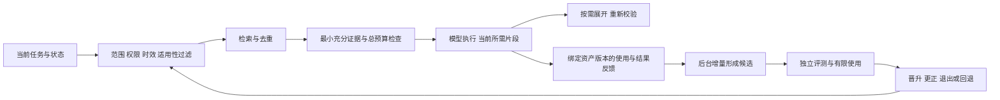

# 上下文工程与自动演进：论文及官方项目核验

核验日期：2026-10-22。范围：论文作者发布的资料、官方 GitHub 与厂商工程文档。本文只研究机制，不运行供应商基准，不修改实现，不把项目说明当作 Craft 的运行证据。GitHub 页面会变化；以下是访问当日的公开说明，未固定源码提交。

## 结论

**分能力存储、按任务检索、版本化产物、评测后晋升的方向成立；把更多历史加工成更多上下文，不是理想态。** 理想态应当是：当前决策拿到充分且有效的证据，额外读取可按需展开；后台可以持续学习，前台延迟、成本与正确性边界明确。下列建议是由资料推导的 Craft 设计判断，不是论文已经证明的产品结论。

需要避免另一个极端：为了省 token，只返回编号或过短摘要，遗漏判断所必需的事实、条件、反例和失败原因。**持久化产物允许丰富；一次注入必须选择。** 两个层次不能混用。

## 一、原始资料及可借鉴边界

### 1. Lost in the Middle：窗口能装下，不代表能正确使用

[论文，2023，TACL](https://arxiv.org/abs/2307.03172)。作者在多文档问答和键值检索任务中发现，相关信息所处位置会影响表现，中间位置尤其容易退化。

- 借鉴：同时评测内容数量、相关性和排列位置；加入同名干扰、近似但失效事实，检查注入是否伤害原本能完成的任务。
- 局限：研究模型与任务有年代边界，不能据此宣称当前模型全部同样退化，更不能推导统一的 1,200 字符或某个最优 token 数。

### 2. Anthropic：渐进读取与最小充分上下文

[官方工程文章，2025-09-29](https://www.anthropic.com/research/effective-context-engineering-for-ai-agents)。文章将上下文视为有限资源，讨论高信号信息、按需检索、压缩和外置笔记等做法。

- 借鉴：先给任务有关的事实、约束和来源入口；读取时再展开原文。结构化笔记保留未完成事项和约束。
- 局限：工程经验不是跨模型定理。渐进读取增加工具往返；压缩过度可能丢失关键信息，必须评测完整任务质量和总成本。

### 3. LongMemEval：记忆质量必须拆开测

[ICLR 2025 论文](https://arxiv.org/abs/2410.10813)、[作者代码与数据说明](https://github.com/xiaowu0162/LongMemEval)。该工作区分索引、检索和阅读，并用信息提取、跨会话推理、时间推理、知识更新、拒答五类能力评测长期记忆。

- 借鉴：存入成功、检索命中和回答正确分别计量；旧事实被更正、时间条件变化、没有证据时拒绝下结论，必须进入验收集。
- 局限：对话记忆问答不能替代真实代码任务、外部副作用或项目流程评测；其分数不是 Craft 的收益预估。

### 4. LoCoMo：长会话和时间因果，不只找同一句话

[ACL 2024 论文](https://arxiv.org/abs/2402.17753)、[作者仓库](https://github.com/snap-research/locomo)。数据使用模型生成与人工核验的长程对话，评测问答、事件总结等，涉及跨会话时间和因果信息。

- 借鉴：用完整任务和跨会话事实链验证记忆，不只验证关键词召回；保留事实来源和发生时间。
- 局限：其构造数据不等于真实工程会话分布；不同项目使用不同数据版本、模型、提示、计分法，商业宣传数字不能直接横比。

### 5. MemGPT / Letta：分层存储与显式读写

[MemGPT 论文](https://arxiv.org/abs/2310.08560)、[Letta 官方仓库](https://github.com/letta-ai/letta)。MemGPT 借用分层内存思路，在有限窗口与外部存储之间调入调出信息；Letta 将有状态代理与记忆作为核心能力。

- 借鉴：会话工作状态、长期事实、可检索档案承担不同职责；持久化容量不决定每轮注入容量。
- 局限：外部存储不创造无限有效窗口；调度出错仍会漏读或误写。这些机制不自动保证事实真实性、项目隔离和长期收益。

### 6. Mem0：按查询与主体过滤，写入和检索分开

[官方仓库](https://github.com/mem0ai/mem0)。当前示例通过查询、`user_id` 过滤及 `top_k` 检索相关记忆，再单独添加会话内容。

- 借鉴：Memory 不应默认全量加载；主体、项目、会话过滤是检索输入，不能仅靠模型看文本后自行隔离。
- 局限：示例的 top-k 值不是通用最优值；仓库宣传的延迟、token 和质量收益不能未经同条件复现就写成 Craft 目标或结论。

### 7. Graphiti / Zep：有效时间、来源和失效关系

[Graphiti 官方仓库](https://github.com/getzep/graphiti)。项目描述了来源 episode、带有效期的事实、增量更新和混合检索，并区分开源 Graphiti 与托管 Zep 的能力。

- 借鉴：同一事实“何时成立”和“何时被系统记录”应区分；替代旧事实时保留历史关联，当前检索排除失效版本。
- 局限：模型识别的矛盾不等于权威裁决；不是所有内容都适合图化。其生产规模、低延迟宣传不能自动归到开源版本，更不能证明 Craft 必须换图数据库。

### 8. Reflexion：反馈可以改善后续尝试，但反思不是真相

[NeurIPS 2023 论文](https://arxiv.org/abs/2303.11366)、[作者仓库](https://github.com/noahshinn/reflexion)。方法把任务反馈整理为反思文本保存在情节记忆中，用于后续尝试，不更新模型权重。

- 借鉴：Experience 要保留执行结果与失败证据，再形成有前提的策略；后续独立任务验证是否可迁移。
- 局限：同题多次尝试的改进不能直接证明跨任务收益。模型自评可能重复自己的错误，不足以单独批准正式晋升。

### 9. ACE：增量整理，防止反复重写造成信息塌缩

[ICLR 2026 论文，核验为 v3](https://arxiv.org/abs/2510.04618)。ACE 将上下文组织为持续演化的策略手册，采用生成、反思和整理流程，强调结构化增量更新，避免过度简化及反复改写损失细节。

- 借鉴：产物层保存细粒度策略和来源，按条目更新、合并、废弃；检索层选择当前任务适用部分。
- 局限：论文支持保存有用细节，不等于应把累计全部手册每轮发送。任务上的在线适应也不能免除独立留出评测和回退机制。此轮未从论文页面核实作者官方 GitHub，因此不把名称相似的第三方实现当作作者源码。

### 10. Serena：按符号和引用获取代码证据

[官方仓库](https://github.com/oraios/serena)。项目提供符号、概览、引用等工具，通过 LSP 或 JetBrains 后端检索，说明功能受语言及后端限制，可按符号探索而无需读取整文件。

- 借鉴：Codebase 先返回入口、符号、关系与位置，按问题展开必要片段；明确语义分析未覆盖的语言和调用类型。
- 局限：静态引用不是运行时调用证明。LSP 依赖启动成本、语言工具链、动态分派及外部依赖完整性，不能以正则降级结果冒充完整语义分析。

## 二、给模型的内容应受哪些边界约束

以下是综合上述机制提出的契约建议；并不存在论文统一规定的数字。

| 边界 | 所有子能力的共同要求 | 失败时行为 |
|---|---|---|
| 任务适用性 | 查询、任务阶段、项目、场景、当前目标明确；可返回零条 | 不以“凑满预算”为目标扩充无关内容 |
| 访问与发送范围 | 检索前限定主体/项目/会话；返回前复查当前权限；发送给外部模型另遵守已有授权 | 不通过摘要或缓存绕过范围限制 |
| 有效性 | 检查来源版本、时间、撤销、冲突和失效状态 | 标为不确定或排除，不能继续当成现行事实 |
| 来源可回溯 | 文本绑定资产版本和原始证据位置 | 摘要不足时允许按引用展开 |
| 全局预算 | 工具说明、系统规则、历史、检索文本、工具结果共同占用输入空间；预留输出空间 | 必需约束放不下应明确返回不足，不能静默截断 |
| 单次与累计开销 | 限制条数、片段长度、字节、估算 token、工具往返和每轮累计注入 | 已提供且未变的证据不重复注入 |
| 内容信任级别 | 来源文本作为证据处理，不赋予修改系统规则或自动执行命令的权力 | 可执行步骤仍受独立执行策略约束 |
| 必要性与完整性 | 选择最小充分证据，保留限制条件、反例和关键结果 | 不用泛化摘要替换需要逐行核对的代码/命令 |

预算的工程表达可为：先取 `有效输入容量 = min(模型输入上限, 上下文窗口 - 输出预留)`，再算 `可用检索预算 = max(0, 有效输入容量 - 已有输入 - 安全余量)`；模型若有共享推理预算，也按其实际接口规则预留。只有 Host 提供可靠计数时才可称精确预算；字符换算只能标为估算。每个能力分别不超限，不能保证总和不超限；中文、代码、JSON 的分词比例也不能固定假定相同。

“项目两次会话、全局三个项目”的阈值属于现有产品政策，不是统计上的真实性证明。独立性须去除复制、同源转述和同次失败的重试；反复出现的错误也可能达到次数。自动晋升还应检查无冲突、来源有效、可迁移及使用反馈，冲突和退出不应只靠计数。

## 三、各能力理想态与验收对象

| 能力 | 产物层可以保存 | 给当前模型选择什么 | 更新/退出 | 必须独立验证 |
|---|---|---|---|---|
| Context | 选择回执、引用和预算使用 | 当前决策的事实、约束、缺口及读取入口 | 任务与状态变化后重新选择 | 少注入是否仍充分；注入是否提高任务质量 |
| Knowledge | 可追溯事实、适用条件、来源片段、冲突 | 与问题有关的事实和最小证据片段 | 来源变化触发重验；撤销/替代保留关联 | 事实成立、时效性、检索与阅读分别达标 |
| Memory | 会话状态、项目偏好、全局偏好及来源 | 当前任务适用且有效的记忆 | 更正优先；会话归档清理；降级/撤销传播至索引和缓存 | 更新、时间推理、拒答、跨范围隔离 |
| Experience | 场景、前提、策略、执行与失败结果 | 适用触发条件和当前所需步骤 | 失败积累触发隔离与重验；版本可回退 | 新任务中的成功率和副作用；不能仅测同题重试 |
| Codebase | 绑定源版本的符号、关系、派生索引 | 入口、引用、必要代码片段及局限 | 工作区变更按影响增量更新 | 关系准确率、快照一致性、动态调用盲区 |

场景分类建议由稳定的项目/任务身份承载，粗细层级是可演化的检索元数据。分类候选可以由模型生成，但需要别名、合并/拆分记录与版本；不应把易变标签作为唯一身份。持久化目录服从已确定的能力分层，分类不能导致跨能力写错位置。这是设计建议，不是需要引入新分类服务的依据。

## 四、性能、并发、稳定性和扩展性

这些是实现验收要求，不是外部论文已经替 Craft 达成的能力。

1. **启动与读取：**初始化不等待全库扫描、归档、模型或全量索引。冷/热启动分别计量；前台读取有截止时间，超时保留可解释的部分结果。后台改成独立进程只隔离主线程阻塞，并没有减少数据库扫描量、磁盘竞争和内存消耗。
2. **读写并发：**应用读取不争抢业务写锁；用快照或版本检查保证一致性，不能承诺底层完全无锁。写入按项目/资产等实际冲突域协调，短事务和乐观版本校验结合；冲突重试有次数及抖动上限。权限和撤销状态不得因旧缓存继续放行。
3. **后台任务：**持久化游标、幂等任务身份、领取租约及拥有者校验；处理成功、失败、崩溃恢复分别记录。限并发、限队列、限模型消耗，前台有优先级。进程退出与重试不能重复晋升或重复外部副作用。
4. **增量与索引：**输入内容、来源版本、转换配置和访问范围共同决定派生结果是否可复用；数据量扩大后按范围筛选并使用查询索引，不把进程内缓存视为扩展性证明。
5. **降级：**模型、向量检索、语言工具链不可用时明示能力缺失；已有正式产物可以按有效性提供有限服务。候选生成失败不覆盖正式产物；语义分析失败不能默默报告“没有调用”。
6. **观测：**同一调用关联选择回执、实际模型请求/结果、候选、评测、发布版本及后续反馈；监控本身有采样、体积和保留上限，不能让日志维护成为主要负载。

不建议先拍一个统一 P95 数字再宣称达标。先在真实数据规模、目标硬件和并发下测量，制定交互请求、按需展开、后台加工三类服务目标；报告分母、数据规模、命中率和超时比例。

## 五、证明“自进化”的最小实验设计

建议把一次发布作为可比较版本，采用：真实任务取样 → 候选生成 → 来源核验 → 独立留出评测 → 小流量使用 → 效果反馈 → 晋升或退出。

- 按任务、会话、源材料及时间去重和分组切分，避免同一任务换句话同时进入生成集和留出集。
- 生成候选不能读取留出答案；在线学习允许使用何种反馈须事先固定。轮次结束后继续调策略，不可反复用同一测试集调到通过再声称独立。
- 对比“没有该资产”“正式版本”“候选版本”，保持模型、工具、预算和任务条件相同；随机波动任务需要重复与区间估计。缺失证据和业务失败分别统计。
- 同时报告任务正确性、有效证据召回、无关注入、过期/跨范围泄露、输入 token、端到端延迟、模型调用成本。不能只追求 token 更低或候选更多。
- 晋升不仅看正向均值，还要检查关键约束、失败严重性和受影响任务范围；回退演练验证旧版本与索引可恢复。

**验收必须分层：**源码实现、相关测试、发布包、当前 Host 实际调用、独立效果证明是不同证据。一个模型 Trace 只能证明发生过调用；自动生成产物也不等于已证明可用。此轮没有运行上述实验，本文不宣称 Craft 已达成自进化。

## 六、对照当前 Craft：哪些方向合理，哪些需要纠偏

本节核对日期同上，核对的是当前 `main` 工作区（存在未提交改动），不是远端发行包的功能承诺。以下路径指向本仓库源码；之前的测试或数据审计结果不作为本轮新增验证。

### 6.1 已有实现与实际边界

| 当前源码证据 | 可以确认什么 | 还不能据此确认什么 |
|---|---|---|
| [context-assets.ts](../../common/craft-common-base/src/context-assets.ts) | 共享条数/字符预算、明确版本的资产引用；本地默认 3 条、1,200 字符 | 这些数字不是研究证明的最优值，也不等于整个 Host 输入预算 |
| [context-resolution.ts](../../core/context-resolution.ts) | 普通知识/记忆按查询选片段，本地普通片段上限 600 字符；有必需引用处理 | 字符短不保证事实完整；跨能力排名和条件覆盖仍要任务评测 |
| [context-response-projection.ts](../../core/context-response-projection.ts) | 本地 compact 响应保留选中正文与引用，并限制包括元数据在内的响应估算 token；默认上限 1,500，full 需要显式预算 | 这是未提交的本地文件，不能称当前 Host 已使用；响应上限也不控制 Host 历史及其他工具 |
| [token-budget.ts](../../core/token-budget.ts) | CJK 字符与其他字符分别估算 token | 没有真实 tokenizer；注释称保守并不构成不低估的保证，代码/JSON/不同语言需校准 |
| [Memory contribution](../../capability/craft-memory/contribution.ts) | 检查范围与可读性，使用检索排名；本地有索引缓存和按选中项取正文 | 首次构建仍需读候选正文，元数据枚举也有成本；缓存不是持久增量索引，不证明大规模性能 |
| [Experience contribution](../../capability/craft-experience/contribution.ts) | 只召回可路由正式 Procedure，候选和诊断模式不会直接当可执行经验；按范围、查询及预算筛选 | 已有候选或 Procedure 不证明新任务收益；当前片段/步骤投影仍需检查复杂流程的必要前提是否完整 |
| [trace-retention-worker.ts](../../core/interfaces/trace-retention-worker.ts) | 本地把日志维护放到受限子进程，具有超时和单次处理限额 | 隔离不减少数据库扫描和磁盘争用；不是查询性能修复本身 |
| [Store](../../common/craft-common-store-local/src/store.ts) | 使用 SQLite WAL、事务及 busy timeout | 应用细粒度锁不会使同一 SQLite 文件同时拥有多个写事务；等待超时也不是前台延迟保证 |
| [config.ts](../../core/config.ts) | 生成文字有语言配置，默认中文，并生成相应指令 | 不能只凭配置证明每个生成入口都已遵守；代码、符号、引用和验证命令不应被语言转换改写 |

本轮还调用了 `craft_context_open`，关闭代码索引并请求小预算。调用超过首次 31 秒等待才取得结果；未准确测量总耗时。返回的 pack 选中条目数为 0，仍含较多审计元数据，且带 `telemetry_error`。这是一次调用的可用性/响应形态证据，不是延迟分布或全系统故障结论。也说明“材料预算”不能冒充“最终响应预算”。本轮未重启 Host，未加载发布候选。

### 6.2 需要纠正的假设

1. **“存得多就会更聪明”不成立。** 原始会话、任务证据、候选、正式产物、当前工作集要分层；全量采集不意味着全量永久保留，更不意味着全量注入。原始证据按保留策略治理，正式产物绑定来源，不把模型总结反复当新证据。
2. **“全局所有记忆每轮加载”不合理。** 全局是适用范围，不是注入优先权；项目/会话更正、当前任务相关性、有效时间和冲突状态应先参与判断。没有相关项时允许零条。
3. **“按场景分目录就解决检索”不成立。** 场景用于过滤和适用性判断，稳定资产身份与易变分类分离。细场景不足证据时不强行新建；粗场景不能把不同验收边界混成同一经验。
4. **“读肯定没锁”不能作为底层承诺。** SQLite WAL 支持读写并行，但一个数据库文件同时只有一个写者；长读事务会影响 checkpoint。应用层目标应是读取不争抢业务写锁、短事务、快照一致、权限撤销及时生效。[SQLite 隔离说明](https://www.sqlite.org/isolation.html)、[WAL 官方说明](https://www.sqlite.org/wal.html)。乐观锁检测冲突，不消除数据库写者串行和 I/O 竞争。
5. **“后台定时跑就是自动演进”不成立。** 必须区分采集覆盖率、证据合格率、生成成功率、评测完成率、晋升率及真实使用收益。零合格样本时应报告数据缺口，不能靠轮询制造进展。
6. **“越短越好”也不成立。** 例如把“仅 dev 环境禁用 Redis”压成“禁用 Redis”会改变行为。否定词、前提、环境、时间、例外及证据不能为省 token 被截掉；无法可靠裁切时返回读取入口，必要材料缺失则暂停该决策。

已有 [ADR-0025](../adr/0025-context-working-set-is-the-retrieval-seam.md) 的“无正文 Receipt”适用于审计回执，不应解释为 Host 永远拿不到证据正文。审计记录和面向模型的材料投影职责需要明确，避免重复返回审计字段，也避免压缩时把实际知识删光。

### 6.3 理想态的运行链路

这不要求新增一整套服务。先复用现有 Store、范围模型、回执和评测合同，将缺失的预算、查询索引、状态推进和验证证据补齐。

存储继续服从既定边界：Knowledge、Experience 等各在 `~/.craft_data/` 的对应能力目录；Memory 的全局文件为 `~/.craft_data/memory/memory.md`，项目文件为 `{project_root}/.craft_data/memory/memory.md`，会话文件为 `/tmp/.craft_data/memory/{session_id}/memory.md`。会话归档清理临时文件，并同步失效派生索引/缓存；长期记忆保留自己的合格来源记录，不依赖被删除的临时正文。场景目录与生成配置也遵循 `.craft_data` 边界。此段是用户已定产品约束，不是本轮已核验全路径一致性。

## 七、下一轮实施与可验证验收

不扩大到整仓清理。按照前台风险和真实闭环推进；以下是建议验收，尚未实施或达标。

| 顺序 | 工作 | 应拿到的证据 |
|---|---|---|
| P0：上下文合同 | 统一材料预算、最终响应预算、每轮累计预算；保留必要条件，支持按需展开；必需项放不下明确失败 | 中英混合/代码/JSON；全能力组合超限；重复 Hook/MCP；整篇不误注入；条件不丢；实际 Host 输入计量或明确标注不可得 |
| P0：前台可靠性 | 初始化不等待模型、全库维护和全量索引；请求截止时间、可解释降级；修复而非仅隐藏 telemetry 异常 | 真实存量数据冷/热启动，前后台并发；超时/错误比例与 P50/P95/P99；比较索引读取量、事件循环阻塞、RSS 和 WAL |
| P0：一致性与隔离 | 返回前复核权限和有效版本；写入幂等、短事务、拥有者/版本校验；恢复不重复晋升 | 慢检索期间撤销/更正；两个进程同时更新；Worker 领取后崩溃、过期拥有者迟到提交；缓存命中与失效负例 |
| P1：七项闭环 | 全量合规会话采集→任务证据整理→独立评测集→Knowledge 闭环→Memory/Experience 晋升退出→增量运行→使用反馈 | 每阶段预期总数与实际完成数、跳过原因、来源版本、模型调用、结果绑定、独立评测、正式产物及回退记录；不能只给总产物数 |
| P1：扩展性 | 按范围与资产查询下推，持久增量索引/游标，队列背压与模型消耗预算，版本兼容迁移 | 固定硬件下递增数据规模与并发，对比扫描量/延迟/吞吐/成本；服务重启恢复；扩展新检索或语言适配器不绕过治理 |
| P2：策略优化 | 用真实任务比较关键词、混合检索、rerank、不同片段/场景粒度；评测不读取生成集答案 | 无 Context/正式策略/候选策略的同条件比较；必要证据召回、无关注入、任务成功、成本与回退率，说明不确定性 |

关键约束作为硬验收：未授权跨范围内容泄露、重复正式晋升、失效版本继续作为现行事实，均应阻止发布。质量、延迟和成本阈值则以目标硬件与真实任务基线制定，不能把未测的目标写成已达到的能力。

补充参考：[LangGraph 官方仓库](https://github.com/langchain-ai/langgraph)与[Persistence 文档](https://docs.langchain.com/oss/python/langgraph/persistence)区分线程检查点和跨线程 Store，可借鉴恢复边界；检查点不自动撤销外部副作用。[MCP 高效使用工程文章](https://www.anthropic.com/research/code-execution-with-mcp)说明工具描述和中间结果也是上下文开销，支持渐进发现与先过滤后返回，不能理解成所有工作都应改为执行任意代码。

本轮交付为这份研究及源码对照，未修改实现、运行测试或发布；现有 `.97` 发布候选继续保留。实现测试、真实运行与效果验证必须在后续交付中分别记录。

后续进展：研究后的 `.97` 发布与真实运行核验见[单独的证据记录](runtime-release-0.12.97-evidence-2026-10-22.md)。上文“本轮”指研究阶段，后续运行结果不回填为论文或行业项目的证据。
