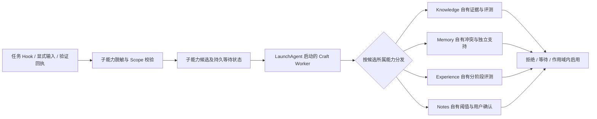

# 持久化自进化 Worker 设计稿

状态：Worker、能力隔离和 LaunchAgent 管理代码已存在；插件 SessionStart 自动确保 Worker、Marketplace 精确制品验证、真实 Host 闭环及效果验收仍待完成。当前本地实现分解见 `.scratch/self-evolution-e2e/spec.md`。

## 1. 目标

让 Craft 在任务结束后自动捕获合规信号并生成候选；候选进入持久、异步、可恢复的后台处理。每个子能力依据自己的证据、评测和安全规则判断是否能启用。Codex/MCP 退出不应丢失候选或停止队列；通过登录后的 Worker 重启应继续处理。

第一阶段以当前 macOS 用户环境和 Craft 研发项目为验收范围。Craft Worker 核心保持跨平台；后续由 Windows/Linux 的服务适配器扩展部署范围。

## 2. 当前基线与缺口

- Knowledge/Experience 有独立学习 Worker、持久派发记录和各自的处理阶段；默认组合 MCP 模式会启动 Worker 子进程。独立命令可供部署拥有单独 Worker 的环境使用，但文档要求不能与同一数据根的 MCP 内嵌 Worker 并行运行。
- Experience 已有 Shadow、Held-out、Signoff、Canary 顺序；只有 Canary 通过，Procedure 才可路由。Knowledge 有来源、独立证据、Scope 和评测检查。
- Memory 捕获路径改为持久候选与异步治理；会话归档仅在候选终态或过期后清除晋级所需的最小证据。
- Notes 以设备、目录和文件为对象；观察达到阈值后产生候选，必须经用户确认才能正常检索。它不应变成可执行经验。
- 当前没有操作系统托管的 Worker 服务。现有本机 Supervisor 不是 LaunchAgent/Daemon。
- 当前运行诊断见到 Knowledge 候选，但当前项目范围检索为空；Memory/Experience 没有候选或正式资产。后台 Worker 的存活状态未验证，Host 使用和任务效果也未形成证据闭环。

这些基线来自源码、部署说明和本轮只读诊断；单测中存在的成功路径不等同于当前 Host 正在运行该路径。

## 3. 成功标准

1. Hook/MCP 任务生命周期产生脱敏、可追溯、带精确 Scope 的候选；普通任务文本、完整 transcript、凭据和原始测试输出不进入候选或通用队列。
2. 候选任务在 Craft 数据根中持久存在；关闭 Codex/MCP 不会终止独立 Worker；崩溃、升级、注销或重启后，未完成工作可安全续跑。
3. 每个候选只由其拥有的子能力处理；缺证、过期、冲突、权限不符、评测失败或安全失败均不得进入默认检索或执行路径。
4. 每个阶段可在内容无关的诊断中看到状态、版本/digest、等待原因、最后尝试、下次尝试和 Worker 活性；不暴露候选正文、提示词或路径敏感信息。
5. 本地机制、真实 Host 执行、候选进入上下文、任务效果和发布/安装分别验收，不相互替代。

## 4. 目标对象和边界

### 4.1 学习候选

- **Knowledge**：由注册的可信只读来源或有验证回执的项目任务产生；证据、独立性、冲突、时效、检索质量和适用 Scope 由 Knowledge 自己判定。需要任务效果证据的候选必须使用独立留出集和冻结的对照条件。
- **Memory**：稳定偏好、事实、决策和方法先形成短小候选。异步阶段按 Memory 的来源、敏感性、冲突和独立支持规则决定会话、项目或用户层级；会话归档不得意外清除已进入晋级流程的脱敏候选及其必要证据引用。跨项目/全局晋级继续要求独立项目证据和去标识化，不默认开放。
- **Experience**：只从终态验证结果积累观察。形成可路由 Procedure 仍须满足重复独立场景、精确版本、Shadow、Held-out、Signoff、Canary 和回滚条件。
- **Notes**：可异步判断使用频率、对象身份和作用范围；达到门槛只形成待确认候选。用户确认前不能进入常规检索，确认也不授予执行权。
- **Codebase**：代码结构索引属于定位资料的基础设施，不是自进化候选，不进入晋级队列。

### 4.2 共享运行框架

共享的是队列承载、租约、调度、重试、健康状态和诊断投影；不共享候选语义、晋级分数、门槛或最终启用权。候选正文和领域状态继续由 Knowledge、Memory、Experience、Notes 的 owner 保存，调度记录只引用候选 ID、精确版本、digest、Scope 和阶段回执。

`enabled` 不作为统一事实状态：Knowledge/Memory 表示特定范围内可检索；Experience 表示精确 Procedure 可路由；Notes 表示已确认且对象身份匹配后可检索。诊断页可映射为统一的“已启用”展示类别，但必须同时展示能力和生效范围。

## 5. 方案比较

| 方案 | 取舍 |
| --- | --- |
| 继续由 MCP 管理子进程 | 改动最少，但 Host/MCP 生命周期仍控制 Worker，不满足持久运行目标。 |
| 操作系统托管 Worker，MCP 只负责捕获和诊断 | 可跨 Host 生命周期运行，能利用现有独立 Worker 命令及持久记录；需要插件启动时幂等安装/升级、状态诊断和防止双 Worker。**采用：macOS 首发使用用户级 LaunchAgent。** |
| 远程常驻服务 | 可以 24/7 运行，但会引入远程身份、数据出域、凭据和部署治理；当前本地 `.craft_data` 及项目隔离不支持无额外设计地迁移。暂不采用。 |

LaunchAgent 在用户登录时启动，不需要 root。craft-context 插件首次有效的 SessionStart 幂等确保 LaunchAgent 已安装、版本匹配且已加载；用户注销或关机时暂停，本地队列保留并在下次登录恢复。显式 CLI 仍提供状态、停止、恢复、升级和卸载；插件启动不得静默覆盖内容冲突的既有服务。

## 6. 处理流程

1. Host 在适用的 Hook 或显式捕获入口执行安全检查、去重和 Scope 绑定。无可信身份或证据不足时，按子能力策略拒绝或暂存，不推断全局范围。
2. 子能力创建自己的候选；必要时创建内容无关的调度引用。写入必须幂等，并绑定候选版本与 evidence digest。
3. LaunchAgent 启动通用 Worker。Worker 获得对应子能力租约后，调用该能力的处理接口；不复制或重写该能力的状态机。
4. 每个处理步骤先记录可恢复阶段，再进行可重放的只读评测或请求。模型不可用、预算耗尽、可信评测器缺失等情况进入明确的等待/重试状态，不绕过门槛。
5. 子能力 owner 完成自己的晋级或拒绝转移。共享调度器只记录阶段回执，不直接把候选改成正式资产。
6. 诊断入口展示各能力的积压数、分阶段状态、阻塞代码、重试时间、Worker 版本和最近心跳；用户可以暂停、恢复、重试符合条件的任务，或撤销候选/启用资产。

## 7. Worker 生命周期和防重复

- macOS LaunchAgent 以当前用户运行，启动后连接同一 `CRAFT_DATA_DIR`。不使用 root LaunchDaemon，不将 Secret 写入 plist、参数、日志或通用队列。
- 提供明确的安装、卸载、启动、停止和状态诊断入口。安装前核对 Node/CLI 的稳定绝对路径、数据根、版本和现存 Worker；路径漂移或升级后失效时报告并停止，不执行模糊替代。
- LaunchAgent 是第一阶段唯一常驻 owner。MCP 启动流程必须检测外部 owner 或被配置为不启动内嵌 Worker；现有组件锁仍作最后防线。不能因 MCP 重启产生第二个处理循环。
- Worker 使用按数据根和能力划分的租约、心跳、幂等处理和有界退避。崩溃时回收过期租约；重复派发不能创建第二个候选、重复扣费或推进同一阶段两次。
- 数据库/游标持久化已有记录优先复用。新增队列只存业务上必需的引用和进度；禁止再建立一套候选正文库。
- 登录期间从 MCP 停止、Worker 退出、机器重启和 CLI 升级都必须有清楚的健康状态及恢复路径。注销/关机则保留工作，不假称仍在执行。

## 8. 预算、隐私和信任

- 保持现有只读来源、Codex CLI/Provider、超时、并发、单轮模型调用限制和 Core Policy；没有可用模型或凭据时等待，不能自动配置新 Provider 或创建 API Key。
- 候选必须最小化和脱敏；异步 Worker 不读取未注册目录，不扫描其他项目，不持久化原始会话、完整模型输入/输出或测试日志。
- 受信 Evidence、候选生成证据和留出评测证据必须分离。候选生成者不能修改自己的评测契约或 held-out 集。
- 项目范围为首期默认范围。跨项目 Memory、全局 Knowledge、自动写代码、自动修改 Hook/策略、提高执行权限和自动发布 Skill 均不在范围。

## 9. 交付顺序

1. **持久队列契约**：对齐现有 Knowledge/Experience 阶段和 Memory 的候选/归档生命周期；定义 Work Item、租约、幂等键、恢复与诊断字段。Notes 保持自己的确认边界。
2. **独立 Worker 所有权**：复用现有 Worker 命令；由插件 SessionStart 幂等确保 macOS LaunchAgent 安装、升级和加载，并保留 CLI 管理；停用或协调 MCP 内嵌 Worker，保证同一数据根唯一 owner。
3. **异步 Memory**：捕获与跨会话/跨项目晋级分离；待处理项目候选可在会话归档后继续，但只保留治理所需的脱敏内容、Scope、证据引用和期限。
4. **观察与恢复**：诊断服务状态、能力锁、心跳、队列阶段、阻塞原因、上次成功和重试；提供用户暂停、恢复、卸载和撤销路径。
5. **Host 与业务验收**：安装精确 Marketplace 包，在真实 Codex Host 验证任务结束后候选写入、关闭 MCP 后后台推进、重启续跑、每能力状态可读；之后执行固定预算的 baseline/candidate 配对和独立盲评。

首期对照场景是 Craft 项目研发任务；先验证项目内检索和 Experience Procedure 路由。跨项目推广须另外提供独立证据、脱敏结果和独立 Evaluation Contract。

## 10. 验收条件

### 机制与恢复

- 插件 SessionStart 可幂等确保 LaunchAgent 安装、版本和加载状态；CLI 可查询、停止、恢复和卸载；冲突不会被静默覆盖，数据目录不会被擅自更改。
- 停止 Codex/MCP 后，Worker 仍能处理已入队候选；停止 Worker、杀进程、升级重启后，待处理工作恢复且阶段不重复提交。
- 两个 MCP/Worker 并发竞争同一数据根时，只有一个有效 owner；MCP 内嵌模式与 LaunchAgent 不会双跑。
- Worker 崩溃、版本不匹配、数据根不可用、凭据缺失、策略禁用、模型超时和评测器不可用时均失败关闭，并显示稳定状态。

### 子能力治理

- Memory 捕获路径只形成可恢复候选；异步重复支持必须来自独立会话/项目，冲突、过期、敏感和 Scope 检查仍生效；会话归档不会误删有效待晋级候选。
- Knowledge 只有经过来源、证据、时效、冲突、评测和范围检查的 Claim 才能在该 Scope 检索；负例、陈旧项和跨项目项不得误入。
- Experience 候选只有经过自己的 Shadow、Held-out、Signoff、Canary 后可路由；失败后不更新 `current`，回滚能指回已验证版本。
- Notes 经过自动频次和身份检查后仍是待确认候选；未确认、跨设备或身份不匹配的条目不进入正常检索。
- 一个能力的故障或待审状态不能改写另一个能力的候选、Evidence、状态或启用权。

### 效果和发布边界

- 真实 Host 原生回执证明精确插件包、MCP 工具面、数据空间、Hook/Worker 启动及实际候选/评测调用；静态配置和模拟 Host 不算。
- 对照组与候选组固定仓库快照、Host/模型、权限、任务和预算；独立评测覆盖产出质量、误召回、成本/延迟、重试和作用域泄漏。单纯队列通过率不代表业务收益。
- 新增/修改的可执行代码按差异基线达到 100% 行覆盖和 100% 分支覆盖；文档验收不替代真实 Host 配对验收。
- Marketplace 版本、`release.json` 的构建输入和安装包 digest 一致；项目本地实现、已构建包和 Host 加载版本分别报告。

## 11. 非目标与主要风险

- 不实现云端 24/7 服务，不以用户注销期间运行作为首期要求。
- 不建一个可以把所有候选直接晋级的统一规则/打分器；共享展示状态不得影响 owner 的政策。
- 不把后台候选数、学习任务成功率或测试通过率描述成模型效果提升。
- 主要风险包括 LaunchAgent 环境不含 MCP 会话中的认证信息、安装路径随升级漂移、重复 Worker 导致重复评测/费用、Memory 候选在归档时失去正文、证据数据在候选生成和评测间泄漏、以及候选长期等待而无可解释状态。
- 若 Worker 无法以当前用户安全获得所需模型身份，必须停在 `waiting_auth`/`waiting_evaluator` 并提供手动恢复路线；不能转为 root 服务或把 Host 凭据复制到 plist。

## 12. 已确认的实现选择

- CLI 命令为 `craft learning-worker launch-agent <install|status|start|stop|resume|upgrade|uninstall>`；LaunchAgent label 为 `com.craft.learning-worker`。插件 SessionStart 自动调用幂等 ensure；CLI 保留显式生命周期管理。
- Service 状态与各子能力 owner 回执组成诊断入口；Workbench UI 仍是后续投影，不另建状态源。
- 复用跨平台 Worker 命令和能力级锁，macOS LaunchAgent 仅负责服务托管；Windows/Linux 的服务适配不阻塞首期。
