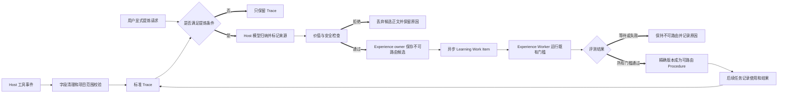

# Craft Experience 任务轨迹提炼设计

**从脱敏任务轨迹和用户纠错中提炼可复用经验，并交给后台异步评测。**

|                |                                                                    |
| -------------- | ------------------------------------------------------------------ |
| **状态**       | Draft；设计边界已确认，实现情况尚未证明                              |
| **负责人**     | Craft Context 与 Experience 维护者                                  |
| **范围**       | Codex Host 任务轨迹、显式提炼请求、Experience 候选、异步评测和后续使用 |
| **相关文档**   | [Experience 治理](../../adr/0033-experience-runbooks-are-governed-procedures.md)、[学习数据边界](../../adr/0035-craft-context-learning-scope-and-data-boundary.md)、[证据门槛](../../adr/0037-evolution-thresholds-follow-evidence-purpose.md)、[持久化学习 Worker](2026-11-21-durable-learning-worker-design.md)、[Experience 评测](../../technical/modules/experience-eval.md)、[Experience Skill](../../../plugins/craft-context/skills/craft-context/references/craft-experience/SKILL.md)、[术语表](../../../GLOSSARY.md) |
| **读者**       | Craft Context、Host Adapter、Experience 和学习 Worker 实现者       |

---

## 1. 摘要

Craft 应记录 Host 能提供的脱敏操作轨迹，在用户明确要求提炼，或轨迹中出现有证据的纠错与恢复时生成 Experience Procedure Candidate。候选提交给现有 Experience owner 和异步 Worker，只有通过既有证据、评测、安全及发布门槛后，才成为可路由 Procedure。

Trace 记录 Host 实际观察到的动作，Experience Runbook 是候选方法的可读视图。系统不把经验保存成对话、命令日志或页面内容。手动提炼默认绑定当前任务；只有一个匹配 Trace 时自动关联，存在多个来源时由用户选择。历史会话须通过显式授权的回放入口处理。

普通成功任务只留下 Trace，不自动生成候选。候选仅在用户明确提出提炼请求，或 Trace 记录到纠错、重试、撤销、回滚等恢复过程并关联到经验证的终态结果时自动生成。用户口述的方法可以进入候选，但必须标为用户陈述，不能冒充 Host 观察结果。

本稿沿用现有术语：Trace 是 Host 中立的有序事件记录；Experience Procedure Candidate 是未通过晋升的版本；Experience Runbook 是该版本的可读视图。

## 2. 当前基线

以下事实根据两个本地仓库的指定提交核对：

| 仓库 | 提交 | 用途 |
| --- | --- | --- |
| `craft` | `5a0ebd6c8c3cc041d0407694b344cb53bdb3166d` | Hook、Trace、候选工具契约和治理文档 |
| `craft-capability` | `1a3d0894531fd47121ec0eb28a254b84a42a6065` | 当前用户口述 Runbook 候选实现 |

| 已核对事实 | 来源 |
| --- | --- |
| Codex 插件为 `Bash`、`apply_patch`、`Edit` 和 `Write` 注册 `PostToolUse`。 | [`codex-hooks.json:6-8`](../../../plugins/craft-context/hooks/codex-hooks.json#L6-L8) |
| 信号清理器只返回编辑或识别出的验证信号；保留的信号记录命令摘要值，不记录命令正文。 | [`codex-hook-signal-sanitizer.ts:78-107`](../../../core/interfaces/codex-hook-signal-sanitizer.ts#L78-L107) |
| Stop Hook 仅在项目编辑通过验证且存在已接受 Observation 时提示提交 Runbook。 | [`codex-hook-bridge.ts:887-897`](../../../core/interfaces/codex-hook-bridge.ts#L887-L897) |
| Runbook 捕获工具要求一个通过态 Host Observation，并接收有限长度的经验字段。 | [`tool-catalog.ts:995-997`](../../../core/mcp/tool-catalog.ts#L995-L997) |
| 标准 Trace 工具已支持有序事件、外部观察、反馈、终态、内容无关查询、回放事实和摘要式保留策略。 | [`tool-catalog.ts:1070-1080`](../../../core/mcp/tool-catalog.ts#L1070-L1080) |
| 当前用户口述 Runbook 实现识别明确步骤、要求来源引用、将原始 statement 写入候选正文，并把范围和领域固定为 `project:self-evolution` 与 `coding`。 | `craft-capability@1a3d0894531fd47121ec0eb28a254b84a42a6065`，`capability/craft-context/runbook-candidate.ts:21-80` |
| Experience Procedure Candidate 不可执行；Runbook 是候选的可读视图，晋升受独立证据和 Experience 评测阶段约束。 | [术语表](../../../GLOSSARY.md#L7-L17)、[ADR-0033](../../adr/0033-experience-runbooks-are-governed-procedures.md)、[Experience 评测](../../technical/modules/experience-eval.md#L48-L56) |
| 从观察归纳 Procedure Proposal 至少需要两个共享 `ScenarioSignature` 的独立观察；单任务可形成不可路由候选。 | [ADR-0033](../../adr/0033-experience-runbooks-are-governed-procedures.md)、[Experience Skill](../../../plugins/craft-context/skills/craft-context/references/craft-experience/SKILL.md#L33-L36) |
| 现有政策区分复现、效果判断和跨项目泛化，不以使用次数直接证明收益。 | [ADR-0037](../../adr/0037-evolution-thresholds-follow-evidence-purpose.md) |
| 历史会话回放需要显式授权，并保留单独的回放来源。 | [术语表](../../../GLOSSARY.md#L57-L63) |

当前 Codex Hook 的 `PostToolUse` 路径没有覆盖浏览器或 API 工具。其他 Host 通道是否提供原生事件尚未核对。本设计只扩展到 Host Adapter 实际提供且可以安全清理的事件类型，未提供的事件仍是明确的覆盖缺口。

当前用户口述入口保存原始 statement，且固定了范围和领域。新入口应保存归纳后的方法和来源引用，按当前任务解析项目范围。本稿不追溯改写或删除旧候选；如需处理旧数据，应另行设计迁移并核对来源。

## 3. 目标和非目标

### 目标

- 将 Host 能提供的工具动作、结果、重试、纠错和终态保存为现有 Trace 中有序、受限的事件引用。
- 从显式提炼请求，或有证据的纠错与恢复中，生成简洁的 Experience Procedure Candidate。
- 区分 Host 观察到的操作与用户口述的方法。
- 将候选交给现有 Experience owner 和异步 Worker，不绕过作用域、证据、评测和安全门槛。
- 在后续任务中按精确 Experience 版本记录呈现、实际调用、任务结果、纠错和回滚。
- 沿用现有 Experience 界面检查和撤销候选的能力。

### 非目标

- 持久化原始对话、提示词、工具参数、浏览器页面内容、API 请求响应正文、命令输出、凭据、客户数据或未受限截图。
- 每次成功都生成候选，或让单次任务的结果直接晋升为可路由 Procedure。
- 新建候选数据库、共享晋升状态机或通用 Experience 评分。
- 降低独立会话、匹配任务对、评测、Signoff、Canary 或回滚要求。
- 自动执行临时候选、修改 Host 配置、编辑 `AGENTS.md`、发布 Skill 或改变权限。
- 将历史对话自动视为实时证据，也不声称 Host 尚未提供的浏览器或 API 覆盖已经可用。
- 批量改写或删除由既有入口创建的候选。

## 4. 设计

### 4.1 复用 Trace 和 Experience owner

标准 Trace 继续保存事件级证据，包括有序 Host 事件和证据引用。Experience 继续持有归纳后的 Runbook 和 Procedure Candidate。异步学习 Worker 只接收候选引用，并按照 Experience owner 的现有门槛推进。

候选只保存可复用的方法，以及检查来源所需的最少信息：项目范围、来源 Trace 和 Observation 引用、事件摘要、来源类型、适用条件、排除条件、坑点、验证标准和恢复说明。候选不复制完整 Trace，也不建立第二个正文库。动作顺序和实际结果仍由 Trace 提供来源。

> **取舍：复用既有证据和候选归属**
>
> **方案：** 扩展现有 Trace 到 Experience 的入口，并让 Experience owner 保存候选正文。
>
> **理由：** Craft 已有有界 Trace 事件和受治理的 Experience 候选类型。增加独立存储会拆散来源关系、保留策略和晋升权。
>
> **替代方案：**
> - *继续只依赖当前 Stop Hook 提示：* 适用于通过验证的代码编辑，但浏览器和 API 任务没有同一条事件级候选路径。
> - *增加独立的任务经验数据库：* 可以保存更多轨迹，但会重复实现现有来源追溯、作用域和治理逻辑。
>
> **回退：** Host 事件不能安全归一化时，只保存可用的内容无关结果，或报告捕获缺口。

### 4.2 用有界字段捕获操作

每个 Host Adapter 将原生事件转换成有限的 Trace Event，包含：

- Trace、任务、会话和事件序号引用。
- Host、工具、操作者和事件类别。
- 归一化的动作名称和结果类型。
- 失败尝试、纠错、重试、回滚或替代动作之间的关联，仅在 Host 能提供关系时记录。
- 经清理后仍安全的动作目标标签和操作标识。
- 通过校验的项目相对文件引用、状态引用或证据引用。
- 不应持久化的来源内容摘要值。

Adapter 使用字段白名单。浏览器事件可记录动作类别、已批准的站点标识、安全的元素角色或名称及脱敏结果引用，不保存表单值、页面文字、完整 URL、Cookie 或原始选择器。API 或 MCP 事件只记录安全的操作标识和结果类别，不保存请求或响应正文。Shell 或脚本事件只记录允许列表内的可执行程序及子命令、有限的工作区引用，不保存任意参数和输出。

Adapter 必须保留事件顺序，并区分工具调用成功与任务结果通过验证。工具返回 `success` 本身不能证明用户任务已完成。任务结果来自 Experience 合同接受的 Host Observation 或其他可信验证器。

Host 没有提供的事件不能从最终回答中推断。若可能，Trace 只记录内容无关的“不支持此事件来源”原因。这样可以呈现浏览器或 API 覆盖缺失，而不虚构操作历史。

### 4.3 只在出现有用信号时生成候选

Host 在以下任一条件成立时生成 Experience Procedure Candidate：

1. **显式提炼：** 用户要求从当前任务或明确选定的任务 Trace 中提炼经验。请求可指定关注点和排除项。
2. **有证据的纠错或恢复：** Trace 将纠错、重试、撤销、回滚或替代动作关联到经过验证的终态结果。

没有纠错或显式提炼请求的通过结果只保留为 Trace。没有观察到纠错的失败任务也只保留为 Trace。若恢复尚未验证，只有用户显式请求提炼时才可以生成待审草稿；此类草稿不能作为成功 Procedure 证据晋升。

Host 模型基于有限 Trace 视图和用户给出的关注点、排除项撰写候选。模型可以归纳表达，但每条操作内容必须对应已观察事件、已接受 Observation 或用户陈述。候选为内容标注 `host_observed`、`user_stated` 或 `inferred` 来源。推断步骤保持未验证状态，不能用于满足证据门槛。

现有 Evolution Value Gate 可在存储前拒绝低价值或不安全内容。它只负责分流，不证明内容正确，也不赋予路由权限。

> **取舍：按信号生成候选**
>
> **方案：** 用户明确要求，或出现有证据的纠错及恢复并得到验证时才创建候选。
>
> **理由：** 普通成功通常没有指出哪些做法值得复用。纠错和恢复提供了可比较的证据，显式请求则允许用户指出系统未识别的价值。重复仍是晋升条件。
>
> **替代方案：**
> - *每次成功都生成候选：* 可能覆盖更多任务，但会带来重复和低价值候选，审阅量随任务数增长。
> - *重复成功后才创建候选：* 可以减少一次性做法，但会延迟失败恢复经验的提炼。
>
> **回退：** 系统无法可靠识别纠错时，只保存 Trace，等待用户显式请求提炼。

### 4.4 将手动请求绑定到正确任务

显式提炼默认绑定当前任务及其 Trace。若当前任务身份恰好匹配一个正在进行或刚完成的 Trace，Host 自动关联该来源。

若存在多个匹配 Trace，Host 展示简短、脱敏的任务摘要供用户选择。用户可以选择一个或多个来源，也可以直接指定多项任务引用。候选分别保留每个来源 Trace 和 Observation 的引用。

历史会话使用现有的 Historical Replay Run 授权。普通提炼请求不得静默搜索已归档会话。回放候选保留 `historical_replay` 来源标记，以便清理回放数据时删除仅依赖回放的候选，同时保留也有正常实时来源的资产。

> **取舍：明确绑定提炼来源**
>
> **方案：** 当前 Trace 唯一匹配时自动关联；多个来源可能匹配时要求用户选择。
>
> **理由：** 常见场景不要求用户复制内部 ID，有歧义的来源也不会被静默合并。
>
> **替代方案：**
> - *始终要求输入 Trace ID：* 来源精确，但自然语言提炼会变得繁琐。
> - *多个来源时选择最近的 Trace：* 操作简单，但可能把无关方法合并进候选。
>
> **回退：** Host 无法确定任务身份时，先让用户选任务；收到选择前不持久化提炼请求。

### 4.5 保持项目范围和非路由状态

每个候选都使用 Craft Context 解析出的规范项目范围。范围或身份不确定时不得默认为用户级。跨项目泛化继续依赖去标识化、独立项目证据，以及既有政策要求的预先绑定 Evaluation Contract。

候选保存以下内容：

- 可复用标题和场景引用。
- 方法适用条件及不适用条件。
- 与证据相符的有序步骤。
- 坑点、已观察到的原因、恢复步骤和完成标准。
- 来源 Trace、Observation、Evidence 的精确引用和摘要值。
- 用户陈述、Host 观察和模型推断的来源标签。
- 解释候选所需的规范化关注点和排除项。
- 候选版本及项目范围。

候选归纳用户陈述，不整段照录原句；来源通过 Trace、Observation 或 Evidence 引用及摘要值保留。候选不复制原始命令或工具正文。示例使用合成值和路径。

如果当前 Context 政策允许，Experience Procedure Candidate 可以作为明确标记的项目内临时建议展示。只有精确的 Procedure 版本通过所有必需门槛后，Host 才能将其作为可路由经验使用。

### 4.6 交给 Experience Worker 异步晋升

Host 将清理后的候选、来源引用和幂等键提交给 Experience owner。Owner 在创建 Learning Work Item 前检查项目范围、来源是否存在、来源类型、安全性、重复身份和候选版本。

Worker 随后执行以下步骤：

1. 解析来源 Trace、Observation 和 Evidence。若必需来源缺失或无法再次验证，则等待或停止。
2. 根据项目场景和现有 Experience 版本检查候选。单个任务可以留下不可路由候选；创建 Procedure Proposal 前，必须有至少两个共享同一 `ScenarioSignature` 的独立观察。
3. 确认 Evaluation Contract 在生成候选前已绑定，候选不能修改合同、留出用例或安全策略。
4. 执行 Experience 自有的 Shadow 和回归评测阶段。
5. 若留出任务效果评测需要适配器，则等待受信评测器提交结果。
6. 精确候选版本通过每项门槛后，再继续 Signoff 和 Canary。
7. 任何门槛失败或无法运行时，保留为等待、拒绝或暂停状态。

Worker 保存可恢复的进度和重试状态，不以共享评分替代 Experience 的门槛。候选已创建、已入队、阶段已完成、已可路由和任务效果已证明是不同结果。

> **取舍：Experience 负责晋升**
>
> **方案：** 候选进入现有 Experience owner 和异步 Worker；候选创建与路由分开。
>
> **理由：** Experience 已负责 Procedure 的范围、证据、评测、发布和撤销。Worker 可以恢复处理，而 Hook 不应掌握晋升策略。
>
> **替代方案：**
> - *由 Host Hook 直接晋升：* Hook 拥有刚结束的任务上下文，但无法建立独立证据或可信留出评测结果。
> - *为 Knowledge、Memory 和 Experience 增加统一晋升规则：* 报表看起来更简单，但会混合各自不同的资产语义和安全门槛。
>
> **回退：** Worker 或评测器不可用时保留候选并显示阻塞阶段，不开放路由。

### 4.7 记录后续使用和反馈

后续任务选中或调用 Procedure 时，Host 在新任务 Trace 中记录精确的 Procedure ID 和版本，并记录该版本是被展示、选择、遵循、修改、跳过还是回滚，以及任务终态引用。

仅展示不算使用。Context 注入本身也不证明有帮助。Procedure 调用和终态 Host 结果可用于使用及结果分析；纠错、失败和回滚都关联到同一版本，以支持回归分析和撤销判断。

作为建议展示的临时候选与可路由 Procedure 调用分开记录。临时候选的使用不计入晋升所需的独立证据，除非 Experience owner 按现有规则接受该任务为独立 Observation。

### 4.8 失败处理

| 情况 | 行为 |
| --- | --- |
| Host 未提供某类事件 | 保留内容无关 Trace，报告缺少的事件来源，不推断操作。 |
| 项目或任务身份有歧义 | 让用户选择来源，不猜测范围写候选。 |
| 清理器拒绝某个字段 | 丢弃字段并记录内容无关的拒绝原因；若缺少字段无法安全说明方法，则拒绝候选。 |
| Trace 或 Evidence 无法解析 | 按 Experience 政策等待或拒绝；不得用模型摘要替代证据。 |
| 候选生成不可用 | 保留 Trace 并返回可重试状态；不得声称候选已经保存。 |
| Worker 或评测器不可用 | 候选和 Learning Work Item 保留明确等待阶段，保持不可路由。 |
| 候选与现有版本重复 | 来源及内容摘要值相同时返回原候选；不同时报告冲突。 |
| 历史来源缺少回放授权 | 在读取或提炼前拒绝该历史来源。 |

## 5. 验收条件

只有下列条件在真实支持的 Host 路径和隔离数据根检查中通过，才能认定改造完成。

### Trace 捕获

- 每个受支持的 Host Adapter 输出有序、幂等的 Trace Event，包含来源、任务与会话身份、动作类别、结果类型和证据引用。
- 测试覆盖编辑与验证、浏览器、API/MCP、脚本操作、纠错、重试、回滚、重复投递、不支持的原生格式和清理拒绝。
- 测试夹具证明原始提示词、网页内容、表单值、请求响应正文、命令参数、工具输出、凭据及客户数据不会进入持久 Trace 或候选正文。
- 工具调用成功与已验证的任务终态可以被明确区分。

### 候选生成

- 无纠错且无显式请求的普通验证成功不会创建候选。
- 有证据的纠错和恢复并最终验证通过时，生成引用来源 Trace 和 Observation 的项目级不可路由候选。
- 自动路径不会从未解决的失败创建可晋升候选。
- 显式请求可从所选当前 Trace 创建候选，用户口述内容保留独立来源标记。
- 一个来源唯一匹配时自动关联；多个可能来源要求用户选择；显式多选保留所有来源。
- 回放候选需要授权并保留 `historical_replay` 来源标记。
- Hook 或 Host 重复投递不会创建重复候选或重复 Worker 任务。

### 异步评测和安全

- 候选创建返回时不等待完整评测结束，并返回 Learning Work Item 引用和当前阶段。
- Worker 重启、重复派发、Evidence 缺失、评测器不可用、安全断言失败和评测超时均产生可恢复或终态状态及明确原因。
- Shadow 阶段通过与否、留出评测、Signoff 或 Canary 证据缺失或失败时，候选都保持不可路由。
- 只有现有 Experience owner 可以将精确通过门槛的版本标记为可路由。现有阈值和回滚行为保持不变。
- 测试证明候选正文不能修改 Evaluation Contract、留出用例、信任根或安全策略。

### 使用和效果

- 后续任务回执记录精确 Procedure 版本，并区分展示、选择、遵循、修改、跳过和回滚。
- 仅展示不计入使用；没有被接受的终态结果时，使用不计入效果证据。
- 独立会话和匹配任务对的计数会拒绝把同一任务或会话的重复事件当成独立证据。
- 回归与回滚指向精确候选版本和来源证据。

### Host 覆盖与结果报告

- 真实 Codex Host 测试证明哪些原生工具事件到达各 Adapter。模拟浏览器或 API 事件不能证明安装后的 Host 会提供这些事件。
- 报告分别说明 Trace 捕获、候选持久化、Worker 处理、路由状态、实际调用和任务效果。
- 不支持的 Host 操作和不可用评测器保持为可见缺口，不得报告为自进化成功。

如实现改动可执行代码，仍须按固定差异基线达到仓库要求的增量可执行行和分支覆盖率各 100%。本设计稿不修改可执行代码，也不声称已经满足覆盖率。

## 6. 收益、成本和剩余风险

当 Host 能提供足够且安全的事件元数据时，本设计可以从浏览器、API、脚本和代码任务中保存可复用经验。用户也能直接指定希望提炼的方法，Worker 则获得明确的纠错证据用于评测。

每类 Host 事件都需要 Adapter 和字段清理规则。用户显式要求宽泛提炼时，候选审阅量也会增加。异步 Worker 解析证据之前，Trace 保留期可能已经结束；实现必须验证归档路径，并在必需引用无法核实时停止晋升。

有些纠错不会被 Host 观察到，有些看似成功的恢复也可能只是偶然。系统应保留缺失候选，不应编造轨迹。独立证据和留出门槛仍负责防止看似合理的摘要变成可路由 Procedure。

## 7. 待核对的 Host 契约

各 Host 中浏览器和 API 操作的原生事件格式及关联能力仍需核对。Host Adapter 维护者负责检查实际事件输入，列出可安全提取的字段、事件顺序保证和重试关联能力。核对结果决定对应 Adapter 能否进入自动候选生成。

如果事件缺少安全的动作或结果引用，Host Adapter 维护者应将该来源列为不支持。Craft 继续记录其他可用事件，不得从模型总结补造缺失的操作。

## 8. 实施顺序

1. 定义 Host 中立 Trace Event 的动作类别、纠错与重试关联、来源身份和终态证据字段。将当前 Codex Hook 映射到这些字段，不持久化原始工具内容。
2. 仅在已安装 Host 提供所需原生事件时，增加浏览器、API/MCP 和脚本 Adapter，并发布按 Host 与工具类别划分的实测覆盖范围。
3. 扩展 Experience 显式提炼入口：默认绑定当前 Trace；来源有歧义时要求选择；支持明确指定多个 Trace。
4. 扩展 Experience 候选入口以接收 Trace/Evidence 血缘和来源标签，同时保持现有 Procedure Candidate 的不可路由语义。
5. 将候选提交接入持久 Experience Learning Work Item 和现有 Worker 门槛。等待评测器、安全失败、重试和取消状态均须可检查且不含原文。
6. 在后续任务 Trace 中记录精确版本的展示、调用、纠错、结果和回滚。
7. 在隔离数据根运行验收场景，再从新启动的真实 Codex Host 核对事件可用性和端到端结果。

---

第 2 节记录已核对的仓库事实，第 3 至 7 节说明建议行为。本稿不声称任务捕获、Worker 交接、Host 覆盖或任务效果评测已经实现。
